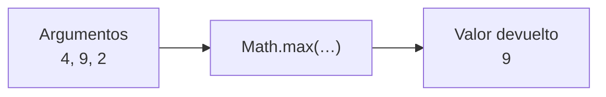
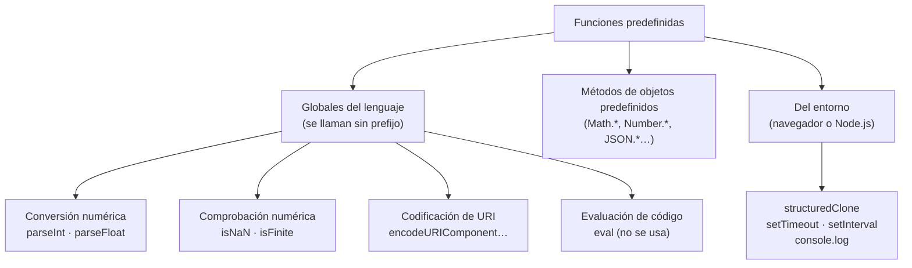

# 1. Funciones predefinidas del lenguaje

[⬅️ Volver a la unidad](./README.md)

## Índice

- [1.1. Qué es una función predefinida](#11-qué-es-una-función-predefinida)
  - [1.1.1. Llamar a una función](#111-llamar-a-una-función)
  - [1.1.2. Argumentos y valor devuelto](#112-argumentos-y-valor-devuelto)
- [1.2. Clasificación de las funciones predefinidas](#12-clasificación-de-las-funciones-predefinidas)
- [1.3. Funciones de conversión numérica](#13-funciones-de-conversión-numérica)
  - [1.3.1. `parseInt` y `parseFloat`](#131-parseint-y-parsefloat)
  - [1.3.2. Las versiones de `Number`](#132-las-versiones-de-number)
- [1.4. Funciones de comprobación numérica](#14-funciones-de-comprobación-numérica)
  - [1.4.1. `isNaN` frente a `Number.isNaN`](#141-isnan-frente-a-numberisnan)
  - [1.4.2. `isFinite` frente a `Number.isFinite`](#142-isfinite-frente-a-numberisfinite)
  - [1.4.3. `Number.isInteger`](#143-numberisinteger)
- [1.5. Funciones de codificación de URI](#15-funciones-de-codificación-de-uri)
- [1.6. Funciones de utilidad](#16-funciones-de-utilidad)
  - [1.6.1. `structuredClone`](#161-structuredclone)
  - [1.6.2. Temporizadores: `setTimeout` y `setInterval`](#162-temporizadores-settimeout-y-setinterval)
  - [1.6.3. `eval`: la que no se usa](#163-eval-la-que-no-se-usa)
- [1.7. Métodos de los objetos predefinidos](#17-métodos-de-los-objetos-predefinidos)
- [1.8. Cómo consultar la documentación](#18-cómo-consultar-la-documentación)
- [1.9. Ejemplo integrador: limpiar los datos de un pedido](#19-ejemplo-integrador-limpiar-los-datos-de-un-pedido)
- [Resumen](#resumen)
- [Ejercicios de reflexión](#ejercicios-de-reflexión)

> **CE que trabaja este tema:** RA4 a.

---

## 1.1. Qué es una función predefinida

Una **función** es un bloque de código con nombre que hace una tarea concreta: recibe unos datos, trabaja con ellos y devuelve un resultado. Ya has usado muchas en la UD2: `console.log`, `Number`, `parseInt`, `Math.round`…

Una **función predefinida** (*built-in function*) es una función que **ya viene con el lenguaje** o con el entorno: no tienes que escribirla, solo llamarla. Es como la calculadora del móvil: no sabes cómo está programada por dentro, pero sabes qué le das y qué te devuelve.

```js
const edad = parseInt('17 años', 10);
console.log(edad); // 17
```

Saber **qué funciones existen** y **para qué sirve cada una** te ahorra escribir código que ya está escrito, probado y optimizado.

### 1.1.1. Llamar a una función

**Llamar** (o **invocar**) una función es pedirle que se ejecute. Se escribe su nombre seguido de paréntesis con los datos que necesita:

```js
Math.max(4, 9, 2); // nombre: Math.max · argumentos: 4, 9 y 2
```



El diagrama muestra una llamada como una caja: entran los argumentos y sale un único valor.

- Sin paréntesis **no** se llama a la función: `Math.max` es la función en sí (un valor), `Math.max()` es el resultado de ejecutarla.
- Una llamada es una **expresión**: se puede usar donde se espera un valor, incluso como argumento de otra llamada.

```js
console.log(Math.max);          // [Function: max] (la función, sin ejecutar)
console.log(Math.max(4, 9, 2)); // 9

// Llamadas anidadas: primero se ejecuta la de dentro
console.log(Math.round(parseFloat('7.6 kg'))); // 8
```

> 💡 **Tip del Examinador**: "¿Qué diferencia hay entre `f` y `f()`?" → `f` es la propia función (un valor que se puede guardar o pasar a otra función); `f()` la **ejecuta** y vale lo que devuelva.

### 1.1.2. Argumentos y valor devuelto

- Los **argumentos** son los valores que pasas en la llamada. El orden importa: `parseInt('ff', 16)` no es lo mismo que `parseInt(16, 'ff')`.
- Si pasas **menos** argumentos de los que espera, los que faltan valen `undefined`. Si pasas **más**, los sobrantes se ignoran.
- Toda función **devuelve** un valor. Si no devuelve nada explícitamente, devuelve `undefined`.

```js
console.log(Math.max());          // -Infinity: no hay ningún número que comparar
console.log(parseInt('42', 10, 'sobra')); // 42: el tercer argumento se ignora
const resultado = console.log('hola'); // muestra 'hola'
console.log(resultado);           // undefined: console.log no devuelve nada
```

> ⚠️ **Cuidado**: Que una función **muestre** algo por consola no significa que lo **devuelva**. `console.log` muestra, pero devuelve `undefined`. Esta diferencia será clave cuando escribas tus propias funciones en el tema 2.

---

## 1.2. Clasificación de las funciones predefinidas

No todas las funciones predefinidas son iguales. Se pueden clasificar por **dónde viven** y por **para qué sirven**:



El diagrama separa tres familias: las globales del estándar ECMAScript, los métodos que cuelgan de un objeto predefinido y las que aporta el entorno de ejecución.

| Familia | Ejemplos | Cómo se llaman | Dónde están definidas |
|---------|----------|----------------|-----------------------|
| **Globales: conversión** | `parseInt`, `parseFloat` | Directamente | Estándar ECMAScript |
| **Globales: comprobación** | `isNaN`, `isFinite` | Directamente | Estándar ECMAScript |
| **Globales: URI** | `encodeURIComponent`, `decodeURIComponent`, `encodeURI`, `decodeURI` | Directamente | Estándar ECMAScript |
| **Globales: evaluación** | `eval` | Directamente | Estándar ECMAScript |
| **Métodos estáticos** | `Number.isInteger`, `Math.max`, `JSON.stringify`, `Array.isArray`, `Object.keys` | `Objeto.metodo()` | Estándar ECMAScript |
| **Del entorno** | `structuredClone`, `setTimeout`, `setInterval`, `console.log` | Directamente | Navegador y Node.js (no ECMAScript) |

> 📝 **Nota del Profesor**: Las globales se pueden llamar sin prefijo porque son propiedades del **objeto global** (`globalThis`, que en el navegador es `window`). `parseInt(…)` es lo mismo que `globalThis.parseInt(…)`. Los objetos predefinidos (`Math`, `Date`, `JSON`, `String`…) los estudiarás a fondo en la UD4; aquí te centras en las **funciones**.

> 💡 **Tip del Examinador**: "Clasifica las funciones predefinidas de JavaScript" → Globales (conversión: `parseInt`, `parseFloat`; comprobación: `isNaN`, `isFinite`; URI: `encodeURIComponent`…; evaluación: `eval`), métodos de objetos predefinidos (`Math.max`, `Number.isInteger`, `JSON.parse`…) y funciones del entorno (`setTimeout`, `structuredClone`, `console.log`).

---

## 1.3. Funciones de conversión numérica

Ya las usaste en la UD2 para convertir textos en números. Aquí las ves con más detalle.

### 1.3.1. `parseInt` y `parseFloat`

`parseInt(texto, base)` lee el texto **de izquierda a derecha** y se queda con la parte entera que pueda interpretar. `parseFloat(texto)` hace lo mismo pero admite decimales.

```js
console.log(parseInt('42px', 10));     // 42
console.log(parseInt('  7 unidades', 10)); // 7: ignora los espacios iniciales
console.log(parseInt('3.99', 10));     // 3: corta en el punto
console.log(parseInt('ff', 16));       // 255: base hexadecimal
console.log(parseInt('101', 2));       // 5: base binaria
console.log(parseInt('abc', 10));      // NaN: no empieza por un número

console.log(parseFloat('3.99 €'));     // 3.99
console.log(parseFloat('1.5e3'));      // 1500: notación científica
console.log(parseFloat('3,99'));       // 3: la coma no es separador decimal
```

| Función | Admite decimales | Admite base | Si el texto empieza por algo no numérico |
|---------|:---:|:---:|------------------------------------------|
| `parseInt(texto, base)` | ❌ (corta) | ✅ | `NaN` |
| `parseFloat(texto)` | ✅ | ❌ | `NaN` |
| `Number(texto)` (UD2) | ✅ | ❌ | `NaN` (y también si **sobra** algo al final) |

> ✅ **Buena práctica**: Pasa siempre la **base** a `parseInt` (`10` casi siempre). Sin ella, un texto como `'0x1A'` se interpretaría como hexadecimal.

> ⚠️ **Cuidado**: `parseInt` y `parseFloat` son **tolerantes**: `parseFloat('12abc')` da `12`. Para **validar** lo que escribe un usuario, usa `Number`, que da `NaN` si sobra cualquier cosa. Para **extraer** un número de un texto con unidades (`'42px'`), usa `parseInt` o `parseFloat`.

### 1.3.2. Las versiones de `Number`

Desde ES2015, las mismas funciones existen también como métodos de `Number`: `Number.parseInt` y `Number.parseFloat`. Son **exactamente las mismas funciones**:

```js
console.log(Number.parseInt === parseInt);     // true
console.log(Number.parseFloat === parseFloat); // true
```

Se añadieron para ir agrupando las funciones numéricas en `Number` y no llenar el ámbito global. En el código moderno verás las dos formas.

---

## 1.4. Funciones de comprobación numérica

### 1.4.1. `isNaN` frente a `Number.isNaN`

Aquí **no** son iguales, y la diferencia importa:

- `isNaN(valor)` (global) **convierte** primero el valor a número y después comprueba si es `NaN`.
- `Number.isNaN(valor)` **no convierte**: solo da `true` si el valor **ya es** `NaN`.

```js
console.log(isNaN('hola'));        // true: Number('hola') es NaN
console.log(Number.isNaN('hola')); // false: 'hola' es un texto, no el valor NaN

console.log(isNaN(''));            // false: Number('') es 0
console.log(isNaN(undefined));     // true: Number(undefined) es NaN
console.log(Number.isNaN(NaN));    // true
console.log(Number.isNaN(0 / 0));  // true
```

| Valor | `isNaN(valor)` | `Number.isNaN(valor)` |
|-------|:---:|:---:|
| `NaN` | `true` | `true` |
| `'hola'` | `true` | `false` |
| `''` | `false` | `false` |
| `undefined` | `true` | `false` |
| `42` | `false` | `false` |

> ✅ **Buena práctica**: Convierte tú de forma explícita y comprueba con `Number.isNaN`:
>
> ```js
> const cantidad = Number(textoCantidad);
> if (Number.isNaN(cantidad)) { … }
> ```
>
> Así el código dice exactamente lo que hace. La global `isNaN` mezcla dos pasos y da sorpresas como `isNaN('') === false`.

### 1.4.2. `isFinite` frente a `Number.isFinite`

`isFinite` comprueba que un valor es un número **normal**: ni `NaN`, ni `Infinity`, ni `-Infinity`. Con la misma diferencia que antes: la global convierte y la de `Number` no.

```js
console.log(isFinite('42'));         // true: convierte '42' a 42
console.log(Number.isFinite('42'));  // false: '42' es un texto
console.log(Number.isFinite(42));    // true
console.log(Number.isFinite(1 / 0)); // false: Infinity
console.log(Number.isFinite(NaN));   // false
```

`Number.isFinite` es la forma más cómoda de validar un número: descarta de una vez `NaN`, los infinitos y cualquier valor que no sea de tipo `number`.

```js
const precio = Number(' 19.95 ');
console.log(Number.isFinite(precio) && precio > 0); // true: precio válido
```

### 1.4.3. `Number.isInteger`

`Number.isInteger(valor)` dice si un valor es un número **entero**. No convierte.

```js
console.log(Number.isInteger(5));     // true
console.log(Number.isInteger(5.0));   // true: 5.0 y 5 son el mismo número
console.log(Number.isInteger(5.5));   // false
console.log(Number.isInteger('5'));   // false: es un texto
```

> 💡 **Tip del Examinador**: "¿Por qué `isNaN('hola')` da `true` y `Number.isNaN('hola')` da `false`?" → Porque la global convierte el texto a número antes de comprobar (y `Number('hola')` es `NaN`), mientras que `Number.isNaN` solo responde `true` si el valor ya es exactamente `NaN`.

---

## 1.5. Funciones de codificación de URI

Una **URI** (o URL) solo puede contener ciertos caracteres. Los espacios, las tildes, la `ñ` o símbolos como `&`, `?` y `=` tienen que **codificarse** como `%` seguido de su código. Si no, la dirección se rompe o se interpreta mal.

Caso real: un buscador de una tienda construye la URL con lo que escribe el usuario.

```js
const busqueda = 'camiseta niño & niña';

// ❌ Sin codificar: el & parte el parámetro en dos
const urlMal = `https://tienda.example/buscar?q=${busqueda}`;
console.log(urlMal);
// https://tienda.example/buscar?q=camiseta niño & niña

// ✅ Codificando el valor del parámetro
const urlBien = `https://tienda.example/buscar?q=${encodeURIComponent(busqueda)}`;
console.log(urlBien);
// https://tienda.example/buscar?q=camiseta%20ni%C3%B1o%20%26%20ni%C3%B1a

console.log(decodeURIComponent('ni%C3%B1o%20%26%20ni%C3%B1a')); // 'niño & niña'
```

| Función | Qué codifica | Cuándo usarla |
|---------|--------------|---------------|
| `encodeURIComponent(texto)` | **Todo** lo que no sea letra, número o `- _ . ! ~ * ' ( )`, incluidos `/ ? & = #` | Para **un valor** que va dentro de una URL (un parámetro, un trozo de ruta) |
| `encodeURI(url)` | Lo mismo, pero **respeta** `/ ? & = # :` | Para una **URL completa** que ya tiene su estructura |
| `decodeURIComponent` / `decodeURI` | Hacen lo contrario | Para leer valores codificados |

```js
const url = 'https://tienda.example/buscar?q=camisa azul';
console.log(encodeURI(url));
// https://tienda.example/buscar?q=camisa%20azul  (respeta ? y =)
console.log(encodeURIComponent(url));
// https%3A%2F%2Ftienda.example%2Fbuscar%3Fq%3Dcamisa%20azul  (lo codifica todo)
```

> ✅ **Buena práctica**: Codifica con `encodeURIComponent` **cada valor** que metas en una URL, sobre todo si viene del usuario. En la UD4 verás `URLSearchParams`, que lo hace automáticamente, y en la UD7 lo usarás con `fetch`.

> ⚠️ **Cuidado**: Las antiguas funciones `escape` y `unescape` están **obsoletas**: no codifican bien los caracteres no ingleses. Si las ves en código heredado, sustitúyelas.

---

## 1.6. Funciones de utilidad

### 1.6.1. `structuredClone`

En la UD2 viste que, al asignar un objeto a otra variable, **no se copia**: las dos variables apuntan al mismo objeto. `structuredClone(valor)` crea una **copia profunda** (*deep copy*): un objeto nuevo con copias de todo lo que contiene, también de los objetos y arrays anidados.

```js
const pedido = { cliente: 'Ana', lineas: [{ producto: 'Libro', cantidad: 1 }] };

const copia = structuredClone(pedido);
copia.lineas[0].cantidad = 5;

console.log(pedido.lineas[0].cantidad); // 1: el original no cambia
console.log(copia.lineas[0].cantidad);  // 5
```

Copia objetos, arrays, fechas, `Map`, `Set` y casi cualquier dato. **No** puede copiar funciones (da error) ni conserva la clase de los objetos creados con clases propias (tema 7). En el tema 3 verás la diferencia entre copia **superficial** y **profunda** con detalle.

> 📝 **Nota del Profesor**: `structuredClone` no forma parte de ECMAScript: la aportan el navegador y Node.js (desde Node.js 17). Por eso está en la familia de funciones **del entorno**. Antes de que existiera se usaba el truco `JSON.parse(JSON.stringify(objeto))`, que pierde las fechas, los `undefined` y los `Map`. Si lo ves en código heredado, ya sabes por qué.

### 1.6.2. Temporizadores: `setTimeout` y `setInterval`

También las aporta el entorno. Sirven para ejecutar una función **más tarde**:

```js
console.log('Antes');
setTimeout(() => console.log('Un segundo después'), 1000);
console.log('Después');
```

```text
// Salida:
Antes
Después
Un segundo después
```

- `setTimeout(funcion, ms)` ejecuta la función **una vez**, pasados al menos `ms` milisegundos.
- `setInterval(funcion, ms)` la ejecuta **cada** `ms` milisegundos, hasta que se cancela con `clearInterval`.

Fíjate en que reciben **una función como argumento**: no la llaman ellas al momento, la guardan para llamarla después. Esto se llama **callback** y lo verás en el tema 2. El porqué de que `'Después'` salga antes lo explica el **bucle de eventos** de la UD1, y lo usarás a fondo en la UD7.

### 1.6.3. `eval`: la que no se usa

`eval(texto)` ejecuta un texto **como si fuera código JavaScript**:

```js
console.log(eval('2 + 3')); // 5
```

Existe, pero **no se usa**:

- **Seguridad:** si el texto viene del usuario, puede ejecutar cualquier código (inyección de código).
- **Rendimiento:** el motor no puede optimizar código que no conoce hasta ejecutarlo.
- **Depuración:** los errores dentro de un texto son difíciles de localizar.

> ⚠️ **Cuidado**: Si ves `eval` (o `new Function('…')` con texto del usuario) en un proyecto, es una señal de alarma. ESLint lo marca con la regla `no-eval`, incluida en la configuración recomendada.

---

## 1.7. Métodos de los objetos predefinidos

Muchas funciones útiles no son globales: cuelgan de un **objeto predefinido** y se llaman con `Objeto.metodo()`. Son los llamados **métodos estáticos**. Los más usados en esta unidad:

| Objeto | Métodos | Para qué |
|--------|---------|----------|
| `Math` | `Math.round`, `Math.floor`, `Math.ceil`, `Math.max`, `Math.min`, `Math.abs`, `Math.random` | Cálculo |
| `Number` | `Number.isNaN`, `Number.isFinite`, `Number.isInteger`, `Number.parseFloat` | Comprobar y convertir números |
| `Array` | `Array.isArray`, `Array.from`, `Array.of` | Crear y reconocer arrays (tema 3) |
| `Object` | `Object.keys`, `Object.values`, `Object.entries`, `Object.groupBy`, `Object.freeze` | Trabajar con objetos (temas 4 y 6) |
| `JSON` | `JSON.stringify`, `JSON.parse` | Pasar datos a texto y al revés (UD4 y UD7) |

```js
console.log(Math.max(...[4, 9, 2])); // 9 (los ... los verás en el tema 2)
console.log(Array.isArray([1, 2]));  // true
console.log(Object.keys({ nombre: 'Ana', edad: 17 })); // [ 'nombre', 'edad' ]
console.log(JSON.stringify({ ok: true })); // '{"ok":true}'
```

Además, cada **valor** tiene sus propios métodos según su tipo: los textos tienen `trim`, `toUpperCase`, `includes`, `replaceAll`…; los números, `toFixed`; los arrays, los métodos que verás en los temas 3 y 4. Se llaman sobre el valor:

```js
const nombre = '  ana garcía ';
console.log(nombre.trim().toUpperCase()); // 'ANA GARCÍA'
console.log((19.951).toFixed(2));         // '19.95'
```

> 📝 **Nota del Profesor**: La diferencia entre una **función** y un **método** es solo dónde está: un método es una función guardada como propiedad de un objeto. `Math.max` es un método del objeto `Math`; `parseInt` es una función global (que, técnicamente, es un método de `globalThis`). En el tema 6 verás cómo crear tus propios métodos.

---

## 1.8. Cómo consultar la documentación

Nadie se sabe de memoria todas las funciones. Lo que sí hay que saber es **dónde buscarlas** y **cómo leer su ficha**. La referencia es **MDN Web Docs** (<https://developer.mozilla.org/es/docs/Web/JavaScript/Reference/Global_Objects>).

La ficha de cada función tiene siempre las mismas partes:

| Apartado de MDN | Qué te dice |
|-----------------|-------------|
| **Sintaxis** | Cómo se llama y qué parámetros tiene. Los que van entre corchetes son opcionales: `parseInt(string[, radix])` |
| **Parámetros** | Qué significa cada uno y qué tipo debe tener |
| **Valor devuelto** | Qué devuelve y en qué casos devuelve algo especial (`NaN`, `-1`, `undefined`…) |
| **Excepciones** | Errores que puede lanzar |
| **Ejemplos** | Código listo para probar |
| **Compatibilidad con navegadores** | Desde qué versión de cada navegador y de Node.js funciona |

> ✅ **Buena práctica**: Antes de usar una función que no conoces, mira su **valor devuelto** y su **compatibilidad**. Muchos errores vienen de suponer qué devuelve una función (por ejemplo, que `push` devuelve el array, cuando devuelve la nueva longitud).

En VS Code también puedes pasar el ratón por encima de una función predefinida: el editor muestra su firma y una descripción breve, igual que con tus funciones documentadas con JSDoc (UD2).

---

## 1.9. Ejemplo integrador: limpiar los datos de un pedido

Un formulario envía los datos de un pedido como textos, con espacios, comas decimales y unidades. Hay que convertirlos, validarlos, preparar un enlace de seguimiento y guardar una copia del pedido original antes de modificarlo.

```js
// pedido.js (módulo)
const formulario = {
  cliente: '  Begoña Muñoz ',
  cantidad: '3 uds',
  precio: '12,50',
  descuento: 'diez',
  ciudad: 'A Coruña',
};

// 1. Copia profunda para poder comparar después (función del entorno)
const original = structuredClone(formulario);

// 2. Conversión: parseInt extrae el número del texto con unidades
const cantidad = parseInt(formulario.cantidad, 10);

// 3. Conversión estricta: Number exige que el texto sea solo un número
const precio = Number(formulario.precio.replace(',', '.'));
const descuento = Number(formulario.descuento);

// 4. Comprobación sin conversiones ocultas
const cantidadValida = Number.isInteger(cantidad) && cantidad > 0;
const precioValido = Number.isFinite(precio) && precio > 0;
const descuentoFinal = Number.isNaN(descuento) ? 0 : descuento;

// 5. Cálculo con métodos de Math y de Number
const total = Math.round(cantidad * precio * (1 - descuentoFinal / 100) * 100) / 100;

// 6. Codificación: la ciudad va en una URL
const seguimiento = `https://envios.example/seguimiento?ciudad=${encodeURIComponent(formulario.ciudad)}`;

formulario.cliente = formulario.cliente.trim();

console.log(`👤 Cliente: ${formulario.cliente} (antes: "${original.cliente}")`);
console.log(`📦 Cantidad: ${cantidad} · válida: ${cantidadValida}`);
console.log(`💶 Precio: ${precio} · válido: ${precioValido}`);
console.log(`🏷️ Descuento: ${descuentoFinal} %`);
console.log(`🧾 Total: ${total.toFixed(2)} €`);
console.log(`🔗 ${seguimiento}`);
```

```text
// Salida:
👤 Cliente: Begoña Muñoz (antes: "  Begoña Muñoz ")
📦 Cantidad: 3 · válida: true
💶 Precio: 12.5 · válido: true
🏷️ Descuento: 0 %
🧾 Total: 37.50 €
🔗 https://envios.example/seguimiento?ciudad=A%20Coru%C3%B1a
```

| Paso | Función | Familia |
|------|---------|---------|
| Copiar el pedido | `structuredClone` | Del entorno |
| Extraer la cantidad | `parseInt` | Global de conversión |
| Convertir el precio | `Number` | Conversión (constructor `Number` llamado como función) |
| Validar | `Number.isInteger`, `Number.isFinite`, `Number.isNaN` | Métodos estáticos de `Number` |
| Redondear | `Math.round` | Método estático de `Math` |
| Preparar la URL | `encodeURIComponent` | Global de URI |
| Limpiar el nombre | `trim` | Método de los textos |

---

## Resumen

- Una **función predefinida** viene con el lenguaje o con el entorno: se **llama** con su nombre y paréntesis, recibe **argumentos** y **devuelve** un valor.
- `f` es la función; `f()` es el resultado de ejecutarla. Mostrar por consola no es devolver.
- Se clasifican en **globales** (conversión, comprobación, URI y evaluación), **métodos de objetos predefinidos** (`Math.*`, `Number.*`, `JSON.*`…) y **funciones del entorno** (`structuredClone`, `setTimeout`, `console.log`).
- `parseInt` y `parseFloat` **extraen** un número del principio de un texto; `Number` **valida** que todo el texto sea un número.
- `isNaN` e `isFinite` globales **convierten** antes de comprobar; `Number.isNaN` y `Number.isFinite` **no**, y son las recomendadas.
- `encodeURIComponent` codifica un **valor** para meterlo en una URL; `encodeURI`, una URL completa.
- `structuredClone` hace una **copia profunda**.
- `eval` existe, pero **no se usa** por seguridad, rendimiento y depuración.
- La documentación de referencia es **MDN**: sintaxis, parámetros, valor devuelto y compatibilidad.

## Ejercicios de reflexión

1. Clasifica estas funciones en las familias del apartado 1.2: `encodeURI`, `Math.floor`, `setInterval`, `parseFloat`, `Number.isInteger`, `structuredClone`, `JSON.parse`, `isFinite`.
2. ¿Qué devuelven `parseInt('08:30', 10)`, `parseFloat('.5')` y `Number('12 kg')`? Compruébalo en la consola y explica cada resultado.
3. Explica con un ejemplo por qué `isNaN('')` da `false` y por qué eso puede ser un problema al validar un formulario.
4. Tienes que construir la URL `https://mapa.example/?origen=…&destino=…` con dos ciudades que escribe el usuario. ¿Qué función usas y sobre qué parte de la URL? ¿Qué pasaría con la ciudad `Castellón & Valencia` si no la usaras?
5. ¿Qué diferencia hay entre `const b = a` y `const b = structuredClone(a)` cuando `a` es un objeto? ¿Cuándo necesitas cada una?

---

[⬅️ Volver a la unidad](./README.md)
