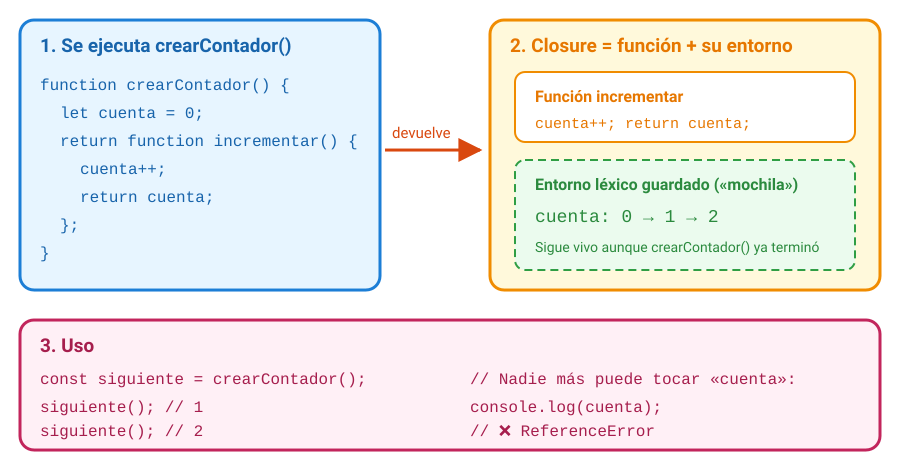
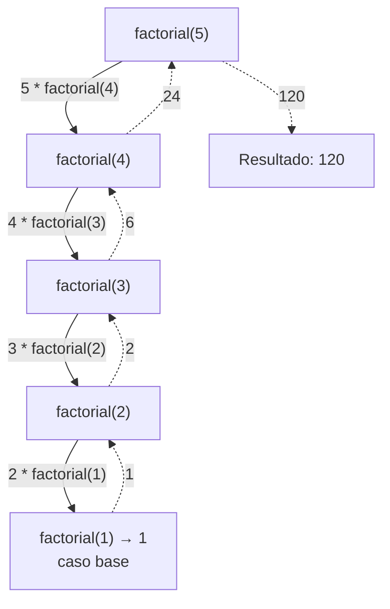

# 2. Funciones definidas por el usuario

[⬅️ Volver a la unidad](./README.md)

## Índice

- [2.1. Para qué sirven las funciones](#21-para-qué-sirven-las-funciones)
- [2.2. Tres formas de definir una función](#22-tres-formas-de-definir-una-función)
  - [2.2.1. Declaración de función](#221-declaración-de-función)
  - [2.2.2. Expresión de función](#222-expresión-de-función)
  - [2.2.3. Funciones flecha](#223-funciones-flecha)
  - [2.2.4. Cuál usar](#224-cuál-usar)
- [2.3. Parámetros y valor devuelto](#23-parámetros-y-valor-devuelto)
  - [2.3.1. `return`](#231-return)
  - [2.3.2. Parámetros por defecto](#232-parámetros-por-defecto)
  - [2.3.3. Parámetros _rest_](#233-parámetros-rest)
  - [2.3.4. El operador _spread_ en las llamadas](#234-el-operador-spread-en-las-llamadas)
  - [2.3.5. Un objeto como parámetro](#235-un-objeto-como-parámetro)
  - [2.3.6. Paso por valor y por referencia](#236-paso-por-valor-y-por-referencia)
- [2.4. Funciones como valores](#24-funciones-como-valores)
  - [2.4.1. Callbacks](#241-callbacks)
  - [2.4.2. Funciones de orden superior](#242-funciones-de-orden-superior)
- [2.5. Closures](#25-closures)
- [2.6. Funciones puras y efectos secundarios](#26-funciones-puras-y-efectos-secundarios)
- [2.7. Recursividad](#27-recursividad)
- [2.8. Lanzar y capturar errores](#28-lanzar-y-capturar-errores)
- [2.9. Ejemplo integrador: calculadora de propinas](#29-ejemplo-integrador-calculadora-de-propinas)
- [Resumen](#resumen)
- [Ejercicios de reflexión](#ejercicios-de-reflexión)

> **CE que trabaja este tema:** RA4 b.

---

## 2.1. Para qué sirven las funciones

Imagina que en un programa calculas el precio con IVA en diez sitios distintos. Si el IVA cambia, tienes que tocar diez líneas y seguro que se te olvida una. Con una **función definida por el usuario** escribes el cálculo **una vez**, le das un nombre y lo **llamas** donde haga falta.

```js
function calcularPrecioConIva(precio) {
  return precio * 1.21;
}

console.log(calcularPrecioConIva(100)); // 121
console.log(calcularPrecioConIva(50));  // 60.5
```

Las funciones sirven para:

- **Reutilizar** código: se escribe una vez y se usa muchas.
- **Dar nombre** a una tarea: `calcularPrecioConIva(precio)` se entiende sin leer su interior.
- **Dividir** un problema grande en piezas pequeñas que se pueden probar por separado (tema 10).

> 📝 **Nota del Profesor**: Una buena función hace **una sola cosa** y su nombre lo dice con un verbo: `calcularTotal`, `validarEmail`, `formatearFecha`. Si para describir lo que hace necesitas un "y", probablemente son dos funciones.

---

## 2.2. Tres formas de definir una función

### 2.2.1. Declaración de función

Es la forma clásica: la palabra `function`, el nombre, los **parámetros** entre paréntesis y el **cuerpo** entre llaves.

```js
function saludar(nombre) {
  return `Hola, ${nombre}`;
}

console.log(saludar('Lucía')); // 'Hola, Lucía'
```

Como viste en la UD2, las declaraciones de función se **elevan** completas (*hoisting*): se pueden llamar antes de la línea donde están escritas.

### 2.2.2. Expresión de función

Una función también es un **valor**, así que se puede guardar en una variable. La función se crea cuando se ejecuta esa línea:

```js
const despedir = function (nombre) {
  return `Adiós, ${nombre}`;
};

console.log(despedir('Lucía')); // 'Adiós, Lucía'
```

Aquí **no** hay elevación útil: la variable `despedir` está en la zona muerta temporal hasta su línea, así que llamarla antes da `ReferenceError`.

### 2.2.3. Funciones flecha

Las **funciones flecha** (*arrow functions*, ES2015) son una forma más corta de escribir expresiones de función. Se usan muchísimo para funciones pequeñas que se pasan a otras funciones.

```js
// Forma completa: llaves y return
const sumar = (a, b) => {
  return a + b;
};

// Cuerpo de una sola expresión: sin llaves y con return implícito
const restar = (a, b) => a - b;

// Un solo parámetro: los paréntesis son opcionales (Prettier los pone siempre)
const doble = (n) => n * 2;

// Sin parámetros: paréntesis vacíos
const tirarDado = () => Math.floor(Math.random() * 6) + 1;

// Devolver un objeto literal: hay que rodearlo de paréntesis
const crearPunto = (x, y) => ({ x, y });

console.log(sumar(2, 3), restar(5, 1), doble(4)); // 5 4 8
console.log(crearPunto(1, 2)); // { x: 1, y: 2 }
```

> ⚠️ **Cuidado**: Si la flecha tiene llaves, **necesita `return`**. `const doble = (n) => { n * 2; };` devuelve `undefined`: las llaves se interpretan como el cuerpo de la función, no como un objeto.

### 2.2.4. Cuál usar

| | Declaración | Expresión | Flecha |
|---|---|---|---|
| Sintaxis | `function f() {}` | `const f = function () {};` | `const f = () => {};` |
| Elevación | ✅ Completa | ❌ (zona muerta temporal) | ❌ (zona muerta temporal) |
| `return` implícito | ❌ | ❌ | ✅ Si no lleva llaves |
| Tiene su propio `this` | ✅ | ✅ | ❌ Usa el `this` de fuera (tema 6) |
| Uso típico | Funciones con nombre de un módulo | Poco usada hoy | Callbacks y funciones cortas |

> ✅ **Buena práctica**: En este curso, **declaraciones** para las funciones principales de un módulo (se leen mejor y se exportan con su nombre) y **flechas** para las funciones cortas que se pasan como argumento. Los métodos de objetos y clases tienen su propia sintaxis (temas 6 y 7).

> 💡 **Tip del Examinador**: "¿Qué diferencias hay entre una declaración de función y una función flecha?" → La declaración se eleva completa y tiene su propio `this`; la flecha es una expresión (no se puede usar antes de definirla), puede tener `return` implícito y toma el `this` del ámbito donde se escribe.

---

## 2.3. Parámetros y valor devuelto

Los **parámetros** son las variables que aparecen en la definición; los **argumentos**, los valores que se pasan en la llamada.

```js
//                 parámetros
function area(base, altura) {
  return base * altura;
}
//                  argumentos
console.log(area(4, 5)); // 20
```

Los parámetros son variables **locales** de la función (ámbito de función, UD2): solo existen mientras se ejecuta.

### 2.3.1. `return`

`return` hace dos cosas: **termina** la función y **devuelve** el valor indicado. Lo que haya después no se ejecuta. Sin `return`, la función devuelve `undefined`.

```js
function clasificarNota(nota) {
  if (nota < 5) return 'Suspenso';    // cláusula de guarda (UD2)
  if (nota < 7) return 'Aprobado';
  if (nota < 9) return 'Notable';
  return 'Sobresaliente';
}

function mostrarNota(nota) {
  console.log(`Nota: ${nota}`); // muestra, pero no devuelve nada
}

console.log(clasificarNota(7.5)); // 'Notable'
console.log(mostrarNota(7.5));    // muestra 'Nota: 7.5' y después undefined
```

> ✅ **Buena práctica**: Haz que las funciones **devuelvan** resultados en lugar de mostrarlos. Una función que devuelve se puede reutilizar (mostrar en consola, en la página, guardar…) y se puede **probar** con tests; una que solo hace `console.log`, no.

### 2.3.2. Parámetros por defecto

Si no se pasa un argumento, el parámetro vale `undefined`. Con un **valor por defecto** (ES2015) puedes decidir qué valor toma en ese caso:

```js
function calcularPrecioFinal(precio, iva = 21, descuento = 0) {
  return precio * (1 - descuento / 100) * (1 + iva / 100);
}

console.log(calcularPrecioFinal(100));          // 121
console.log(calcularPrecioFinal(100, 4));       // 104
console.log(calcularPrecioFinal(100, 21, 50));  // 60.5
console.log(calcularPrecioFinal(100, undefined, 50)); // 60.5: undefined usa el valor por defecto
```

El valor por defecto se aplica **solo** cuando el argumento es `undefined` (o no se pasa), no con `null`, `0` ni `''`.

> 📝 **Nota del Profesor**: En código heredado verás `iva = iva || 21;` dentro de la función. Es la forma antigua y tiene el problema de `||` que viste en la UD2: un IVA de `0` se cambiaría por `21`. Los parámetros por defecto lo resuelven.

### 2.3.3. Parámetros _rest_

Un **parámetro _rest_** (`...nombre`) recoge en un **array** todos los argumentos que sobran. Permite escribir funciones que aceptan **cualquier número de argumentos**, como `Math.max`.

```js
function sumarTodos(...numeros) {
  let total = 0;
  for (const n of numeros) total += n;
  return total;
}

console.log(sumarTodos(1, 2, 3));     // 6
console.log(sumarTodos(10, 20, 30, 40)); // 100
console.log(sumarTodos());            // 0: numeros es un array vacío

function registrar(nivel, ...mensajes) {
  return `[${nivel}] ${mensajes.join(' ')}`;
}
console.log(registrar('INFO', 'Servidor', 'arrancado')); // '[INFO] Servidor arrancado'
```

Reglas: solo puede haber **uno** y tiene que ser el **último** parámetro.

> 📝 **Nota del Profesor**: Antes de ES2015 se usaba el objeto `arguments`, que existe dentro de las funciones declaradas con `function`. Es parecido a un array, pero no lo es (no tiene `map`, `filter`…) y no existe en las funciones flecha. Si lo ves en código heredado, sustitúyelo por un parámetro _rest_.

### 2.3.4. El operador _spread_ en las llamadas

Los tres puntos también funcionan **al revés**: en una llamada, el operador **_spread_** (propagación) **despliega** un array en argumentos sueltos.

```js
const notas = [6, 9.5, 4, 8];

console.log(Math.max(notas));    // NaN: recibe un único argumento, el array
console.log(Math.max(...notas)); // 9.5: equivale a Math.max(6, 9.5, 4, 8)
console.log(sumarTodos(...notas, 10)); // 37.5
```

| | Dónde se escribe | Qué hace |
|---|---|---|
| **_Rest_** `...` | En los **parámetros** de la definición | **Recoge** varios argumentos en un array |
| **_Spread_** `...` | En los **argumentos** de una llamada (y en arrays y objetos, temas 3 y 6) | **Despliega** un array en valores sueltos |

> 💡 **Tip del Examinador**: "¿Qué diferencia hay entre _rest_ y _spread_ si se escriben igual?" → El lugar: en la **definición** de la función, `...` recoge argumentos en un array (_rest_); en una **llamada**, un array o un objeto literal, `...` despliega sus elementos (_spread_).

### 2.3.5. Un objeto como parámetro

Cuando una función tiene muchos parámetros opcionales, es fácil equivocarse de orden: `crearUsuario('Ana', true, false, 3)`. ¿Qué era cada valor? La solución es recibir **un objeto** y desestructurarlo (UD2) en los parámetros, con valores por defecto:

```js
function crearUsuario({ nombre, admin = false, activo = true, intentos = 3 }) {
  return `${nombre} · admin: ${admin} · activo: ${activo} · intentos: ${intentos}`;
}

console.log(crearUsuario({ nombre: 'Ana', intentos: 5 }));
// 'Ana · admin: false · activo: true · intentos: 5'
```

Los argumentos se pasan **por nombre**, en cualquier orden, y los que faltan toman su valor por defecto. Este patrón lo verás en muchas librerías y en Angular.

### 2.3.6. Paso por valor y por referencia

¿Qué pasa si una función modifica un parámetro?

- Si el argumento es un **primitivo** (número, texto, booleano…), la función recibe una **copia del valor**. Cambiar el parámetro no afecta a la variable de fuera.
- Si es un **objeto** (incluidos los arrays), la función recibe una **copia de la referencia**: apunta al **mismo** objeto. Si la función lo modifica, el cambio se ve fuera.

```js
function incrementar(n) {
  n++;
  return n;
}
const edad = 17;
console.log(incrementar(edad), edad); // 18 17: edad no cambia

function anadirNota(lista, nota) {
  lista.push(nota); // modifica el array que recibe
}
const notas = [6, 7];
anadirNota(notas, 9);
console.log(notas); // [ 6, 7, 9 ]: el array de fuera ha cambiado
```

> ⚠️ **Cuidado**: Modificar un objeto o un array recibido como parámetro es un **efecto secundario** que sorprende a quien llama a la función. Es mejor devolver uno nuevo (apartado 2.6): `return [...lista, nota];`.

---

## 2.4. Funciones como valores

En JavaScript, las funciones son **ciudadanos de primera clase** (*first-class functions*): se tratan como cualquier otro valor. Se pueden:

- Guardar en variables, arrays y objetos.
- **Pasar como argumento** a otra función.
- **Devolver** desde otra función.

```js
const operaciones = {
  sumar: (a, b) => a + b,
  multiplicar: (a, b) => a * b,
};
console.log(operaciones.multiplicar(3, 4)); // 12
```

### 2.4.1. Callbacks

Un **callback** (función de retrollamada) es una función que **pasas a otra** para que esta la llame cuando le toque. Ya lo viste con `setTimeout` en el tema 1.

```js
function procesarPedido(pedido, alTerminar) {
  const total = pedido.precio * pedido.cantidad;
  alTerminar(total); // llama al callback con el resultado
}

procesarPedido({ precio: 5, cantidad: 3 }, (total) => {
  console.log(`✅ Pedido procesado: ${total} €`);
});
// ✅ Pedido procesado: 15 €
```

Fíjate: se pasa la **función** (`(total) => {…}`), no el resultado de llamarla. Quien decide **cuándo** se ejecuta y **con qué datos** es `procesarPedido`.

> ⚠️ **Cuidado**: Un error muy común es llamar al callback al pasarlo: `setTimeout(saludar(), 1000)` ejecuta `saludar` **ya** y pasa a `setTimeout` lo que devuelva (`undefined`). Lo correcto es `setTimeout(saludar, 1000)` o, si necesita argumentos, `setTimeout(() => saludar('Ana'), 1000)`.

### 2.4.2. Funciones de orden superior

Una **función de orden superior** (*higher-order function*) es la que **recibe** una función como argumento o **devuelve** una función. Son la base de las operaciones agregadas del tema 4 (`map`, `filter`, `reduce` reciben un callback).

```js
// Recibe una función: la aplica a cada elemento
function aplicarATodos(valores, transformar) {
  const resultado = [];
  for (const valor of valores) {
    resultado.push(transformar(valor));
  }
  return resultado;
}

console.log(aplicarATodos([1, 2, 3], (n) => n * 10)); // [ 10, 20, 30 ]
console.log(aplicarATodos(['ana', 'luis'], (t) => t.toUpperCase())); // [ 'ANA', 'LUIS' ]

// Devuelve una función: una "fábrica" de funciones
function crearMultiplicador(factor) {
  return (n) => n * factor;
}

const triple = crearMultiplicador(3);
const conIva = crearMultiplicador(1.21);
console.log(triple(5));    // 15
console.log(conIva(100));  // 121
```

`aplicarATodos` no sabe qué transformación se hará: solo sabe **recorrer**. La transformación la decide quien la llama. Así se separa el **qué** del **cómo**, y una misma función sirve para muchas tareas.

---

## 2.5. Closures

Fíjate en `crearMultiplicador` del apartado anterior: devuelve una función que usa `factor`, **pero `crearMultiplicador` ya ha terminado** cuando se llama a `triple(5)`. ¿Cómo es posible que `factor` siga existiendo?

Porque en JavaScript, una función **recuerda el ámbito donde se creó**, aunque ese ámbito haya terminado. La combinación de una función y el entorno que recuerda se llama **closure** (clausura).

```js
function crearContador() {
  let cuenta = 0; // variable local de crearContador
  return function incrementar() {
    cuenta++;
    return cuenta;
  };
}

const siguiente = crearContador();
console.log(siguiente()); // 1
console.log(siguiente()); // 2
console.log(siguiente()); // 3

const otro = crearContador(); // un contador nuevo, con su propia "cuenta"
console.log(otro());      // 1
```



La imagen muestra la idea: la función devuelta se lleva una "mochila" con las variables del ámbito donde nació. Cada llamada a `crearContador` crea una mochila nueva, por eso `siguiente` y `otro` cuentan por separado.

Esto es consecuencia del **ámbito léxico** que viste en la UD2: el ámbito se decide por dónde está **escrito** el código.

Los closures sirven para:

- **Datos privados:** nadie puede modificar `cuenta` salvo a través de `siguiente()`. Es la base del patrón **Módulo** (tema 9).
- **Fábricas de funciones** configuradas: `crearMultiplicador(3)`, `crearValidador(minimo, maximo)`…
- **Recordar estado** entre llamadas: contadores, cachés, temporizadores.

```js
function crearValidadorLongitud(minimo, maximo) {
  return (texto) => texto.length >= minimo && texto.length <= maximo;
}

const validarUsuario = crearValidadorLongitud(3, 12);
const validarClave = crearValidadorLongitud(8, 64);
console.log(validarUsuario('ana'));   // true
console.log(validarClave('1234'));    // false
```

> 📝 **Nota del Profesor**: Los closures no son algo que "se use" de vez en cuando: están en todas partes. Cada callback que usa una variable de fuera (un manejador de eventos en la UD6, un `then` en la UD7) es un closure. En el tema 10 verás cómo inspeccionarlos en el depurador (sección **Closure** del panel de ámbitos).

> 💡 **Tip del Examinador**: "¿Qué es un closure?" → Una función junto con el entorno léxico donde se creó: puede seguir accediendo a las variables de ese ámbito aunque la función exterior ya haya terminado. Ejemplo típico: un contador con una variable privada.

---

## 2.6. Funciones puras y efectos secundarios

Una **función pura** cumple dos condiciones:

1. Con los **mismos argumentos**, devuelve **siempre el mismo resultado**.
2. **No tiene efectos secundarios**: no modifica nada de fuera (variables externas, parámetros, la página, la consola…).

```js
// ✅ Pura: solo depende de sus argumentos y no cambia nada
function calcularDescuento(precio, porcentaje) {
  return precio * (porcentaje / 100);
}

// ❌ Impura: depende de una variable externa que puede cambiar
let tipoIva = 21;
function aplicarIva(precio) {
  return precio * (1 + tipoIva / 100);
}

// ❌ Impura: modifica el array que recibe (efecto secundario)
function anadirProducto(carrito, producto) {
  carrito.push(producto);
  return carrito;
}

// ✅ Pura: devuelve un array nuevo
function anadirProductoPuro(carrito, producto) {
  return [...carrito, producto];
}
```

| | Función pura | Función impura |
|---|---|---|
| Resultado | Solo depende de los argumentos | Depende de algo externo (variables, fecha, `Math.random`) |
| Efectos | Ninguno | Modifica datos, muestra mensajes, guarda… |
| Probar con tests | Muy fácil | Más difícil |
| Ejemplos | `calcularDescuento`, `Math.max` | `console.log`, `Math.random`, `Date.now`, `push` |

Un programa no puede ser **solo** funciones puras: en algún momento hay que mostrar el resultado o guardarlo. La idea es **separar**: la lógica en funciones puras y los efectos (consola, DOM, almacenamiento) en pocas funciones bien localizadas, como hiciste en el cajero de la UD2 (`cajero.js` puro y `main.js` con los mensajes).

> ✅ **Buena práctica**: Por defecto, escribe funciones puras que **devuelvan** datos nuevos en lugar de modificar los que reciben. Son más fáciles de entender, de reutilizar y de probar.

---

## 2.7. Recursividad

Una función **recursiva** es la que **se llama a sí misma**. Sirve para problemas que se pueden dividir en una versión más pequeña del mismo problema.

Toda función recursiva necesita:

1. Un **caso base**: la situación en la que ya no se llama a sí misma y devuelve un resultado directo.
2. Un **caso recursivo**: se llama a sí misma con un problema **más pequeño**, que se acerca al caso base.

```js
function factorial(n) {
  if (n <= 1) return 1;          // caso base
  return n * factorial(n - 1);   // caso recursivo
}

console.log(factorial(5)); // 120
```



El diagrama muestra la bajada hasta el caso base (flechas continuas) y la subida de los resultados (flechas discontinuas): cada llamada espera a que termine la siguiente.

Donde la recursividad brilla es en las **estructuras anidadas**, como un árbol de categorías o carpetas (y, en la UD5, el árbol DOM):

```js
const categorias = {
  nombre: 'Tienda',
  hijas: [
    { nombre: 'Libros', hijas: [{ nombre: 'Novela', hijas: [] }, { nombre: 'Cómic', hijas: [] }] },
    { nombre: 'Música', hijas: [] },
  ],
};

function contarCategorias(categoria) {
  let total = 1; // esta categoría
  for (const hija of categoria.hijas) {
    total += contarCategorias(hija); // y todas las de debajo
  }
  return total;
}

console.log(contarCategorias(categorias)); // 5
```

Con un bucle normal sería difícil, porque no sabes cuántos niveles hay.

> ⚠️ **Cuidado**: Sin caso base, o si el caso recursivo no se acerca a él, la función se llama infinitas veces hasta que se llena la **pila de llamadas** (tema 10): `RangeError: Maximum call stack size exceeded`. Para problemas sencillos como el factorial, un bucle es igual de claro y más eficiente; usa la recursividad cuando la estructura de los datos sea recursiva.

---

## 2.8. Lanzar y capturar errores

¿Qué debe hacer `calcularPrecioFinal(-10)`? Devolver un número negativo sería un resultado sin sentido, y devolver `null` obliga a quien llama a comprobarlo siempre. La alternativa es **lanzar un error** con `throw`: la función se detiene y avisa de que la han llamado mal.

```js
function calcularPrecioFinal(precio, iva = 21) {
  if (!Number.isFinite(precio) || precio < 0) {
    throw new Error(`Precio no válido: ${precio}`);
  }
  return precio * (1 + iva / 100);
}
```

Quien llama puede **capturar** el error con `try…catch` y decidir qué hacer:

```js
try {
  console.log(calcularPrecioFinal(100)); // 121
  console.log(calcularPrecioFinal(-10)); // lanza el error: no sigue
  console.log('Esta línea no se ejecuta');
} catch (error) {
  console.log(`❌ ${error.message}`);    // ❌ Precio no válido: -10
}
console.log('El programa continúa');
```

- `throw new Error(mensaje)` crea un objeto de error con ese mensaje y **corta** la ejecución de la función.
- Si nadie lo captura, el programa se detiene y el error aparece en la consola.
- En el bloque `catch`, `error.message` contiene el mensaje.

| Cuándo | Qué hacer |
|--------|-----------|
| El dato es **normal** que falte o sea incorrecto (lo que escribe un usuario) | Devolver un valor especial (`null`) o un resultado de validación |
| La función se ha **llamado mal** (un error de programación: precio negativo, cantidad no numérica) | Lanzar un error con `throw` |

> 📝 **Nota del Profesor**: Aquí ves lo justo para que tus funciones y clases puedan rechazar datos inválidos y para documentarlo con la etiqueta `@throws` de JSDoc (tema 10). Los tipos de error (`TypeError`, `RangeError`…) y el bloque `finally` los usarás con la asincronía de la UD7.

---

## 2.9. Ejemplo integrador: calculadora de propinas

Un restaurante quiere repartir la cuenta entre los comensales con propina. Junta parámetros por defecto, _rest_, funciones de orden superior, un closure y una función pura.

```js
// propinas.js (módulo)

/** Función pura: reparte un importe entre personas, redondeando a céntimos. */
function repartir(importe, personas) {
  if (!Number.isInteger(personas) || personas < 1) {
    throw new Error(`Número de personas no válido: ${personas}`);
  }
  return Math.round((importe / personas) * 100) / 100;
}

/** Suma cualquier número de consumiciones (parámetro rest). */
function sumarConsumiciones(...precios) {
  let total = 0;
  for (const precio of precios) total += precio;
  return total;
}

/** Fábrica de calculadoras de propina: devuelve un closure que recuerda el porcentaje. */
function crearCalculadoraPropina(porcentaje = 10) {
  return (importe) => importe * (1 + porcentaje / 100);
}

/** Función de orden superior: aplica una política de propina a la cuenta. */
function cerrarCuenta(consumiciones, personas, politicaPropina) {
  const subtotal = sumarConsumiciones(...consumiciones);
  const total = politicaPropina(subtotal);
  return { subtotal, total, porPersona: repartir(total, personas) };
}

const propinaNormal = crearCalculadoraPropina();
const propinaGenerosa = crearCalculadoraPropina(15);
const sinPropina = (importe) => importe;

const mesa = [12.5, 9.9, 15, 3.6];

for (const [nombre, politica] of [
  ['Normal', propinaNormal],
  ['Generosa', propinaGenerosa],
  ['Sin propina', sinPropina],
]) {
  const { subtotal, total, porPersona } = cerrarCuenta(mesa, 3, politica);
  console.log(`🍽️ ${nombre}: ${subtotal.toFixed(2)} € → ${total.toFixed(2)} € · ${porPersona.toFixed(2)} € por persona`);
}

try {
  cerrarCuenta(mesa, 0, propinaNormal);
} catch (error) {
  console.log(`❌ ${error.message}`);
}
```

```text
// Salida:
🍽️ Normal: 41.00 € → 45.10 € · 15.03 € por persona
🍽️ Generosa: 41.00 € → 47.15 € · 15.72 € por persona
🍽️ Sin propina: 41.00 € → 41.00 € · 13.67 € por persona
❌ Número de personas no válido: 0
```

| Concepto | Dónde |
|----------|-------|
| Declaración de función | `repartir`, `sumarConsumiciones`, `crearCalculadoraPropina`, `cerrarCuenta` |
| Función flecha | `sinPropina` y las funciones que devuelve `crearCalculadoraPropina` |
| Parámetro por defecto | `porcentaje = 10` |
| _Rest_ y _spread_ | `...precios` en la definición; `...consumiciones` en la llamada |
| Closure | Cada calculadora recuerda su `porcentaje` |
| Orden superior | `cerrarCuenta` recibe `politicaPropina`; `crearCalculadoraPropina` devuelve una función |
| Función pura | `repartir`, `sumarConsumiciones` |
| Errores | `repartir` lanza un error si las personas no son válidas |

---

## Resumen

- Una **función** agrupa código con un nombre para **reutilizarlo**; se define una vez y se **llama** muchas.
- Tres formas: **declaración** (se eleva), **expresión** y **flecha** (corta, `return` implícito sin llaves y sin `this` propio).
- `return` termina la función y devuelve un valor; sin él, devuelve `undefined`.
- **Parámetros por defecto** (`iva = 21`) para los argumentos que faltan; **_rest_** (`...numeros`) para recoger varios en un array; **_spread_** (`...array`) para desplegarlos en una llamada.
- Los primitivos se pasan **por valor** y los objetos **por referencia**: modificar un objeto recibido se nota fuera.
- Las funciones son **valores**: se guardan, se pasan como **callback** y se devuelven. Las que reciben o devuelven funciones son de **orden superior**.
- Un **closure** es una función con el entorno donde se creó: recuerda sus variables aunque la función exterior haya terminado.
- Las **funciones puras** devuelven siempre lo mismo con los mismos argumentos y no tienen efectos secundarios: son las más fáciles de probar.
- Una función **recursiva** se llama a sí misma; necesita un **caso base**.
- `throw new Error(…)` avisa de una llamada incorrecta y `try…catch` la captura.

## Ejercicios de reflexión

1. Reescribe `function cuadrado(n) { return n * n; }` como expresión de función y como función flecha con `return` implícito. ¿Cuál de las tres se puede llamar antes de su definición?
2. ¿Qué muestra `console.log(Math.min(...[3, 1, 2], 0))`? ¿Y `Math.min([3, 1, 2])`? Explica la diferencia.
3. Escribe una función `crearSaludo(saludo)` que devuelva una función que reciba un nombre y devuelva el saludo completo. ¿Dónde está el closure?
4. ¿Es pura una función que devuelve `precio * (1 + IVA)` si `IVA` es una constante del módulo? ¿Y si fuera una variable con `let`? Razónalo.
5. ¿Qué pasa si a `factorial` le quitas el caso base? ¿Qué error obtienes y por qué?

---

[⬅️ Volver a la unidad](./README.md)
