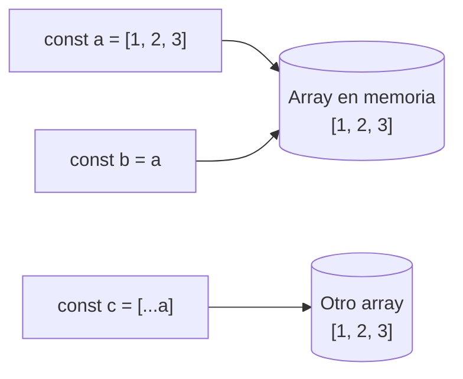

# 3. Arrays

[⬅️ Volver a la unidad](./README.md)

## Índice

- [3.1. Qué es un array](#31-qué-es-un-array)
  - [3.1.1. Características de los arrays en JavaScript](#311-características-de-los-arrays-en-javascript)
- [3.2. Crear arrays](#32-crear-arrays)
- [3.3. Acceder y modificar elementos](#33-acceder-y-modificar-elementos)
  - [3.3.1. Índices, `length` y `at`](#331-índices-length-y-at)
  - [3.3.2. Huecos y posiciones fuera de rango](#332-huecos-y-posiciones-fuera-de-rango)
- [3.4. Añadir y quitar elementos](#34-añadir-y-quitar-elementos)
- [3.5. Buscar, extraer y combinar](#35-buscar-extraer-y-combinar)
- [3.6. Métodos que mutan y métodos que no](#36-métodos-que-mutan-y-métodos-que-no)
  - [3.6.1. Ordenar con `sort` y `toSorted`](#361-ordenar-con-sort-y-tosorted)
  - [3.6.2. Las versiones que no mutan](#362-las-versiones-que-no-mutan)
- [3.7. Recorrer un array](#37-recorrer-un-array)
- [3.8. Arrays multidimensionales](#38-arrays-multidimensionales)
- [3.9. Desestructuración y _spread_ con arrays](#39-desestructuración-y-spread-con-arrays)
- [3.10. Referencias, comparación y copias](#310-referencias-comparación-y-copias)
  - [3.10.1. Comparar arrays](#3101-comparar-arrays)
  - [3.10.2. Copia superficial y copia profunda](#3102-copia-superficial-y-copia-profunda)
- [3.11. Ejemplo integrador: cola de turnos de una consulta](#311-ejemplo-integrador-cola-de-turnos-de-una-consulta)
- [Resumen](#resumen)
- [Ejercicios de reflexión](#ejercicios-de-reflexión)

> **CE que trabaja este tema:** RA4 c, d.

---

## 3.1. Qué es un array

Un **array** (matriz o vector) es una **lista ordenada de valores** guardada en una sola variable. Cada valor es un **elemento** y ocupa una **posición** (índice) que empieza en 0.

Piensa en una fila de taquillas numeradas: cada una guarda algo y la encuentras por su número.

```js
const notas = [7, 5.5, 9, 6];
//  índice:    0   1    2  3

console.log(notas[0]);      // 7
console.log(notas.length);  // 4
```

Sin arrays, para guardar las notas de 30 alumnos necesitarías 30 variables. Con un array, una sola variable y un bucle (UD2) para recorrerla.

### 3.1.1. Características de los arrays en JavaScript

Si vienes de otros lenguajes como Java o C, los arrays de JavaScript tienen algunas diferencias importantes:

| Característica | En JavaScript | En Java o C |
|----------------|---------------|-------------|
| **Tamaño** | **Dinámico**: crece y decrece al añadir o quitar | Fijo al crearlo |
| **Tipo de los elementos** | **Pueden mezclarse** tipos: `[1, 'a', true]` | Todos del mismo tipo |
| **Qué es** | Un **objeto** especial (`typeof [] === 'object'`) | Un bloque de memoria |
| **Índices** | Empiezan en 0; leer fuera del rango da `undefined` | Leer fuera del rango da error |
| **Se asigna y se pasa** | **Por referencia** (apartado 3.10) | Igual |
| **Comprobar si es array** | `Array.isArray(valor)` | El compilador conoce el tipo |

```js
const mezcla = [42, 'texto', true, null, { nombre: 'Ana' }, [1, 2]];
console.log(mezcla.length);         // 6
console.log(typeof mezcla);         // 'object'
console.log(Array.isArray(mezcla)); // true
console.log(Array.isArray('hola')); // false
```

> ✅ **Buena práctica**: Aunque se puede, **no mezcles tipos** en un mismo array. Un array de notas debe contener solo números; un array de alumnos, solo objetos con la misma forma. Así puedes tratar todos los elementos igual, y el motor de JavaScript los optimiza mejor.

> 💡 **Tip del Examinador**: "¿Qué devuelve `typeof []` y cómo se comprueba si algo es un array?" → `typeof []` devuelve `'object'`, porque los arrays son objetos. Para saber si es un array se usa `Array.isArray(valor)`.

---

## 3.2. Crear arrays

| Forma | Ejemplo | Resultado | Cuándo |
|-------|---------|-----------|--------|
| **Literal** | `[1, 2, 3]` | `[1, 2, 3]` | Casi siempre |
| `Array.of(...)` | `Array.of(5)` | `[5]` | Crear a partir de valores sueltos |
| `Array.from(iterable)` | `Array.from('hola')` | `['h', 'o', 'l', 'a']` | Convertir un iterable (texto, `Set`, `Map`, `NodeList`…) |
| `Array.from({ length: n }, fn)` | `Array.from({ length: 3 }, (_, i) => i * 2)` | `[0, 2, 4]` | Generar un array de `n` elementos calculados |
| `new Array(n).fill(valor)` | `new Array(3).fill(0)` | `[0, 0, 0]` | Rellenar con un valor fijo |

```js
const vacio = [];
const dias = ['lunes', 'martes', 'miércoles'];
const letras = Array.from('DWEC');                     // [ 'D', 'W', 'E', 'C' ]
const cuadrados = Array.from({ length: 5 }, (_, i) => (i + 1) ** 2); // [ 1, 4, 9, 16, 25 ]
const tablero = new Array(4).fill('·');                // [ '·', '·', '·', '·' ]
```

En `Array.from({ length: 5 }, (_, i) => …)`, el segundo argumento es un callback (tema 2) que recibe el valor (aquí no se usa, por eso se llama `_`) y el índice.

> ⚠️ **Cuidado**: `new Array(3)` **no** crea `[3]`: crea un array de longitud 3 **con huecos** (`[ <3 empty items> ]`). Y `new Array(3, 4)` sí crea `[3, 4]`. Esta incoherencia es el motivo de que se prefiera el literal o `Array.of`.

---

## 3.3. Acceder y modificar elementos

### 3.3.1. Índices, `length` y `at`

```js
const frutas = ['manzana', 'pera', 'uva'];

console.log(frutas[0]);                  // 'manzana' (primero)
console.log(frutas[frutas.length - 1]);  // 'uva' (último, forma clásica)
console.log(frutas.at(-1));              // 'uva' (último, forma moderna)
console.log(frutas.at(-2));              // 'pera'

frutas[1] = 'kiwi';                      // modificar
console.log(frutas);                     // [ 'manzana', 'kiwi', 'uva' ]
```

- `length` es el número de elementos. El último índice es siempre `length - 1`.
- `at(i)` (ES2022) acepta **índices negativos**: `-1` es el último, `-2` el penúltimo…

> 📝 **Nota del Profesor**: Fíjate en que `frutas` es `const` y aun así se puede modificar un elemento. Como viste en la UD2, `const` impide **reasignar** la variable (`frutas = []`), no cambiar el contenido del array.

### 3.3.2. Huecos y posiciones fuera de rango

```js
const numeros = [10, 20, 30];

console.log(numeros[5]); // undefined: no hay error

numeros[5] = 60;         // asignar más allá del final crea huecos
console.log(numeros);    // [ 10, 20, 30, <2 empty items>, 60 ]
console.log(numeros.length); // 6
```

Un array con huecos se llama **disperso** (*sparse*). Los huecos se comportan de forma distinta según el método (algunos los saltan, otros los tratan como `undefined`), y el motor no puede optimizar el array.

> ⚠️ **Cuidado**: Leer fuera del rango no da error, devuelve `undefined`: un índice mal calculado pasa desapercibido. Y escribir fuera del rango crea huecos. Para añadir al final, usa `push` (apartado 3.4).

---

## 3.4. Añadir y quitar elementos

| Método | Qué hace | Devuelve | ¿Muta? |
|--------|----------|----------|:---:|
| `push(a, b…)` | Añade al **final** | La nueva **longitud** | ✅ |
| `pop()` | Quita el **último** | El elemento quitado (o `undefined` si está vacío) | ✅ |
| `unshift(a, b…)` | Añade al **principio** | La nueva **longitud** | ✅ |
| `shift()` | Quita el **primero** | El elemento quitado | ✅ |
| `splice(inicio, cuantos, …nuevos)` | Quita y/o inserta en **cualquier posición** | Array con los elementos quitados | ✅ |

```js
const cola = ['Ana', 'Luis'];

cola.push('Marta');        // [ 'Ana', 'Luis', 'Marta' ]
cola.unshift('Pablo');     // [ 'Pablo', 'Ana', 'Luis', 'Marta' ]
const primero = cola.shift(); // 'Pablo' · cola: [ 'Ana', 'Luis', 'Marta' ]
const ultimo = cola.pop();    // 'Marta' · cola: [ 'Ana', 'Luis' ]

const letras = ['a', 'b', 'c', 'd', 'e'];
const quitadas = letras.splice(1, 2);   // quita 2 desde la posición 1
console.log(quitadas, letras);          // [ 'b', 'c' ] [ 'a', 'd', 'e' ]
letras.splice(1, 0, 'X', 'Y');          // inserta en la posición 1 sin quitar nada
console.log(letras);                    // [ 'a', 'X', 'Y', 'd', 'e' ]
```

Con `push` y `pop` el array funciona como una **pila** (el último en entrar es el primero en salir); con `push` y `shift`, como una **cola** (el primero en entrar es el primero en salir).

> ⚠️ **Cuidado**: `push` devuelve la **longitud**, no el array. `const lista = [].push(5)` guarda `1` en `lista`. Es uno de los errores más frecuentes al empezar.

---

## 3.5. Buscar, extraer y combinar

Estos métodos **no modifican** el array original:

| Método | Qué hace | Ejemplo | Resultado |
|--------|----------|---------|-----------|
| `indexOf(valor)` | Posición de la primera aparición, o `-1` | `['a','b','a'].indexOf('a')` | `0` |
| `lastIndexOf(valor)` | Posición de la última aparición, o `-1` | `['a','b','a'].lastIndexOf('a')` | `2` |
| `includes(valor)` | ¿Está el valor? | `[1, 2, 3].includes(2)` | `true` |
| `slice(inicio, fin)` | Copia del tramo `[inicio, fin)` | `[1, 2, 3, 4].slice(1, 3)` | `[2, 3]` |
| `concat(otro…)` | Une arrays en uno nuevo | `[1].concat([2, 3])` | `[1, 2, 3]` |
| `join(separador)` | Une los elementos en un texto | `['a', 'b'].join(' - ')` | `'a - b'` |

```js
const alumnos = ['Ana', 'Luis', 'Marta', 'Pablo'];

console.log(alumnos.includes('Marta'));  // true
console.log(alumnos.indexOf('Pedro'));   // -1: no está
console.log(alumnos.slice(1, 3));        // [ 'Luis', 'Marta' ]
console.log(alumnos.slice(-2));          // [ 'Marta', 'Pablo' ]: los dos últimos
console.log(alumnos.join(', '));         // 'Ana, Luis, Marta, Pablo'
console.log('a,b,c'.split(','));         // [ 'a', 'b', 'c' ]: lo contrario de join
```

Para buscar con una **condición** (el primer alumno con nota mayor que 9, por ejemplo) se usan `find`, `findIndex`, `some` y `every`, que reciben un callback. Los verás en el tema 4.

> 📝 **Nota del Profesor**: `includes` encuentra `NaN` y `indexOf` no (`[NaN].indexOf(NaN)` da `-1`), porque `includes` usa una comparación que considera `NaN` igual a sí mismo. Para comprobar si un valor está, usa `includes`; para saber **dónde** está, `indexOf`.

---

## 3.6. Métodos que mutan y métodos que no

Un método **muta** (modifica) el array cuando cambia el array original. Saber cuáles mutan es esencial: si un array lo comparten varias partes del programa, mutarlo sin querer provoca errores difíciles de encontrar.

| Mutan el original | No mutan: devuelven algo nuevo |
|-------------------|--------------------------------|
| `push`, `pop`, `shift`, `unshift`, `splice` | `slice`, `concat`, `join` |
| `sort`, `reverse` | `toSorted`, `toReversed` (ES2023) |
| `fill` | `toSpliced`, `with` (ES2023) |
| | `map`, `filter`, `reduce`… (tema 4) |

### 3.6.1. Ordenar con `sort` y `toSorted`

`sort` ordena **el propio array** y lo devuelve. Sin argumentos, ordena **como textos**, lo que da sorpresas con los números:

```js
const numeros = [10, 9, 1, 100, 25];
numeros.sort();
console.log(numeros); // [ 1, 10, 100, 25, 9 ]: orden alfabético, no numérico
```

Para ordenar bien hay que pasarle una **función de comparación** `(a, b) => …` que devuelva:

- Un número **negativo** si `a` va antes que `b`.
- Un número **positivo** si `a` va después que `b`.
- `0` si da igual.

```js
const numeros = [10, 9, 1, 100, 25];
numeros.sort((a, b) => a - b); // ascendente
console.log(numeros);          // [ 1, 9, 10, 25, 100 ]
numeros.sort((a, b) => b - a); // descendente
console.log(numeros);          // [ 100, 25, 10, 9, 1 ]

// Textos en español: localeCompare respeta tildes, ñ y mayúsculas
const nombres = ['Óscar', 'ana', 'Íñigo', 'Zoe', 'Ángel'];
nombres.sort((a, b) => a.localeCompare(b, 'es'));
console.log(nombres); // [ 'ana', 'Ángel', 'Íñigo', 'Óscar', 'Zoe' ]
```

`toSorted` (ES2023) hace lo mismo **sin tocar el original**: devuelve un array nuevo ordenado.

```js
const precios = [30, 5, 12];
const ordenados = precios.toSorted((a, b) => a - b);
console.log(ordenados); // [ 5, 12, 30 ]
console.log(precios);   // [ 30, 5, 12 ]: intacto
```

> 💡 **Tip del Examinador**: "¿Qué muestra `[10, 9, 1].sort()`?" → `[1, 10, 9]`, porque sin función de comparación `sort` convierte los elementos a texto y los ordena alfabéticamente. Para números: `sort((a, b) => a - b)`.

> 📝 **Nota del Profesor**: `localeCompare` es la forma correcta de comparar textos en español (la UD2 lo anunciaba). Con `<` y `>`, `'Ángel'` iría detrás de `'Zoe'` porque se comparan los códigos de los caracteres, y las mayúsculas irían antes que las minúsculas.

### 3.6.2. Las versiones que no mutan

ES2023 añadió una versión **sin mutación** de cada método que mutaba:

```js
const semana = ['lun', 'mar', 'mie', 'jue', 'vie'];

console.log(semana.toReversed());       // [ 'vie', 'jue', 'mie', 'mar', 'lun' ]
console.log(semana.toSpliced(1, 2));    // [ 'lun', 'jue', 'vie' ]
console.log(semana.with(2, 'MIE'));     // [ 'lun', 'mar', 'MIE', 'jue', 'vie' ]
console.log(semana);                    // [ 'lun', 'mar', 'mie', 'jue', 'vie' ]: intacto
```

| Muta | No muta (ES2023) |
|------|------------------|
| `array.sort(fn)` | `array.toSorted(fn)` |
| `array.reverse()` | `array.toReversed()` |
| `array.splice(i, n, …)` | `array.toSpliced(i, n, …)` |
| `array[i] = valor` | `array.with(i, valor)` |

> ✅ **Buena práctica**: Cuando un array lo recibe una función o lo comparten varias partes del programa, usa las versiones que **no mutan**. En frameworks como Angular (UD8), cambiar el array por uno nuevo es además la forma de que la interfaz detecte el cambio.

---

## 3.7. Recorrer un array

Ya conoces los bucles de la UD2. Con arrays se usan así:

```js
const notas = [7, 5.5, 9];

// for…of: cuando solo necesitas los valores (el más habitual)
for (const nota of notas) {
  console.log(nota);
}

// for…of con entries(): cuando necesitas también la posición
for (const [indice, nota] of notas.entries()) {
  console.log(`${indice + 1}. ${nota}`);
}

// for clásico: cuando necesitas controlar el índice (saltos, recorrer al revés…)
for (let i = notas.length - 1; i >= 0; i--) {
  console.log(notas[i]);
}
```

| Bucle | Úsalo cuando |
|-------|--------------|
| `for…of` | Necesitas los valores |
| `for…of` con `entries()` | Necesitas valor y posición |
| `for` con índice | Recorres al revés, saltando posiciones o comparando con el siguiente |
| `forEach`, `map`, `filter`… | Quieres expresar la operación sin bucle (tema 4) |

> ⚠️ **Cuidado**: No uses `for…in` con arrays. Recorre las **claves** como textos (`'0'`, `'1'`…) y también recorrería propiedades añadidas al array. `for…in` es para objetos (tema 6).

---

## 3.8. Arrays multidimensionales

Un array puede contener otros arrays. Un array de arrays es una **matriz** (tabla de filas y columnas): `matriz[fila][columna]`.

```js
// Tablero de tres en raya: 3 filas × 3 columnas
const tablero = [
  ['X', 'O', 'X'],
  [' ', 'X', 'O'],
  ['O', ' ', 'X'],
];

console.log(tablero[1][2]); // 'O': fila 1, columna 2
tablero[1][0] = 'O';

for (const fila of tablero) {
  console.log(fila.join(' | '));
}
```

```text
// Salida:
O
X | O | X
O | X | O
O |   | X
```

Para crear una matriz vacía de `filas × columnas`, usa `Array.from` con un callback para que cada fila sea un array **distinto**:

```js
const filas = 2;
const columnas = 3;
const matriz = Array.from({ length: filas }, () => new Array(columnas).fill(0));
matriz[0][0] = 5;
console.log(matriz); // [ [ 5, 0, 0 ], [ 0, 0, 0 ] ]
```

> ⚠️ **Cuidado**: `new Array(2).fill(new Array(3).fill(0))` parece igual, pero mete **el mismo array** en las dos filas: al cambiar `matriz[0][0]`, también cambia `matriz[1][0]`. Es un caso del paso por referencia que verás en el apartado 3.10.

---

## 3.9. Desestructuración y _spread_ con arrays

La **desestructuración** (UD2) saca elementos de un array a variables según su posición:

```js
const podio = ['Ana', 'Luis', 'Marta', 'Pablo', 'Sara'];

const [oro, plata, bronce] = podio;
console.log(oro, plata, bronce);  // Ana Luis Marta

const [primero, , tercero] = podio; // una coma vacía salta un elemento
console.log(primero, tercero);     // Ana Marta

const [ganador, ...resto] = podio;  // rest: el resto en un array
console.log(ganador, resto);        // Ana [ 'Luis', 'Marta', 'Pablo', 'Sara' ]

const [a = 'nadie', b = 'nadie'] = ['Eva']; // valores por defecto
console.log(a, b);                  // Eva nadie

let x = 1;
let y = 2;
[x, y] = [y, x];                    // intercambiar sin variable auxiliar
console.log(x, y);                  // 2 1
```

El operador **_spread_** (tema 2) despliega un array **dentro de otro**: sirve para copiar, unir y añadir sin mutar.

```js
const fruta = ['manzana', 'pera'];
const verdura = ['lechuga'];

const copia = [...fruta];                        // copia superficial
const compra = [...fruta, ...verdura, 'pan'];    // unir y añadir
const conPrimero = ['leche', ...fruta];          // añadir al principio

console.log(compra);     // [ 'manzana', 'pera', 'lechuga', 'pan' ]
console.log(conPrimero); // [ 'leche', 'manzana', 'pera' ]
console.log([...'hola']); // [ 'h', 'o', 'l', 'a' ]: funciona con cualquier iterable
```

---

## 3.10. Referencias, comparación y copias

Una variable de tipo array **no contiene** los elementos: contiene una **referencia** (la dirección) al array, que vive en otra zona de la memoria. Al asignar la variable a otra, se copia la **referencia**, no el array.



El diagrama muestra que `a` y `b` apuntan al **mismo** array, mientras que `c` apunta a una **copia** distinta.

```js
const a = [1, 2, 3];
const b = a;        // misma referencia
const c = [...a];   // array nuevo

b.push(4);
console.log(a); // [ 1, 2, 3, 4 ]: a y b son el mismo array
console.log(c); // [ 1, 2, 3 ]
```

### 3.10.1. Comparar arrays

`===` compara **referencias**, no contenidos. Dos arrays con los mismos elementos, pero creados por separado, **no son iguales**:

```js
console.log([1, 2] === [1, 2]); // false: dos arrays distintos
const a = [1, 2];
const b = a;
console.log(a === b);           // true: la misma referencia
```

Para comparar contenidos hay que recorrerlos elemento a elemento:

```js
function sonIguales(lista1, lista2) {
  if (lista1.length !== lista2.length) return false;
  for (let i = 0; i < lista1.length; i++) {
    if (lista1[i] !== lista2[i]) return false;
  }
  return true;
}

console.log(sonIguales([1, 2, 3], [1, 2, 3])); // true
console.log(sonIguales([1, 2, 3], [1, 3, 2])); // false
```

En el tema 4 lo escribirás en una línea con `every`, y en los tests (tema 10), `expect(…).toEqual(…)` compara contenidos.

> 💡 **Tip del Examinador**: "¿Por qué `[1, 2] === [1, 2]` da `false`?" → Porque los arrays son objetos y `===` compara referencias: son dos arrays distintos en memoria aunque tengan el mismo contenido.

### 3.10.2. Copia superficial y copia profunda

- Una **copia superficial** (*shallow copy*) crea un array nuevo, pero si los elementos son objetos o arrays, copia sus **referencias**: los elementos internos se comparten. La hacen `[...array]`, `slice()`, `Array.from(array)` y `concat`.
- Una **copia profunda** (*deep copy*) copia también todo lo que hay dentro. La hace `structuredClone` (tema 1).

```js
const clase = [
  { nombre: 'Ana', nota: 7 },
  { nombre: 'Luis', nota: 5 },
];

const superficial = [...clase];
const profunda = structuredClone(clase);

superficial[0].nota = 10;  // cambia el objeto compartido
console.log(clase[0].nota);    // 10: ¡el original también ha cambiado!

profunda[1].nota = 0;
console.log(clase[1].nota);    // 5: la copia profunda es independiente

superficial.push({ nombre: 'Eva', nota: 8 });
console.log(clase.length);     // 2: el array exterior sí es distinto
```

| | Copia superficial | Copia profunda |
|---|---|---|
| Cómo | `[...a]`, `a.slice()`, `Array.from(a)` | `structuredClone(a)` |
| Array exterior | Nuevo | Nuevo |
| Objetos y arrays internos | **Compartidos** | **Copiados** |
| Cuándo basta | Elementos primitivos (números, textos) o si no vas a modificar los internos | Vas a modificar objetos o arrays anidados |

> ⚠️ **Cuidado**: `[...array]` es suficiente para un array de números o textos, pero **no** para un array de objetos si vas a cambiar sus propiedades. Ese es uno de los errores más difíciles de encontrar: cambias "la copia" y se modifican los datos originales.

---

## 3.11. Ejemplo integrador: cola de turnos de una consulta

Una consulta médica gestiona su sala de espera con un array: los pacientes entran por el final y se atiende por el principio, salvo las urgencias, que se colocan delante.

```js
// turnos.js (módulo)
const sala = [];

function llegar(nombre, urgente = false) {
  if (urgente) {
    sala.unshift(nombre); // delante de todos
  } else {
    sala.push(nombre);    // al final
  }
  return sala.length;     // personas esperando
}

function atender() {
  return sala.shift() ?? '(nadie)'; // undefined si la sala está vacía
}

function posicionDe(nombre) {
  const indice = sala.indexOf(nombre);
  return indice === -1 ? 'no está en la sala' : `posición ${indice + 1}`;
}

console.log(`👥 Esperando: ${llegar('Ana')}`);
console.log(`👥 Esperando: ${llegar('Luis')}`);
console.log(`👥 Esperando: ${llegar('Marta')}`);
console.log(`🚑 Esperando: ${llegar('Pablo', true)}`);
console.log(`📋 Sala: ${sala.join(' → ')}`);
console.log(`🔎 Luis: ${posicionDe('Luis')}`);
console.log(`🩺 Atendido: ${atender()}`);
console.log(`🩺 Atendido: ${atender()}`);

// Informe sin tocar la sala: copia ordenada alfabéticamente
const orden = sala.toSorted((a, b) => a.localeCompare(b, 'es'));
console.log(`🔤 Por orden alfabético: ${orden.join(', ')}`);
console.log(`📋 Sala: ${sala.join(' → ')}`);

const [siguiente, ...despues] = sala;
console.log(`⏭️ Siguiente: ${siguiente} · después: ${despues.length}`);
console.log(`🩺 Atendido: ${atender()}`);
console.log(`🩺 Atendido: ${atender()}`);
console.log(`🩺 Atendido: ${atender()}`);
```

```text
// Salida:
👥 Esperando: 1
👥 Esperando: 2
👥 Esperando: 3
🚑 Esperando: 4
📋 Sala: Pablo → Ana → Luis → Marta
🔎 Luis: posición 3
🩺 Atendido: Pablo
🩺 Atendido: Ana
🔤 Por orden alfabético: Luis, Marta
📋 Sala: Luis → Marta
⏭️ Siguiente: Luis · después: 1
🩺 Atendido: Luis
🩺 Atendido: Marta
🩺 Atendido: (nadie)
```

| Necesidad | Método | ¿Muta? |
|-----------|--------|:---:|
| Llegar a la cola | `push` | ✅ |
| Urgencia delante | `unshift` | ✅ |
| Atender al primero | `shift` | ✅ |
| Buscar la posición | `indexOf` | ❌ |
| Listar la sala | `join` | ❌ |
| Informe ordenado sin alterar la cola | `toSorted` con `localeCompare` | ❌ |
| Separar el siguiente del resto | Desestructuración con _rest_ | ❌ |

---

## Resumen

- Un **array** es una lista ordenada de valores con índices desde 0. En JavaScript es **dinámico**, admite tipos mezclados y es un **objeto** (`Array.isArray` para reconocerlo).
- Se crea con el **literal** `[]`, `Array.of`, `Array.from` o `new Array(n).fill(v)`. Cuidado con `new Array(3)`.
- `length` da el número de elementos; `at(-1)`, el último. Leer fuera del rango da `undefined`.
- `push`/`pop` trabajan al final, `unshift`/`shift` al principio y `splice` en cualquier posición. **Mutan** el array.
- `indexOf`, `includes`, `slice`, `concat` y `join` **no** mutan.
- `sort` muta y, sin función de comparación, ordena como textos. `toSorted`, `toReversed`, `toSpliced` y `with` (ES2023) devuelven un array nuevo.
- Las **matrices** son arrays de arrays: `matriz[fila][columna]`.
- La **desestructuración** saca elementos por posición; el **_spread_** copia y une arrays.
- Los arrays se asignan y comparan **por referencia**: `===` no compara contenidos.
- `[...a]` hace una **copia superficial**; `structuredClone(a)`, una **profunda**.

## Ejercicios de reflexión

1. ¿Qué diferencias hay entre un array de JavaScript y uno de Java? ¿Qué ventajas e inconvenientes tiene que su tamaño sea dinámico?
2. ¿Qué muestra este código y por qué?

   ```js
   const a = [3, 20, 100];
   const b = a.sort();
   console.log(a === b, a);
   ```

3. Tienes un array `precios` que usan dos funciones distintas. Una de ellas necesita mostrarlo ordenado. ¿Usarías `sort` o `toSorted`? Justifícalo.
4. Explica con un dibujo de referencias por qué, en el apartado 3.10.2, cambiar `superficial[0].nota` modifica `clase`, pero `superficial.push(…)` no cambia `clase.length`.
5. ¿Cómo crearías una matriz de 5 × 5 llena de ceros en la que cada fila sea un array distinto? ¿Por qué falla la versión con `fill` de otro array?

---

[⬅️ Volver a la unidad](./README.md)
