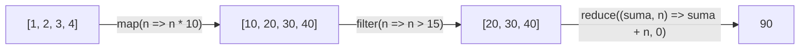

# 4. Operaciones agregadas

[⬅️ Volver a la unidad](./README.md)

## Índice

- [4.1. Qué son las operaciones agregadas](#41-qué-son-las-operaciones-agregadas)
  - [4.1.1. Filtrado, transformación, reducción y recolección](#411-filtrado-transformación-reducción-y-recolección)
  - [4.1.2. El callback de las operaciones agregadas](#412-el-callback-de-las-operaciones-agregadas)
- [4.2. `forEach`: recorrer](#42-foreach-recorrer)
- [4.3. `map`: transformar](#43-map-transformar)
- [4.4. `filter`: filtrar](#44-filter-filtrar)
- [4.5. `reduce`: reducir a un valor](#45-reduce-reducir-a-un-valor)
- [4.6. Buscar y comprobar: `find`, `findIndex`, `some`, `every`](#46-buscar-y-comprobar-find-findindex-some-every)
- [4.7. Aplanar: `flat` y `flatMap`](#47-aplanar-flat-y-flatmap)
- [4.8. Recolectar: agrupar y convertir](#48-recolectar-agrupar-y-convertir)
  - [4.8.1. `Object.groupBy`](#481-objectgroupby)
  - [4.8.2. `Object.entries` y `Object.fromEntries`](#482-objectentries-y-objectfromentries)
- [4.9. Encadenar operaciones](#49-encadenar-operaciones)
- [4.10. Bucles frente a operaciones agregadas](#410-bucles-frente-a-operaciones-agregadas)
- [4.11. Errores frecuentes](#411-errores-frecuentes)
- [4.12. Ejemplo integrador: informe de ventas](#412-ejemplo-integrador-informe-de-ventas)
- [Resumen](#resumen)
- [Ejercicios de reflexión](#ejercicios-de-reflexión)

> **CE que trabaja este tema:** RA4 e.

---

## 4.1. Qué son las operaciones agregadas

En la UD2 resolviste con bucles problemas como "suma las notas", "cuenta los aprobados" o "busca el primer suspenso". Son tareas que se repiten en todos los programas. Las **operaciones agregadas** son métodos de los arrays (y de otras colecciones) que resuelven esas tareas **sobre toda la colección de una vez**, sin escribir el bucle.

```js
const notas = [7, 4, 9, 5.5, 3];

// Con un bucle (UD2)
const aprobadasBucle = [];
for (const nota of notas) {
  if (nota >= 5) aprobadasBucle.push(nota);
}

// Con una operación agregada
const aprobadas = notas.filter((nota) => nota >= 5);

console.log(aprobadas); // [ 7, 9, 5.5 ]
```

Las dos dan el mismo resultado, pero la segunda dice **qué** quieres (filtrar las notas mayores o iguales a 5) y no **cómo** recorrer el array. Este estilo se llama **declarativo**, frente al **imperativo** de los bucles.

> 📝 **Nota del Profesor**: Las operaciones agregadas son una de las novedades que el RD 405/2023 exige trabajar en este módulo. Las vas a usar en todas las unidades siguientes: para generar listas en el DOM (UD5), procesar los datos de una API (UD7) y, sobre todo, en Angular (UD8).

### 4.1.1. Filtrado, transformación, reducción y recolección

Casi todo lo que se hace con una colección es una de estas cuatro operaciones o una combinación de ellas:

| Operación | Qué hace | Métodos | Entra → sale |
|-----------|----------|---------|--------------|
| **Filtrado** | Se queda con los elementos que cumplen una condición | `filter`, `find`, `findIndex` | n elementos → m ≤ n |
| **Transformación** (mapeo) | Convierte cada elemento en otro | `map`, `flatMap` | n elementos → n elementos |
| **Reducción** | Combina todos los elementos en **un solo valor** | `reduce`, `some`, `every` | n elementos → 1 valor |
| **Recolección** | Reúne los elementos en otra estructura: grupos, objeto, `Map`… | `Object.groupBy`, `Object.fromEntries`, `reduce` | n elementos → estructura |



El diagrama sigue un array por una cadena de operaciones: `map` transforma los cuatro elementos, `filter` deja pasar tres y `reduce` los combina en un único número.

### 4.1.2. El callback de las operaciones agregadas

Todas reciben un **callback** (tema 2) que el método llama **una vez por cada elemento**, con estos argumentos:

```js
array.map((elemento, indice, arrayCompleto) => { … });
```

Casi siempre basta con el primero. El índice es útil a veces; el array completo, rara vez.

```js
const letras = ['a', 'b', 'c'];
console.log(letras.map((letra, i) => `${i}:${letra}`)); // [ '0:a', '1:b', '2:c' ]
```

> ✅ **Buena práctica**: Las operaciones agregadas no modifican el array original (salvo que lo hagas tú dentro del callback, cosa que **no** debes hacer). Escribe callbacks **puros** (tema 2): que solo devuelvan un valor a partir del elemento.

---

## 4.2. `forEach`: recorrer

`forEach` llama al callback para cada elemento. **No devuelve nada** (`undefined`): se usa para hacer algo con cada elemento (mostrarlo, guardarlo…), es decir, para **efectos secundarios**.

```js
const alumnos = ['Ana', 'Luis', 'Marta'];

alumnos.forEach((nombre, i) => {
  console.log(`${i + 1}. ${nombre}`);
});
```

```text
// Salida:
1. Ana
2. Luis
3. Marta
```

| | `for…of` | `forEach` |
|---|---|---|
| Se puede salir antes con `break` | ✅ | ❌ (recorre siempre todos) |
| Funciona con `await` (UD7) | ✅ | ❌ |
| Se puede encadenar tras `filter`, `map`… | ❌ | ✅ |

> ⚠️ **Cuidado**: Si necesitas **construir** un array nuevo o **calcular** un valor, no uses `forEach` con un `push` o un acumulador externo: usa `map`, `filter` o `reduce`, que lo devuelven directamente.

---

## 4.3. `map`: transformar

`map` crea un **array nuevo, del mismo tamaño**, con el resultado de aplicar el callback a cada elemento.

```js
const precios = [10, 25, 4.5];
const conIva = precios.map((precio) => precio * 1.21);
console.log(conIva); // [ 12.1, 30.25, 5.445 ]

const alumnos = [
  { nombre: 'Ana', nota: 7 },
  { nombre: 'Luis', nota: 4 },
];
const nombres = alumnos.map((alumno) => alumno.nombre);
console.log(nombres); // [ 'Ana', 'Luis' ]

// Transformar cada objeto en otro: hay que devolver un objeto NUEVO
const conEstado = alumnos.map((alumno) => ({
  ...alumno,
  aprobado: alumno.nota >= 5,
}));
console.log(conEstado);
// [ { nombre: 'Ana', nota: 7, aprobado: true }, { nombre: 'Luis', nota: 4, aprobado: false } ]
```

`{ ...alumno, aprobado: … }` copia las propiedades del objeto y añade una nueva (lo verás en el tema 6). Así `alumnos` no se modifica.

> 💡 **Tip del Examinador**: "¿Qué diferencia hay entre `map` y `forEach`?" → `map` devuelve un **array nuevo** con el resultado de cada llamada al callback; `forEach` devuelve `undefined` y solo sirve para hacer algo con cada elemento.

---

## 4.4. `filter`: filtrar

`filter` crea un **array nuevo** con los elementos para los que el callback devuelve un valor **verdadero** (_truthy_). El callback es una **condición** (un **predicado**).

```js
const productos = [
  { nombre: 'Teclado', precio: 25, stock: 4 },
  { nombre: 'Ratón', precio: 12, stock: 0 },
  { nombre: 'Monitor', precio: 180, stock: 2 },
];

const disponibles = productos.filter((p) => p.stock > 0);
const baratos = productos.filter((p) => p.precio < 30);

console.log(disponibles.map((p) => p.nombre)); // [ 'Teclado', 'Monitor' ]
console.log(baratos.length);                   // 2

const sinVacios = ['Ana', '', 'Luis', '', 'Eva'].filter((nombre) => nombre !== '');
console.log(sinVacios); // [ 'Ana', 'Luis', 'Eva' ]
```

Si ningún elemento cumple la condición, devuelve un array **vacío** `[]`, nunca `undefined`.

---

## 4.5. `reduce`: reducir a un valor

`reduce` recorre el array **acumulando** un resultado. Es la generalización del patrón **acumulador** de la UD2.

```js
array.reduce((acumulador, elemento) => nuevoAcumulador, valorInicial);
```

- El callback recibe el **acumulador** (lo que lleva calculado) y el **elemento** actual, y devuelve el **nuevo acumulador**.
- `valorInicial` es el valor del acumulador antes del primer elemento.
- El resultado final es el último acumulador.

```js
const carrito = [12.5, 30, 7.25];
const total = carrito.reduce((suma, precio) => suma + precio, 0);
console.log(total); // 49.75
```

| Paso | `suma` (acumulador) | `precio` (elemento) | Devuelve |
|-----:|--------------------:|--------------------:|---------:|
| 1 | 0 (valor inicial) | 12.5 | 12.5 |
| 2 | 12.5 | 30 | 42.5 |
| 3 | 42.5 | 7.25 | 49.75 |

La tabla es la **traza** de `reduce`: igual que las tablas de traza de los bucles de la UD2.

`reduce` puede producir cualquier tipo de valor, no solo números:

```js
const notas = [7, 4, 9, 5.5];

const maxima = notas.reduce((max, nota) => (nota > max ? nota : max), -Infinity);
console.log(maxima); // 9 (también Math.max(...notas))

const palabras = ['hola', 'que', 'hola', 'tal', 'hola'];
const frecuencias = palabras.reduce((cuenta, palabra) => {
  cuenta[palabra] = (cuenta[palabra] ?? 0) + 1;
  return cuenta;
}, {});
console.log(frecuencias); // { hola: 3, que: 1, tal: 1 }
```

> ⚠️ **Cuidado**: Pon **siempre** el valor inicial. Sin él, `reduce` usa el primer elemento como acumulador inicial, lo que falla si el acumulador tiene que ser de otro tipo (un objeto, un texto) y lanza `TypeError: Reduce of empty array with no initial value` si el array está vacío.

> 💡 **Tip del Examinador**: "¿Qué recibe el callback de `reduce` y para qué sirve el segundo argumento?" → Recibe el acumulador y el elemento actual (además del índice y el array), y devuelve el nuevo acumulador. El segundo argumento de `reduce` es el valor inicial del acumulador.

---

## 4.6. Buscar y comprobar: `find`, `findIndex`, `some`, `every`

| Método | Devuelve | Si no hay ninguno | Se para |
|--------|----------|-------------------|---------|
| `find(cond)` | El **primer elemento** que cumple la condición | `undefined` | Al encontrarlo |
| `findIndex(cond)` | La **posición** del primero que la cumple | `-1` | Al encontrarlo |
| `findLast(cond)` / `findLastIndex(cond)` | Lo mismo, buscando desde el final | `undefined` / `-1` | Al encontrarlo |
| `some(cond)` | `true` si **alguno** la cumple | `false` | En el primer `true` |
| `every(cond)` | `true` si **todos** la cumplen | `true` (array vacío) | En el primer `false` |

```js
const alumnos = [
  { nombre: 'Ana', nota: 7 },
  { nombre: 'Luis', nota: 4 },
  { nombre: 'Marta', nota: 9 },
];

console.log(alumnos.find((a) => a.nota >= 9));       // { nombre: 'Marta', nota: 9 }
console.log(alumnos.find((a) => a.nota === 10));     // undefined
console.log(alumnos.findIndex((a) => a.nombre === 'Luis')); // 1
console.log(alumnos.some((a) => a.nota < 5));        // true: hay algún suspenso
console.log(alumnos.every((a) => a.nota >= 5));      // false: no aprueban todos

// Comparar dos arrays elemento a elemento (tema 3) en una línea
const iguales = (x, y) => x.length === y.length && x.every((v, i) => v === y[i]);
console.log(iguales([1, 2, 3], [1, 2, 3])); // true
```

> 📝 **Nota del Profesor**: `some` y `every` hacen **cortocircuito**, como `||` y `&&` en la UD2: en cuanto conocen la respuesta, dejan de recorrer. Son la versión agregada de los patrones de **búsqueda** de la UD2 (con `break`).

---

## 4.7. Aplanar: `flat` y `flatMap`

`flat(profundidad)` crea un array nuevo **aplanando** los arrays anidados hasta la profundidad indicada (1 por defecto).

```js
const anidado = [1, [2, 3], [4, [5, 6]]];
console.log(anidado.flat());         // [ 1, 2, 3, 4, [ 5, 6 ] ]
console.log(anidado.flat(2));        // [ 1, 2, 3, 4, 5, 6 ]
console.log(anidado.flat(Infinity)); // aplana todos los niveles
```

`flatMap(fn)` equivale a `map(fn).flat()`: cada elemento puede producir **varios** (o ninguno).

```js
const pedidos = [
  { cliente: 'Ana', productos: ['libro', 'lápiz'] },
  { cliente: 'Luis', productos: ['cuaderno'] },
  { cliente: 'Eva', productos: [] },
];

console.log(pedidos.map((p) => p.productos));
// [ [ 'libro', 'lápiz' ], [ 'cuaderno' ], [] ]
console.log(pedidos.flatMap((p) => p.productos));
// [ 'libro', 'lápiz', 'cuaderno' ]

const frases = ['hola mundo', 'buenos días'];
console.log(frases.flatMap((f) => f.split(' '))); // [ 'hola', 'mundo', 'buenos', 'días' ]
```

---

## 4.8. Recolectar: agrupar y convertir

### 4.8.1. `Object.groupBy`

`Object.groupBy(colección, callback)` (ES2024) reparte los elementos en **grupos**. El callback devuelve la **clave** del grupo de cada elemento, y el resultado es un objeto con un array por clave.

```js
const alumnos = [
  { nombre: 'Ana', grupo: 'A', nota: 7 },
  { nombre: 'Luis', grupo: 'B', nota: 4 },
  { nombre: 'Marta', grupo: 'A', nota: 9 },
  { nombre: 'Pablo', grupo: 'B', nota: 6 },
];

const porGrupo = Object.groupBy(alumnos, (a) => a.grupo);
console.log(Object.keys(porGrupo));          // [ 'A', 'B' ]
console.log(porGrupo.A.map((a) => a.nombre)); // [ 'Ana', 'Marta' ]

const porResultado = Object.groupBy(alumnos, (a) => (a.nota >= 5 ? 'aprobados' : 'suspensos'));
console.log(porResultado.suspensos.length);   // 1
```

Antes de ES2024 esto se hacía con `reduce`, y lo verás así en código heredado:

```js
const porGrupoReduce = alumnos.reduce((grupos, alumno) => {
  (grupos[alumno.grupo] ??= []).push(alumno);
  return grupos;
}, {});
```

`??=` asigna solo si la propiedad es `null` o `undefined`: crea el array del grupo la primera vez. Existe también `Map.groupBy`, que devuelve un `Map` (tema 5) en lugar de un objeto.

> 📝 **Nota del Profesor**: `Object.groupBy` funciona en todos los navegadores actuales y en Node.js desde la versión 21. Si un proyecto tiene que funcionar en navegadores muy antiguos, se usa la versión con `reduce`.

### 4.8.2. `Object.entries` y `Object.fromEntries`

Los objetos no tienen `map` ni `filter`. Para aplicarles operaciones agregadas, se convierten en un array de pares `[clave, valor]` con `Object.entries`, se opera y se vuelve a objeto con `Object.fromEntries`:

```js
const stock = { teclado: 4, raton: 0, monitor: 2, cable: 0 };

const agotados = Object.entries(stock)
  .filter(([, cantidad]) => cantidad === 0)
  .map(([producto]) => producto);
console.log(agotados); // [ 'raton', 'cable' ]

const conStock = Object.fromEntries(Object.entries(stock).filter(([, cantidad]) => cantidad > 0));
console.log(conStock); // { teclado: 4, monitor: 2 }
```

Los callbacks desestructuran el par: `([producto, cantidad]) => …`. Con una coma inicial, `([, cantidad])`, se salta la clave.

---

## 4.9. Encadenar operaciones

Como `map`, `filter`, `flatMap` y `toSorted` devuelven un **array**, se puede llamar a otro método sobre el resultado. Así se construye una **tubería** (*pipeline*) de pasos pequeños y claros:

```js
const ventas = [
  { producto: 'Teclado', unidades: 3, precio: 25 },
  { producto: 'Ratón', unidades: 10, precio: 12 },
  { producto: 'Monitor', unidades: 1, precio: 180 },
  { producto: 'Cable', unidades: 0, precio: 5 },
];

const informe = ventas
  .filter((v) => v.unidades > 0)                                    // 1. quitar lo no vendido
  .map((v) => ({ producto: v.producto, importe: v.unidades * v.precio })) // 2. calcular importes
  .toSorted((a, b) => b.importe - a.importe)                       // 3. ordenar de mayor a menor
  .map((v) => `${v.producto}: ${v.importe} €`);                     // 4. formatear

console.log(informe); // [ 'Monitor: 180 €', 'Ratón: 120 €', 'Teclado: 75 €' ]
```

> ✅ **Buena práctica**: Pon **una operación por línea**, con el punto al principio (Prettier lo hace así). Cada línea se lee como un paso. Si una cadena se vuelve muy larga, guarda los resultados intermedios en constantes con nombre: `const vendidos = …; const importes = …;`.

> ⚠️ **Cuidado**: En una cadena, usa `toSorted` mejor que `sort`. Después de un `map` o un `filter` el array ya es nuevo y `sort` no haría daño, pero si `sort` se queda al principio de la cadena, ordenaría el array original.

---

## 4.10. Bucles frente a operaciones agregadas

Cada operación agregada es un **patrón de bucle** de la UD2 con nombre propio:

| Patrón de la UD2 | Bucle | Operación agregada |
|------------------|-------|--------------------|
| Recorrer | `for (const x of a) hacer(x);` | `a.forEach(hacer)` |
| Transformar | `const r = []; for (const x of a) r.push(f(x));` | `a.map(f)` |
| Filtrar | `const r = []; for (const x of a) if (c(x)) r.push(x);` | `a.filter(c)` |
| Acumulador | `let s = 0; for (const x of a) s += x;` | `a.reduce((s, x) => s + x, 0)` |
| Contador | `let n = 0; for (const x of a) if (c(x)) n++;` | `a.filter(c).length` |
| Búsqueda | `for (const x of a) if (c(x)) { r = x; break; }` | `a.find(c)` |
| ¿Existe alguno? | Bandera `encontrado` y `break` | `a.some(c)` |
| ¿Todos cumplen? | Bandera `todos` y `break` | `a.every(c)` |
| Máximo | `let m = -Infinity; for (…) if (x > m) m = x;` | `Math.max(...a)` o `reduce` |

¿Cuándo sigue siendo mejor un bucle?

- Cuando necesitas **salir antes** en una lógica compleja (varias condiciones de salida).
- Cuando haces **varias cosas a la vez** en una sola pasada sobre una colección muy grande.
- Con `await` dentro (UD7).
- Cuando la operación agregada queda menos clara que el bucle (un `reduce` muy complicado, por ejemplo).

> 💡 **Tip del Examinador**: "Reescribe este bucle con operaciones agregadas" es una pregunta muy habitual. Identifica primero el **patrón** (¿filtra?, ¿transforma?, ¿acumula?, ¿busca?) y elige el método de la tabla.

---

## 4.11. Errores frecuentes

```js
const numeros = [1, 2, 3];

// ❌ Olvidar return en una flecha con llaves
console.log(numeros.map((n) => { n * 2; })); // [ undefined, undefined, undefined ]
// ✅
console.log(numeros.map((n) => n * 2));      // [ 2, 4, 6 ]

// ❌ Usar el resultado de forEach
const dobles = numeros.forEach((n) => n * 2);
console.log(dobles); // undefined

// ❌ Usar map para filtrar
console.log(numeros.map((n) => n > 1)); // [ false, true, true ]: booleanos, no elementos
// ✅
console.log(numeros.filter((n) => n > 1)); // [ 2, 3 ]

// ❌ Mutar los objetos originales dentro de map
const items = [{ precio: 10 }];
const conIva = items.map((item) => {
  item.precio *= 1.21; // ¡modifica items!
  return item;
});
// ✅ Devolver un objeto nuevo
const conIvaBien = items.map((item) => ({ ...item, precio: item.precio * 1.21 }));

// ❌ Comprobar find con un if sobre el elemento, cuando el elemento puede ser falsy
const ceros = [0, 5];
const primeroMenor = ceros.find((n) => n < 3); // 0
if (!primeroMenor) console.log('no encontrado'); // ¡se muestra aunque sí lo encontró!
// ✅ Comparar con undefined
if (primeroMenor === undefined) console.log('no encontrado');
```

---

## 4.12. Ejemplo integrador: informe de ventas

Una tienda tiene las líneas de pedido de una semana. Quiere un informe con el total facturado, las ventas por categoría, el producto estrella y algunas comprobaciones.

```js
// informe.js (módulo)
const lineas = [
  { pedido: 1, producto: 'Camiseta', categoria: 'ropa', unidades: 2, precio: 15 },
  { pedido: 1, producto: 'Gorra', categoria: 'complementos', unidades: 1, precio: 12 },
  { pedido: 2, producto: 'Sudadera', categoria: 'ropa', unidades: 1, precio: 35 },
  { pedido: 3, producto: 'Camiseta', categoria: 'ropa', unidades: 3, precio: 15 },
  { pedido: 3, producto: 'Mochila', categoria: 'complementos', unidades: 1, precio: 40 },
  { pedido: 4, producto: 'Calcetines', categoria: 'ropa', unidades: 5, precio: 4 },
];

const importe = (linea) => linea.unidades * linea.precio;

// Reducción: total facturado
const total = lineas.reduce((suma, linea) => suma + importe(linea), 0);

// Recolección: grupos por categoría y, de cada grupo, su total
const porCategoria = Object.groupBy(lineas, (linea) => linea.categoria);
const totalPorCategoria = Object.entries(porCategoria).map(([categoria, delGrupo]) => ({
  categoria,
  total: delGrupo.reduce((suma, linea) => suma + importe(linea), 0),
}));

// Recolección en un objeto: unidades por producto
const unidadesPorProducto = lineas.reduce((cuenta, linea) => {
  cuenta[linea.producto] = (cuenta[linea.producto] ?? 0) + linea.unidades;
  return cuenta;
}, {});

// Transformación + ordenación: el producto con más unidades
const [estrella] = Object.entries(unidadesPorProducto).toSorted((a, b) => b[1] - a[1]);

// Filtrado + transformación: pedidos distintos con alguna línea de más de 30 €
const pedidosGrandes = lineas
  .filter((linea) => importe(linea) > 30)
  .map((linea) => linea.pedido);

console.log(`💶 Total facturado: ${total} €`);
totalPorCategoria.forEach(({ categoria, total: totalCategoria }) => {
  console.log(`🏷️ ${categoria}: ${totalCategoria} €`);
});
console.log(`⭐ Producto estrella: ${estrella[0]} (${estrella[1]} uds)`);
console.log(`📦 Pedidos con líneas de más de 30 €: ${pedidosGrandes.join(', ')}`);
console.log(`❓ ¿Alguna venta de complementos? ${lineas.some((l) => l.categoria === 'complementos')}`);
console.log(`❓ ¿Todas las líneas tienen unidades? ${lineas.every((l) => l.unidades > 0)}`);
```

```text
// Salida:
💶 Total facturado: 182 €
🏷️ ropa: 130 €
🏷️ complementos: 52 €
⭐ Producto estrella: Camiseta (5 uds)
📦 Pedidos con líneas de más de 30 €: 2, 3, 3
❓ ¿Alguna venta de complementos? true
❓ ¿Todas las líneas tienen unidades? true
```

Fíjate en que el pedido 3 sale **dos veces**: tiene dos líneas de más de 30 €. Para quedarte con los pedidos **distintos** necesitas una colección que no admita repetidos: un `Set`, que verás en el tema 5.

| Necesidad | Tipo de operación | Método |
|-----------|-------------------|--------|
| Total facturado | Reducción | `reduce` |
| Ventas por categoría | Recolección | `Object.groupBy` + `Object.entries` + `map` + `reduce` |
| Unidades por producto | Recolección | `reduce` con un objeto como acumulador |
| Producto estrella | Transformación y ordenación | `Object.entries` + `toSorted` + desestructuración |
| Pedidos con líneas grandes | Filtrado y transformación | `filter` + `map` |
| Comprobaciones | Reducción a booleano | `some`, `every` |

---

## Resumen

- Las **operaciones agregadas** procesan toda una colección sin escribir el bucle: estilo **declarativo**.
- Cuatro tipos: **filtrado** (`filter`, `find`), **transformación** (`map`, `flatMap`), **reducción** (`reduce`, `some`, `every`) y **recolección** (`Object.groupBy`, `Object.fromEntries`, `reduce`).
- Todas reciben un **callback** `(elemento, indice, array)`; escríbelo **puro**.
- `forEach` recorre y devuelve `undefined`; `map` transforma (mismo tamaño); `filter` filtra (puede devolver `[]`).
- `reduce(fn, inicial)` acumula; pon **siempre** el valor inicial.
- `find` devuelve el elemento o `undefined`; `findIndex`, la posición o `-1`; `some` y `every`, un booleano con cortocircuito.
- `flat` aplana arrays anidados; `flatMap` transforma y aplana.
- `Object.groupBy` agrupa; `Object.entries` y `Object.fromEntries` permiten aplicar operaciones agregadas a objetos.
- Se **encadenan** porque devuelven arrays: una operación por línea.
- Cada operación es un **patrón de bucle** con nombre: elige el bucle solo cuando quede más claro.

## Ejercicios de reflexión

1. Clasifica estas tareas en filtrado, transformación, reducción o recolección y di qué método usarías: (a) la nota media; (b) los nombres en mayúsculas; (c) los alumnos de 2.º DAW; (d) los alumnos agrupados por curso; (e) saber si alguien tiene un 10.
2. Haz a mano la tabla de traza de `[3, 8, 2].reduce((max, n) => (n > max ? n : max), -Infinity)`.
3. ¿Qué devuelve `[].every((n) => n > 100)`? ¿Y `[].some((n) => n > 100)`? ¿Tiene sentido? Busca en MDN la explicación.
4. Reescribe con operaciones agregadas: un bucle que recorre un array de pedidos, suma el importe de los que están pagados y cuenta los pendientes. ¿Lo harías con una cadena o con dos operaciones separadas? ¿Por qué?
5. ¿Por qué es peligroso modificar `item` dentro del callback de `map`? Pon un ejemplo en el que ese error cambie un dato que se muestra en otra parte del programa.

---

[⬅️ Volver a la unidad](./README.md)
