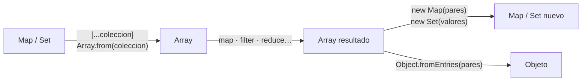
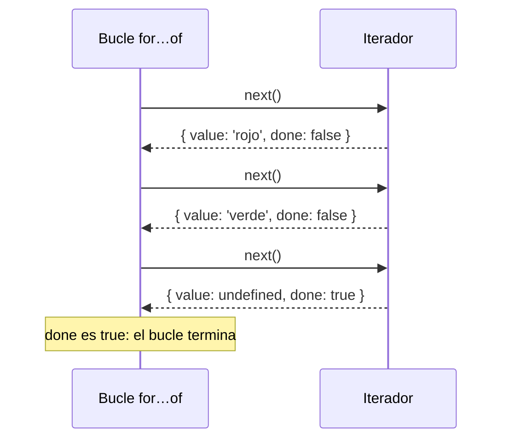
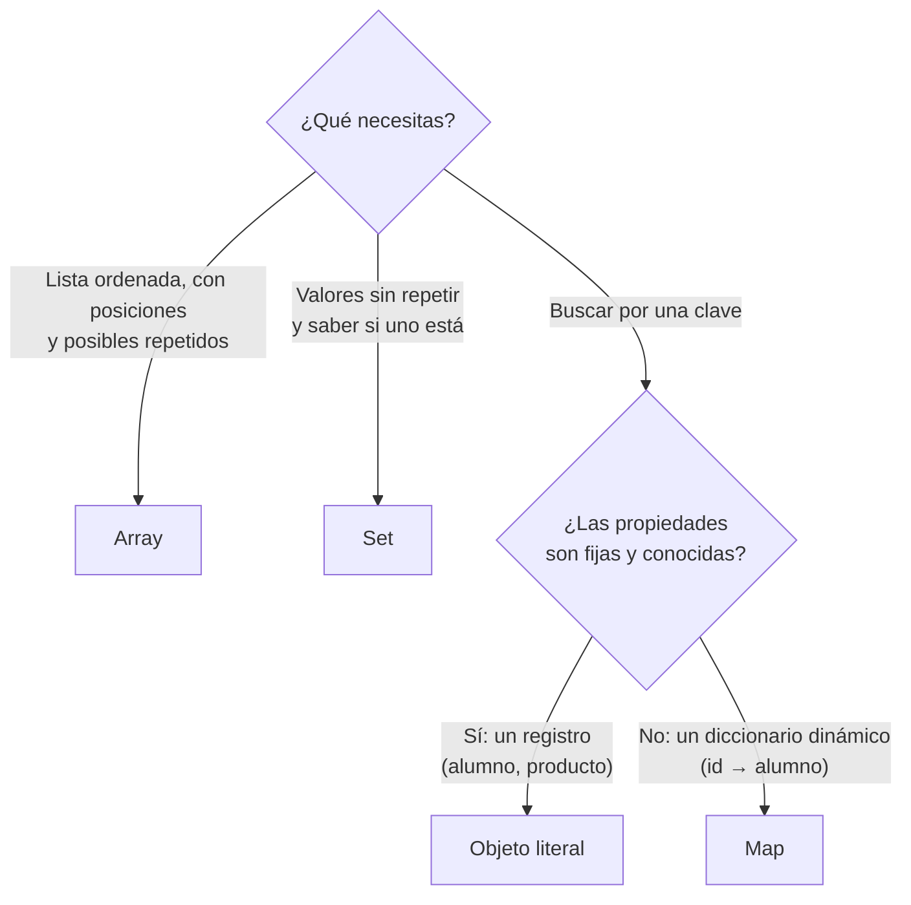

# 5. Colecciones: Map, Set e iterables

[⬅️ Volver a la unidad](./README.md)

## Índice

- [5.1. Más allá de los arrays](#51-más-allá-de-los-arrays)
- [5.2. `Map`: diccionarios de clave y valor](#52-map-diccionarios-de-clave-y-valor)
  - [5.2.1. Crear y usar un `Map`](#521-crear-y-usar-un-map)
  - [5.2.2. Recorrer un `Map`](#522-recorrer-un-map)
  - [5.2.3. `Map` frente a objeto literal](#523-map-frente-a-objeto-literal)
- [5.3. `Set`: valores únicos](#53-set-valores-únicos)
  - [5.3.1. Crear y usar un `Set`](#531-crear-y-usar-un-set)
  - [5.3.2. Quitar duplicados](#532-quitar-duplicados)
  - [5.3.3. Operaciones de conjuntos](#533-operaciones-de-conjuntos)
- [5.4. `WeakMap` y `WeakSet`](#54-weakmap-y-weakset)
- [5.5. Operaciones agregadas con `Map` y `Set`](#55-operaciones-agregadas-con-map-y-set)
- [5.6. Iterables y protocolo de iteración](#56-iterables-y-protocolo-de-iteración)
  - [5.6.1. Qué es un iterable](#561-qué-es-un-iterable)
  - [5.6.2. Cómo funciona por dentro](#562-cómo-funciona-por-dentro)
  - [5.6.3. Hacer iterable un objeto propio](#563-hacer-iterable-un-objeto-propio)
- [5.7. Cuándo usar cada colección](#57-cuándo-usar-cada-colección)
- [5.8. Ejemplo integrador: control de asistencia](#58-ejemplo-integrador-control-de-asistencia)
- [Resumen](#resumen)
- [Ejercicios de reflexión](#ejercicios-de-reflexión)

> **CE que trabaja este tema:** RA4 c, e.

---

## 5.1. Más allá de los arrays

Los arrays son perfectos para **listas ordenadas** que recorres de principio a fin. Pero hay problemas en los que se quedan cortos:

- **Buscar por una clave**: "dame el alumno con DNI 12345678Z". Con un array hay que recorrerlo entero con `find`.
- **Evitar repetidos**: "lista de etiquetas sin duplicados". Con un array hay que comprobar `includes` antes de cada `push`.

Para eso JavaScript tiene dos **colecciones** más, introducidas en ES2015:

| Colección | Qué guarda | Pregunta que responde rápido |
|-----------|------------|------------------------------|
| **`Map`** | Pares **clave → valor** | ¿Qué valor tiene esta clave? |
| **`Set`** | **Valores únicos** | ¿Está este valor? |

> 📝 **Nota del Profesor**: Los arrays, `Map` y `Set` son **colecciones**, y todas son **iterables**: se recorren con `for…of` y se les aplican operaciones agregadas (convirtiéndolas en array cuando hace falta). El CE c habla de "matrices (arrays)", pero entender cuándo un array **no** es la mejor estructura forma parte de conocer sus características.

---

## 5.2. `Map`: diccionarios de clave y valor

Un **`Map`** es como una agenda: buscas por el nombre (la **clave**) y obtienes el teléfono (el **valor**). Cada clave aparece **una sola vez**.

### 5.2.1. Crear y usar un `Map`

```js
const telefonos = new Map();

telefonos.set('Ana', '600111222');      // añadir
telefonos.set('Luis', '600333444');
telefonos.set('Ana', '699999999');      // misma clave: se sustituye el valor

console.log(telefonos.get('Ana'));      // '699999999'
console.log(telefonos.get('Pedro'));    // undefined: no existe
console.log(telefonos.has('Luis'));     // true
console.log(telefonos.size);            // 2

telefonos.delete('Luis');               // borrar
console.log(telefonos.size);            // 1

// Crear con datos iniciales: un array de pares [clave, valor]
const precios = new Map([
  ['café', 1.2],
  ['té', 1.1],
  ['zumo', 2.5],
]);
console.log(precios.get('zumo'));       // 2.5
```

| Método / propiedad | Qué hace | Devuelve |
|--------------------|----------|----------|
| `set(clave, valor)` | Añade o sustituye | El propio `Map` (se puede encadenar) |
| `get(clave)` | Lee el valor | El valor o `undefined` |
| `has(clave)` | ¿Existe la clave? | `boolean` |
| `delete(clave)` | Borra la entrada | `true` si existía |
| `clear()` | Vacía el `Map` | `undefined` |
| `size` | Número de entradas (propiedad, sin paréntesis) | `number` |

Las **claves pueden ser de cualquier tipo**: números, booleanos e incluso objetos.

```js
const ana = { nombre: 'Ana' };
const notasPorAlumno = new Map();
notasPorAlumno.set(ana, [7, 8.5]);          // un objeto como clave
console.log(notasPorAlumno.get(ana));       // [ 7, 8.5 ]
console.log(notasPorAlumno.get({ nombre: 'Ana' })); // undefined: es OTRO objeto
```

> ⚠️ **Cuidado**: Con objetos como clave, `Map` compara **referencias** (como `===`, tema 3). Un objeto con el mismo contenido pero creado aparte es otra clave.

### 5.2.2. Recorrer un `Map`

Un `Map` **recuerda el orden de inserción** y se recorre con `for…of`. Cada elemento es un par `[clave, valor]`:

```js
const stock = new Map([
  ['teclado', 4],
  ['ratón', 0],
  ['monitor', 2],
]);

for (const [producto, unidades] of stock) {
  console.log(`${producto}: ${unidades}`);
}

console.log([...stock.keys()]);    // [ 'teclado', 'ratón', 'monitor' ]
console.log([...stock.values()]);  // [ 4, 0, 2 ]
console.log([...stock.entries()]); // [ [ 'teclado', 4 ], [ 'ratón', 0 ], [ 'monitor', 2 ] ]
```

`keys()`, `values()` y `entries()` devuelven **iteradores** (apartado 5.6), no arrays: por eso se despliegan con `[...]` para mostrarlos o para usar `map` y `filter`.

### 5.2.3. `Map` frente a objeto literal

Un objeto literal `{}` también guarda pares clave-valor. ¿Cuándo usar cada uno?

| | Objeto literal `{}` | `Map` |
|---|---|---|
| Tipo de las claves | Solo textos (y símbolos); los números se convierten a texto | **Cualquier** tipo |
| Número de entradas | `Object.keys(obj).length` | `map.size` |
| Orden | Casi siempre el de inserción, con excepciones (las claves numéricas van primero) | **Siempre** el de inserción |
| Recorrer | `Object.entries(obj)` | Directamente con `for…of` |
| Claves heredadas | Puede tener claves "de serie" (`toString`, `constructor`) | Ninguna |
| Añadir y borrar a menudo | Más lento | Optimizado para ello |
| Pasar a JSON | Directo con `JSON.stringify` | Hay que convertirlo antes |
| Uso típico | **Registros** con propiedades fijas: un alumno, un producto | **Diccionarios** dinámicos: id → alumno, palabra → frecuencia |

```js
// Registro: un objeto con propiedades conocidas
const alumno = { nombre: 'Ana', curso: '2DAW', nota: 7 };

// Diccionario: claves que no conoces de antemano y que cambian
const alumnosPorDni = new Map();
alumnosPorDni.set('12345678Z', alumno);
```

> 💡 **Tip del Examinador**: "¿Qué ventajas tiene `Map` frente a un objeto?" → Admite claves de cualquier tipo, mantiene siempre el orden de inserción, tiene `size`, se recorre directamente con `for…of`, no tiene claves heredadas y está optimizado para añadir y borrar entradas con frecuencia.

---

## 5.3. `Set`: valores únicos

Un **`Set`** (conjunto) guarda valores **sin repetir**. Si añades un valor que ya está, no pasa nada: se ignora.

### 5.3.1. Crear y usar un `Set`

```js
const etiquetas = new Set();

etiquetas.add('javascript');
etiquetas.add('web');
etiquetas.add('javascript'); // ya estaba: se ignora

console.log(etiquetas.size);           // 2
console.log(etiquetas.has('web'));     // true
etiquetas.delete('web');
console.log([...etiquetas]);           // [ 'javascript' ]

for (const etiqueta of new Set(['a', 'b', 'a', 'c'])) {
  console.log(etiqueta);               // a, b, c (orden de inserción)
}
```

| Método / propiedad | Qué hace |
|--------------------|----------|
| `add(valor)` | Añade (si no estaba) y devuelve el `Set` |
| `has(valor)` | ¿Está el valor? |
| `delete(valor)` | Lo quita |
| `clear()` | Vacía el conjunto |
| `size` | Número de elementos |

`Set` decide si dos valores son iguales como `===` (salvo que considera `NaN` igual a `NaN`). Con objetos, compara **referencias**.

### 5.3.2. Quitar duplicados

El uso más frecuente de `Set` es quitar los repetidos de un array en una línea:

```js
const pedidos = [2, 3, 3, 5, 2, 7];
const distintos = [...new Set(pedidos)];
console.log(distintos); // [ 2, 3, 5, 7 ]

const visitas = ['ana', 'luis', 'ana', 'eva', 'luis'];
console.log(new Set(visitas).size); // 3 visitantes distintos
```

> ✅ **Buena práctica**: Para comprobar si un valor pertenece a una lista larga muchas veces, convierte la lista en un `Set`: `conjunto.has(valor)` es mucho más rápido que `array.includes(valor)` cuando hay miles de elementos, porque no recorre la colección.

### 5.3.3. Operaciones de conjuntos

Los navegadores actuales y Node.js (desde la versión 22) incluyen las operaciones clásicas de conjuntos (ES2025):

```js
const dwec = new Set(['Ana', 'Luis', 'Marta']);
const dwes = new Set(['Luis', 'Marta', 'Pablo']);

console.log([...dwec.union(dwes)]);        // [ 'Ana', 'Luis', 'Marta', 'Pablo' ]: en alguno
console.log([...dwec.intersection(dwes)]); // [ 'Luis', 'Marta' ]: en los dos
console.log([...dwec.difference(dwes)]);   // [ 'Ana' ]: en DWEC pero no en DWES
console.log(dwec.isSubsetOf(dwes));        // false
```

Si un proyecto tiene que funcionar en entornos más antiguos, se hacen con `filter`:

```js
const comunes = [...dwec].filter((alumno) => dwes.has(alumno)); // intersección
```

---

## 5.4. `WeakMap` y `WeakSet`

`WeakMap` y `WeakSet` son versiones "débiles" de `Map` y `Set`:

- Sus claves (en `WeakMap`) o sus valores (en `WeakSet`) tienen que ser **objetos**.
- **No impiden** que el recolector de basura libere esos objetos: si el objeto deja de usarse en el resto del programa, su entrada desaparece sola.
- Por eso **no se pueden recorrer** ni tienen `size`: su contenido puede cambiar en cualquier momento.

```js
const visitasPorBoton = new WeakMap();

let boton = { id: 'comprar' }; // en la UD5 será un elemento del DOM
visitasPorBoton.set(boton, 0);
visitasPorBoton.set(boton, visitasPorBoton.get(boton) + 1);
console.log(visitasPorBoton.get(boton)); // 1

boton = null; // ya nadie usa el objeto: su entrada se liberará automáticamente
```

Sirven para asociar datos a objetos **sin alargar su vida**: datos extra de elementos del DOM, cachés por objeto o datos privados de una clase.

> 📝 **Nota del Profesor**: En este curso los usarás poco. Lo importante es saber que existen, que solo admiten objetos como clave y que no se pueden recorrer. Para datos privados de una clase verás una solución mejor: los campos privados `#` (tema 7).

---

## 5.5. Operaciones agregadas con `Map` y `Set`

`Map` y `Set` tienen `forEach`, pero no `map`, `filter` ni `reduce`. La forma de aplicarles operaciones agregadas es **convertirlos en array**, operar y, si hace falta, **volver a convertir**:

```js
const precios = new Map([
  ['café', 1.2],
  ['té', 1.1],
  ['zumo', 2.5],
  ['batido', 3],
]);

// Map → array de pares → filtrar → Map nuevo
const caros = new Map([...precios].filter(([, precio]) => precio > 2));
console.log([...caros.keys()]); // [ 'zumo', 'batido' ]

// Map → valores → reducir
const media = [...precios.values()].reduce((s, p) => s + p, 0) / precios.size;
console.log(media.toFixed(2)); // '1.95'

// Map → objeto (por ejemplo, para JSON) y al revés
const comoObjeto = Object.fromEntries(precios);
console.log(comoObjeto); // { 'café': 1.2, 'té': 1.1, zumo: 2.5, batido: 3 }
const otraVez = new Map(Object.entries(comoObjeto));
console.log(otraVez.size); // 4

// Agrupar directamente en un Map
const productos = ['café', 'té', 'zumo', 'batido'];
const porInicial = Map.groupBy(productos, (p) => p[0]);
console.log(porInicial.get('t')); // [ 'té' ]
```



El diagrama resume el camino: de la colección a un array, operaciones agregadas y, si se necesita, de vuelta a una colección o a un objeto.

> 📝 **Nota del Profesor**: Las versiones más recientes de JavaScript añaden **ayudantes de iteradores** (`map`, `filter`, `take`… directamente sobre `stock.values()`), disponibles en Node.js 22 y en los navegadores actuales. Si los ves, hacen lo mismo sin crear el array intermedio. En este curso se usa la conversión a array, que funciona en todas partes.

---

## 5.6. Iterables y protocolo de iteración

### 5.6.1. Qué es un iterable

Un **iterable** es cualquier objeto que se puede **recorrer elemento a elemento**. Todos los iterables funcionan con:

- `for…of`
- El operador _spread_ `[...iterable]`
- `Array.from(iterable)`
- La desestructuración `const [a, b] = iterable`
- Los constructores `new Map(iterable)` y `new Set(iterable)`

| Estructura | ¿Iterable? | Qué produce al recorrerla |
|------------|:---:|---------------------------|
| `Array` | ✅ | Sus elementos |
| `String` | ✅ | Sus caracteres |
| `Map` | ✅ | Pares `[clave, valor]` |
| `Set` | ✅ | Sus valores |
| `NodeList` del DOM (UD5) | ✅ | Los nodos |
| `arguments` (código heredado) | ✅ | Los argumentos |
| Objeto literal `{}` | ❌ | Se recorre con `Object.entries(obj)` |

```js
const [primera, segunda] = 'DWEC';
console.log(primera, segunda); // D W

const objeto = { a: 1 };
for (const x of objeto) {} // ❌ TypeError: objeto is not iterable
```

### 5.6.2. Cómo funciona por dentro

Un objeto es iterable si tiene un método con la clave especial **`Symbol.iterator`**. Ese método devuelve un **iterador**: un objeto con un método `next()` que, en cada llamada, devuelve `{ value, done }`.

```js
const colores = ['rojo', 'verde'];
const iterador = colores[Symbol.iterator]();

console.log(iterador.next()); // { value: 'rojo', done: false }
console.log(iterador.next()); // { value: 'verde', done: false }
console.log(iterador.next()); // { value: undefined, done: true }
```



El diagrama muestra lo que hace `for…of` por debajo: pide el siguiente valor hasta que el iterador responde `done: true`. Este acuerdo entre quien recorre y quien produce los valores es el **protocolo de iteración**.

### 5.6.3. Hacer iterable un objeto propio

Si tu objeto implementa `Symbol.iterator`, funciona con `for…of`, _spread_ y todo lo demás. La forma más sencilla es con una **función generadora** (`function*`), que produce valores con `yield`:

```js
const rango = {
  desde: 1,
  hasta: 5,
  *[Symbol.iterator]() {
    for (let n = this.desde; n <= this.hasta; n++) {
      yield n; // produce un valor y se pausa hasta el siguiente next()
    }
  },
};

console.log([...rango]);  // [ 1, 2, 3, 4, 5 ]
for (const n of rango) console.log(n);
```

> 📝 **Nota del Profesor**: Los generadores (`function*` y `yield`) son **Ampliación**: basta con reconocerlos. Lo que sí debes saber es qué es un iterable, qué lo es y qué no, y que `for…of`, el _spread_ y `Array.from` funcionan con cualquiera de ellos. Angular (UD8) recorre iterables en sus plantillas con `@for`.

> 💡 **Tip del Examinador**: "¿Por qué `for…of` funciona con un `Map` y no con un objeto literal?" → Porque `Map` implementa el protocolo de iteración (tiene el método `Symbol.iterator`) y los objetos literales no. Un objeto se recorre con `for…in` o con `Object.entries`.

---

## 5.7. Cuándo usar cada colección



El diagrama es una guía rápida: primero decide si necesitas orden, unicidad o búsqueda por clave.

| Necesidad | Colección | Ejemplo |
|-----------|-----------|---------|
| Lista con orden y repetidos | `Array` | Notas de un examen, líneas de un pedido |
| Valores únicos | `Set` | Etiquetas, visitantes distintos, pedidos ya procesados |
| Datos de **una** entidad | Objeto literal | `{ nombre, curso, nota }` |
| Buscar entidades por un identificador | `Map` | `dni → alumno`, `codigo → producto` |
| Contar apariciones | `Map` (u objeto) | `palabra → frecuencia` |
| Datos extra asociados a objetos, sin retenerlos | `WeakMap` | Elemento del DOM → datos |

> ✅ **Buena práctica**: Lo habitual es **combinarlas**: un array de objetos para la lista principal, un `Map` como índice para buscar por clave y un `Set` para controlar lo que ya se ha procesado.

---

## 5.8. Ejemplo integrador: control de asistencia

Un profesor registra quién entra a clase cada día. Necesita saber cuántos alumnos distintos han venido, quién falta, cuántas asistencias tiene cada uno y quién ha venido todos los días.

```js
// asistencia.js (módulo)
const matriculados = new Map([
  ['a01', 'Ana'],
  ['a02', 'Luis'],
  ['a03', 'Marta'],
  ['a04', 'Pablo'],
]);

// Registros de entrada: puede haber repetidos (alguien ficha dos veces)
const registros = [
  { dia: 'lunes', alumno: 'a01' },
  { dia: 'lunes', alumno: 'a02' },
  { dia: 'lunes', alumno: 'a01' },
  { dia: 'martes', alumno: 'a01' },
  { dia: 'martes', alumno: 'a03' },
  { dia: 'miércoles', alumno: 'a01' },
  { dia: 'miércoles', alumno: 'a02' },
  { dia: 'miércoles', alumno: 'a03' },
];

// Set: días con clase (sin repetidos)
const dias = new Set(registros.map((r) => r.dia));

// Map de Set: qué alumnos distintos vinieron cada día
const presentesPorDia = new Map();
for (const { dia, alumno } of registros) {
  if (!presentesPorDia.has(dia)) presentesPorDia.set(dia, new Set());
  presentesPorDia.get(dia).add(alumno); // el Set ignora los fichajes dobles
}

// Map: asistencias de cada alumno (contador)
const asistencias = new Map([...matriculados.keys()].map((id) => [id, 0]));
for (const presentes of presentesPorDia.values()) {
  for (const id of presentes) asistencias.set(id, asistencias.get(id) + 1);
}

const nombre = (id) => matriculados.get(id);
const vinieronAlguna = new Set([...presentesPorDia.values()].flatMap((s) => [...s]));
const nuncaVinieron = [...matriculados.keys()].filter((id) => !vinieronAlguna.has(id));
const todosLosDias = [...asistencias].filter(([, n]) => n === dias.size).map(([id]) => nombre(id));

console.log(`📅 Días con clase: ${[...dias].join(', ')}`);
for (const [dia, presentes] of presentesPorDia) {
  console.log(`  ${dia}: ${[...presentes].map(nombre).join(', ')}`);
}
console.log(`👥 Alumnos distintos que han venido: ${vinieronAlguna.size} de ${matriculados.size}`);
for (const [id, n] of asistencias) {
  console.log(`  ${nombre(id)}: ${n}/${dias.size}`);
}
console.log(`🚫 No han venido nunca: ${nuncaVinieron.map(nombre).join(', ')}`);
console.log(`⭐ Han venido todos los días: ${todosLosDias.join(', ')}`);
```

```text
// Salida:
📅 Días con clase: lunes, martes, miércoles
  lunes: Ana, Luis
  martes: Ana, Marta
  miércoles: Ana, Luis, Marta
👥 Alumnos distintos que han venido: 3 de 4
  Ana: 3/3
  Luis: 2/3
  Marta: 2/3
  Pablo: 0/3
🚫 No han venido nunca: Pablo
⭐ Han venido todos los días: Ana
```

| Estructura | Para qué |
|------------|----------|
| `Map` `matriculados` | Buscar el nombre por identificador |
| `Set` `dias` | Días sin repetir y su número (`size`) |
| `Map` de `Set` `presentesPorDia` | Alumnos distintos de cada día, aunque fichen dos veces |
| `Map` `asistencias` | Contador por alumno, en el orden de matrícula |
| Operaciones agregadas | `map`, `flatMap` y `filter` sobre las colecciones convertidas en array |

---

## Resumen

- **`Map`** guarda pares **clave → valor** con claves de cualquier tipo, en orden de inserción: `set`, `get`, `has`, `delete`, `size`.
- Usa **objetos** para registros con propiedades fijas y **`Map`** para diccionarios dinámicos.
- **`Set`** guarda **valores únicos**: `add`, `has`, `delete`, `size`. `[...new Set(array)]` quita duplicados.
- `union`, `intersection` y `difference` hacen operaciones de conjuntos.
- **`WeakMap`** y **`WeakSet`** solo admiten objetos, no los retienen en memoria y no se pueden recorrer.
- Para aplicar **operaciones agregadas** a `Map` y `Set`, se convierten en array (`[...coleccion]`) y, si hace falta, se vuelven a convertir.
- Un **iterable** implementa `Symbol.iterator`, que devuelve un iterador con `next()` → `{ value, done }`. Arrays, textos, `Map` y `Set` lo son; los objetos literales, no.
- Lo habitual es **combinar** colecciones: array para la lista, `Map` como índice y `Set` para los únicos.

## Ejercicios de reflexión

1. ¿Qué colección usarías para cada caso y por qué? (a) Las canciones de una lista de reproducción, que pueden repetirse. (b) Los usuarios conectados a un chat. (c) El precio de cada producto a partir de su código. (d) La ficha de un único producto.
2. ¿Qué muestra `new Set([1, '1', 1, NaN, NaN]).size`? Compruébalo y explícalo.
3. Explica qué ventajas tiene `new Map([['1', 'a']])` frente a `{ 1: 'a' }` si las claves fueran números de pedido. ¿Qué pasa con la clave numérica en el objeto?
4. ¿Por qué `WeakMap` no tiene `size` ni se puede recorrer con `for…of`?
5. Escribe en una línea cómo obtener el número de palabras distintas de una frase, sin distinguir mayúsculas.

---

[⬅️ Volver a la unidad](./README.md)
