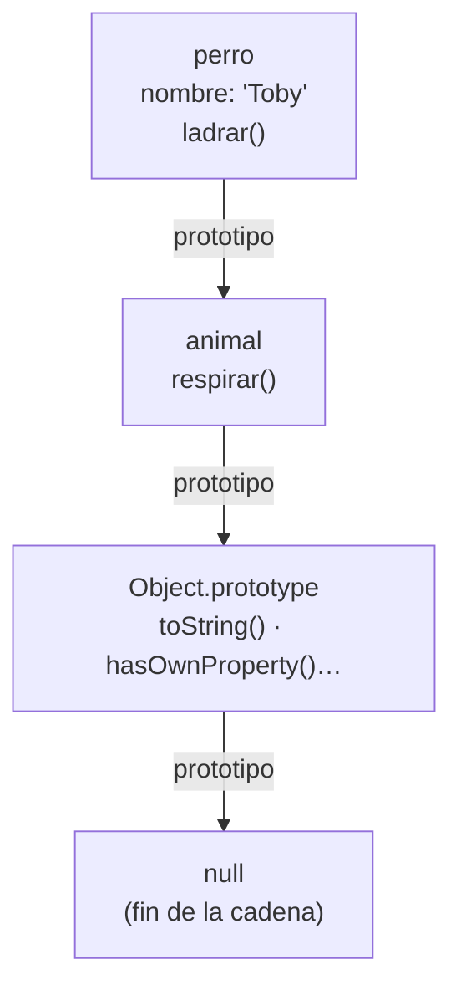
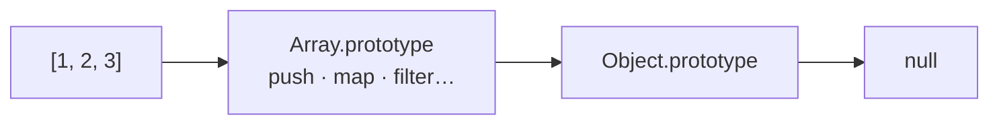
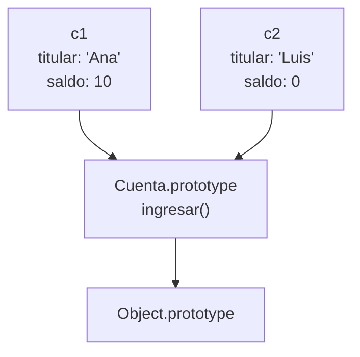

# 6. Objetos y prototipos

[⬅️ Volver a la unidad](./README.md)

## Índice

- [6.1. Orientación a objetos en JavaScript](#61-orientación-a-objetos-en-javascript)
  - [6.1.1. Conceptos de la orientación a objetos](#611-conceptos-de-la-orientación-a-objetos)
  - [6.1.2. Las características de JavaScript](#612-las-características-de-javascript)
- [6.2. Objetos literales](#62-objetos-literales)
  - [6.2.1. Crear un objeto y acceder a sus propiedades](#621-crear-un-objeto-y-acceder-a-sus-propiedades)
  - [6.2.2. Añadir, modificar, borrar y comprobar propiedades](#622-añadir-modificar-borrar-y-comprobar-propiedades)
  - [6.2.3. Atajos de sintaxis](#623-atajos-de-sintaxis)
- [6.3. Métodos y `this`](#63-métodos-y-this)
  - [6.3.1. Definir métodos](#631-definir-métodos)
  - [6.3.2. Qué vale `this`](#632-qué-vale-this)
  - [6.3.3. `this` en las funciones flecha](#633-this-en-las-funciones-flecha)
- [6.4. Propiedades calculadas: _getters_ y _setters_](#64-propiedades-calculadas-getters-y-setters)
- [6.5. Recorrer, copiar y comparar objetos](#65-recorrer-copiar-y-comparar-objetos)
- [6.6. Proteger un objeto: `Object.freeze`](#66-proteger-un-objeto-objectfreeze)
- [6.7. Crear muchos objetos iguales](#67-crear-muchos-objetos-iguales)
  - [6.7.1. Funciones fábrica](#671-funciones-fábrica)
  - [6.7.2. Funciones constructoras y `new`](#672-funciones-constructoras-y-new)
- [6.8. Prototipos y cadena de prototipos](#68-prototipos-y-cadena-de-prototipos)
  - [6.8.1. Qué es un prototipo](#681-qué-es-un-prototipo)
  - [6.8.2. La cadena de prototipos](#682-la-cadena-de-prototipos)
  - [6.8.3. Métodos compartidos en el prototipo](#683-métodos-compartidos-en-el-prototipo)
- [6.9. Ejemplo integrador: carrito de la compra](#69-ejemplo-integrador-carrito-de-la-compra)
- [Resumen](#resumen)
- [Ejercicios de reflexión](#ejercicios-de-reflexión)

> **CE que trabaja este tema:** RA4 f, g, h, i.

---

## 6.1. Orientación a objetos en JavaScript

Hasta ahora has guardado datos en variables y arrays, y has escrito funciones que trabajan con ellos. Pero en un programa real, los datos y las operaciones van juntos: una **cuenta bancaria** tiene un titular y un saldo (datos), y se puede ingresar o retirar dinero (operaciones).

La **programación orientada a objetos** (POO) organiza el código en **objetos** que agrupan **datos** (propiedades) y **comportamiento** (métodos).

```js
const cuenta = {
  titular: 'Ana',             // propiedad
  saldo: 100,                 // propiedad
  ingresar(importe) {         // método
    this.saldo += importe;
  },
};

cuenta.ingresar(50);
console.log(cuenta.saldo); // 150
```

### 6.1.1. Conceptos de la orientación a objetos

| Concepto | Qué es | En JavaScript |
|----------|--------|---------------|
| **Objeto** | Entidad con estado (datos) y comportamiento (operaciones) | Cualquier valor que no es primitivo: `{}`, arrays, funciones… |
| **Propiedad** | Dato de un objeto | `cuenta.saldo` |
| **Método** | Función de un objeto | `cuenta.ingresar(50)` |
| **Clase** | Plantilla para crear objetos con la misma estructura | `class CuentaBancaria { … }` (tema 7) |
| **Instancia** | Objeto creado a partir de una clase | `new CuentaBancaria('Ana')` |
| **Encapsulación** | Ocultar los datos internos y exponer solo las operaciones | Closures (tema 2) y campos privados `#` (tema 7) |
| **Herencia** | Un tipo de objeto reutiliza y amplía otro | Prototipos (este tema) y `extends` (tema 7) |
| **Polimorfismo** | Objetos distintos responden al mismo mensaje cada uno a su manera | Sobrescribir métodos (tema 7) |
| **Abstracción** | Usar un objeto por lo que hace, sin conocer cómo lo hace | Interfaz pública de métodos |

### 6.1.2. Las características de JavaScript

JavaScript es orientado a objetos, pero **no como Java o C#**. Estas son sus características propias:

| Característica | JavaScript | Java |
|----------------|------------|------|
| **Base de la herencia** | **Prototipos**: un objeto hereda directamente de otro objeto | Clases |
| **Clases** | Desde ES2015, como **sintaxis** sobre los prototipos | Elemento central del lenguaje |
| **Crear objetos sin clase** | ✅ Con literales `{}` | ❌ Siempre hace falta una clase |
| **Estructura de un objeto** | **Dinámica**: se pueden añadir y borrar propiedades en cualquier momento | Fija, definida por la clase |
| **Tipado** | Dinámico: no se declara el tipo de las propiedades | Estático |
| **Funciones** | Son objetos (tienen propiedades y se pasan como valores) | Los métodos no son objetos |
| **Privacidad** | Closures y campos `#` (ES2022) | `private`, `protected`, `public` |
| **Herencia múltiple** | ❌ (una cadena de prototipos), se compensa con composición | ❌ (solo de interfaces) |

> 📝 **Nota del Profesor**: Casi todo en JavaScript es un objeto o se comporta como tal: los arrays, las funciones, las fechas, los `Map`… Incluso los primitivos (`'hola'.toUpperCase()`) se envuelven temporalmente en un objeto para poder llamar a sus métodos (lo verás en la UD4). Entender los objetos es entender el lenguaje.

> 💡 **Tip del Examinador**: "¿Qué tipo de herencia tiene JavaScript?" → Herencia **basada en prototipos**: cada objeto tiene un enlace a otro objeto (su prototipo) del que hereda propiedades y métodos. Las clases de ES2015 son una sintaxis más cómoda sobre ese mismo mecanismo.

---

## 6.2. Objetos literales

### 6.2.1. Crear un objeto y acceder a sus propiedades

Un **objeto literal** se escribe entre llaves con pares `clave: valor` separados por comas. Es la forma más directa de crear un objeto, sin necesidad de clases.

```js
const libro = {
  titulo: 'Rayuela',
  autor: 'Julio Cortázar',
  paginas: 600,
  disponible: true,
  'año publicación': 1963,        // clave con espacio: entre comillas
  editorial: { nombre: 'Sudamericana', pais: 'Argentina' }, // objeto anidado
};

console.log(libro.titulo);              // 'Rayuela' (notación punto)
console.log(libro['autor']);            // 'Julio Cortázar' (notación corchetes)
console.log(libro['año publicación']);  // 1963: solo con corchetes
console.log(libro.editorial.pais);      // 'Argentina'
console.log(libro.isbn);                // undefined: no existe
console.log(libro.premio?.nombre);      // undefined: ?. evita el error (UD2)
```

| Notación | Ejemplo | Cuándo |
|----------|---------|--------|
| **Punto** | `libro.titulo` | Casi siempre: la clave es un nombre válido y la conoces al escribir el código |
| **Corchetes** | `libro['titulo']`, `libro[clave]` | La clave tiene espacios o guiones, o está en una **variable** |

```js
const campo = 'paginas';
console.log(libro[campo]); // 600: la clave se calcula al ejecutar
console.log(libro.campo);  // undefined: busca una propiedad llamada "campo"
```

### 6.2.2. Añadir, modificar, borrar y comprobar propiedades

La estructura de un objeto es **dinámica**:

```js
const alumno = { nombre: 'Luis' };

alumno.curso = '2DAW';         // añadir
alumno.nombre = 'Luis Pérez';  // modificar
delete alumno.curso;           // borrar

console.log('nombre' in alumno);          // true: la propiedad existe
console.log(Object.hasOwn(alumno, 'curso')); // false
console.log(alumno);                      // { nombre: 'Luis Pérez' }
```

| Comprobación | Qué mira |
|--------------|----------|
| `'clave' in objeto` | Si existe la propiedad, **propia o heredada** del prototipo |
| `Object.hasOwn(objeto, 'clave')` | Si existe como propiedad **propia** del objeto (ES2022) |
| `objeto.clave !== undefined` | Si tiene un valor distinto de `undefined` (falla si la propiedad existe y vale `undefined`) |

> ✅ **Buena práctica**: Aunque se puede, evita añadir y borrar propiedades sobre la marcha: define todas las propiedades al crear el objeto (con `null` si aún no tienen valor). Así todos los objetos del mismo tipo tienen la misma forma, el código es más predecible y el motor los optimiza mejor.

### 6.2.3. Atajos de sintaxis

```js
const nombre = 'Ana';
const nota = 8;

// Propiedades abreviadas: si la variable se llama como la clave
const alumno = { nombre, nota };        // igual que { nombre: nombre, nota: nota }

// Claves calculadas: la clave sale de una expresión
const campo = 'curso';
const ficha = { [campo]: '2DAW', [`${campo}Anterior`]: '1DAW' };
console.log(ficha); // { curso: '2DAW', cursoAnterior: '1DAW' }

// Spread: copiar y ampliar o sobrescribir
const conCurso = { ...alumno, curso: '2DAW' };
const aprobado = { ...alumno, nota: 5 }; // las propiedades posteriores ganan
console.log(conCurso); // { nombre: 'Ana', nota: 8, curso: '2DAW' }
console.log(aprobado); // { nombre: 'Ana', nota: 5 }

// Desestructuración (UD2) con renombrado, valor por defecto y rest
const { nombre: alias, curso = 'sin curso', ...resto } = { nombre: 'Eva', nota: 9, edad: 20 };
console.log(alias, curso, resto); // Eva sin curso { nota: 9, edad: 20 }
```

---

## 6.3. Métodos y `this`

### 6.3.1. Definir métodos

Un **método** es una propiedad cuyo valor es una función. Se escribe con la **sintaxis abreviada** de métodos:

```js
const calculadora = {
  marca: 'Casio',
  sumar(a, b) {             // sintaxis abreviada (la habitual)
    return a + b;
  },
  restar: function (a, b) { // forma antigua, equivalente
    return a - b;
  },
};

console.log(calculadora.sumar(2, 3));  // 5
console.log(calculadora.restar(5, 1)); // 4
```

### 6.3.2. Qué vale `this`

Dentro de un método, **`this`** es el **objeto sobre el que se ha llamado** al método: el que está a la izquierda del punto. Así el método puede leer y modificar las propiedades de su objeto.

```js
const contador = {
  valor: 0,
  incrementar() {
    this.valor++;      // this es contador
    return this.valor;
  },
};

contador.incrementar();
contador.incrementar();
console.log(contador.valor); // 2
```

La regla clave: **`this` no depende de dónde se escribe el método, sino de cómo se llama**. Si separas el método de su objeto, `this` se pierde:

```js
const incrementarSuelto = contador.incrementar;
incrementarSuelto(); // ❌ TypeError: Cannot read properties of undefined (reading 'valor')
```

Al llamar `incrementarSuelto()` no hay nada a la izquierda del punto, así que en modo estricto (módulos) `this` es `undefined`.

| Cómo se llama | Qué vale `this` |
|---------------|-----------------|
| `objeto.metodo()` | `objeto` |
| `funcion()` suelta (módulo o modo estricto) | `undefined` |
| `new Constructor()` | El objeto nuevo (apartado 6.7.2 y tema 7) |
| Función flecha | El `this` del código que la rodea |
| Manejador de eventos (UD6) | El elemento que recibe el evento |

> ⚠️ **Cuidado**: El caso más habitual de `this` perdido es pasar un método como **callback**: `setTimeout(contador.incrementar, 1000)` o `boton.addEventListener('click', contador.incrementar)`. La solución es envolverlo en una flecha: `setTimeout(() => contador.incrementar(), 1000)`.

### 6.3.3. `this` en las funciones flecha

Las funciones flecha **no tienen su propio `this`**: usan el del código donde están escritas. Eso tiene dos consecuencias:

```js
const temporizador = {
  segundos: 0,

  // ❌ Un método escrito como flecha: this NO es el objeto
  reiniciarMal: () => {
    this.segundos = 0; // this es el del módulo (undefined): TypeError
  },

  // ✅ Una flecha DENTRO de un método: usa el this del método
  contarTres() {
    [1, 2, 3].forEach(() => {
      this.segundos++; // this es temporizador
    });
    return this.segundos;
  },
};

console.log(temporizador.contarTres()); // 3
```

> ✅ **Buena práctica**: Los **métodos**, con la sintaxis abreviada `metodo() {}`. Los **callbacks dentro de métodos**, con flechas, para que conserven el `this` del método.

> 💡 **Tip del Examinador**: "¿Por qué no se debe definir un método con una función flecha?" → Porque las flechas no tienen `this` propio: toman el del ámbito exterior, no el objeto sobre el que se llama el método.

---

## 6.4. Propiedades calculadas: _getters_ y _setters_

Un **_getter_** (`get`) es un método que se usa **como si fuera una propiedad**: se lee sin paréntesis y su valor se calcula al leerlo. Un **_setter_** (`set`) se ejecuta al **asignar** un valor, y permite validarlo.

```js
const rectangulo = {
  ancho: 4,
  alto: 3,

  get area() {              // propiedad calculada: siempre al día
    return this.ancho * this.alto;
  },

  set dimensiones(texto) {  // '5x2' → ancho 5, alto 2
    const [ancho, alto] = texto.split('x').map(Number);
    if (!(ancho > 0 && alto > 0)) throw new Error(`Dimensiones no válidas: ${texto}`);
    this.ancho = ancho;
    this.alto = alto;
  },
};

console.log(rectangulo.area);   // 12 (sin paréntesis)
rectangulo.ancho = 10;
console.log(rectangulo.area);   // 30: se recalcula
rectangulo.dimensiones = '5x2'; // llama al setter
console.log(rectangulo.area);   // 10
```

- Un _getter_ sin _setter_ es una propiedad de **solo lectura**: asignarle un valor da error en modo estricto.
- Úsalos para valores **derivados** de otros (área, total, nombre completo) y para **validar** asignaciones.

Los usarás sobre todo en las clases (tema 7).

---

## 6.5. Recorrer, copiar y comparar objetos

```js
const producto = { nombre: 'Teclado', precio: 25, stock: 4 };

// Recorrer
for (const clave in producto) {
  console.log(`${clave}: ${producto[clave]}`);
}
console.log(Object.keys(producto));    // [ 'nombre', 'precio', 'stock' ]
console.log(Object.values(producto));  // [ 'Teclado', 25, 4 ]
for (const [clave, valor] of Object.entries(producto)) {
  console.log(`${clave} = ${valor}`);
}
```

Como los arrays, los objetos se asignan, se pasan y se comparan **por referencia** (tema 3):

```js
const a = { x: 1 };
const b = a;              // misma referencia
const c = { ...a };       // copia superficial
const d = structuredClone({ x: 1, punto: { y: 2 } }); // copia profunda

b.x = 99;
console.log(a.x);                 // 99
console.log(c.x);                 // 1
console.log({ x: 1 } === { x: 1 }); // false: objetos distintos
```

> ⚠️ **Cuidado**: `for…in` recorre también las propiedades **heredadas** que sean enumerables (apartado 6.8). Con objetos literales no suele importar, pero `Object.keys`, `Object.values` y `Object.entries` solo devuelven las **propias**: son la opción más segura.

---

## 6.6. Proteger un objeto: `Object.freeze`

`const` impide reasignar la variable, pero no cambiar el objeto. Para que un objeto **no se pueda modificar**, se congela con `Object.freeze`:

```js
const CONFIG = Object.freeze({ iva: 21, moneda: 'EUR', envio: { gratisDesde: 50 } });

CONFIG.iva = 10;          // en un módulo: ❌ TypeError (modo estricto)
CONFIG.envio.gratisDesde = 0; // ✅ se permite: freeze es superficial
console.log(CONFIG.envio.gratisDesde); // 0
```

`Object.freeze` es **superficial**: congela las propiedades del objeto, pero no los objetos anidados. Es útil para constantes de configuración y para los objetos que hacen de **enumeración**:

```js
const ESTADOS = Object.freeze({ PENDIENTE: 'pendiente', ENVIADO: 'enviado', ENTREGADO: 'entregado' });
```

---

## 6.7. Crear muchos objetos iguales

¿Y si necesitas cien cuentas bancarias? Escribir cien literales con los mismos métodos no tiene sentido.

### 6.7.1. Funciones fábrica

Una **función fábrica** (*factory function*) es una función normal que **devuelve un objeto nuevo** cada vez que se llama:

```js
function crearCuenta(titular, saldoInicial = 0) {
  return {
    titular,
    saldo: saldoInicial,
    ingresar(importe) {
      this.saldo += importe;
      return this.saldo;
    },
  };
}

const cuentaAna = crearCuenta('Ana', 100);
const cuentaLuis = crearCuenta('Luis');
cuentaAna.ingresar(50);
console.log(cuentaAna.saldo, cuentaLuis.saldo); // 150 0
```

Combinada con un closure (tema 2), una fábrica puede tener datos **realmente privados**:

```js
function crearCuentaPrivada(titular) {
  let saldo = 0; // solo accesible desde los métodos: encapsulación
  return {
    titular,
    ingresar(importe) {
      saldo += importe;
    },
    consultar() {
      return saldo;
    },
  };
}

const cuenta = crearCuentaPrivada('Eva');
cuenta.ingresar(30);
console.log(cuenta.consultar()); // 30
console.log(cuenta.saldo);       // undefined: no se puede tocar desde fuera
```

### 6.7.2. Funciones constructoras y `new`

Antes de las clases (ES2015), la forma estándar era una **función constructora**: una función normal, con nombre en `PascalCase`, que se llama con **`new`**.

```js
function Producto(nombre, precio) {
  this.nombre = nombre;   // this es el objeto nuevo
  this.precio = precio;
}

const teclado = new Producto('Teclado', 25);
console.log(teclado);                       // Producto { nombre: 'Teclado', precio: 25 }
console.log(teclado instanceof Producto);   // true
```

`new` hace cuatro cosas:

1. Crea un objeto vacío.
2. Enlaza ese objeto con el **prototipo** de la función (`Producto.prototype`, apartado 6.8).
3. Ejecuta la función con `this` apuntando al objeto nuevo.
4. Devuelve el objeto (salvo que la función devuelva otro objeto).

> 📝 **Nota del Profesor**: Hoy no se escriben funciones constructoras: se usan **clases** (tema 7), que hacen lo mismo con una sintaxis más clara. Pero las verás en código heredado y en muchas explicaciones de Internet, y entenderlas te ayuda a saber qué hace una clase por dentro.

---

## 6.8. Prototipos y cadena de prototipos

### 6.8.1. Qué es un prototipo

Cada objeto de JavaScript tiene un enlace interno a **otro objeto**, su **prototipo**. Cuando lees una propiedad que el objeto **no tiene**, JavaScript la busca en su prototipo.

¿Te has preguntado de dónde salen `toString`, `hasOwnProperty` o `push` si nunca los has definido? Vienen del prototipo.

```js
const alumno = { nombre: 'Ana' };
console.log(alumno.toString()); // '[object Object]': alumno no tiene toString, lo hereda

console.log(Object.getPrototypeOf(alumno) === Object.prototype); // true
```

Puedes crear un objeto con el prototipo que quieras usando `Object.create`:

```js
const animal = {
  respirar() {
    return `${this.nombre} respira`;
  },
};

const perro = Object.create(animal); // el prototipo de perro es animal
perro.nombre = 'Toby';
perro.ladrar = function () {
  return `${this.nombre} dice guau`;
};

console.log(perro.ladrar());   // 'Toby dice guau' (propio)
console.log(perro.respirar()); // 'Toby respira' (heredado de animal)
console.log(Object.hasOwn(perro, 'respirar')); // false: no es suyo
console.log('respirar' in perro);              // true: lo encuentra en el prototipo
```

### 6.8.2. La cadena de prototipos

Un prototipo puede tener a su vez otro prototipo, y así sucesivamente. Esta secuencia de enlaces es la **cadena de prototipos** (*prototype chain*). Termina siempre en `Object.prototype`, cuyo prototipo es `null`.



El diagrama muestra la cadena de `perro`. Al buscar una propiedad, JavaScript sube por las flechas hasta encontrarla o llegar a `null`:

1. `perro.ladrar` → está en `perro`.
2. `perro.respirar` → no está en `perro`; sube a `animal` y la encuentra.
3. `perro.toString` → sube hasta `Object.prototype`.
4. `perro.volar` → recorre toda la cadena sin encontrarla: `undefined`.

Los arrays y las funciones también tienen su cadena:



Por eso todos los arrays comparten `push`, `map` o `filter` sin que cada uno tenga su copia: están **una sola vez** en `Array.prototype`.

> 📝 **Nota del Profesor**: Es el mismo mecanismo que la **cadena de ámbitos** de la UD2, pero con objetos en lugar de ámbitos: se busca de lo más cercano a lo más lejano y gana lo primero que se encuentra. Y, como con el sombreado de variables, si un objeto tiene una propiedad con el mismo nombre que su prototipo, **la tapa**: eso es la base de sobrescribir métodos.

### 6.8.3. Métodos compartidos en el prototipo

Con las funciones fábrica del apartado 6.7.1, cada cuenta tiene **su propia copia** del método `ingresar`. Con cien cuentas, cien copias. Con las funciones constructoras, los métodos se ponen **una vez** en el prototipo y los comparten todas las instancias:

```js
function Cuenta(titular) {
  this.titular = titular;
  this.saldo = 0;
}

Cuenta.prototype.ingresar = function (importe) {
  this.saldo += importe;
  return this.saldo;
};

const c1 = new Cuenta('Ana');
const c2 = new Cuenta('Luis');
c1.ingresar(10);
console.log(c1.ingresar === c2.ingresar); // true: el mismo método, compartido
console.log(Object.getPrototypeOf(c1) === Cuenta.prototype); // true
```



Cada instancia guarda sus **datos**; los **métodos** están en el prototipo común. Esto es exactamente lo que hacen las **clases** del tema 7.

> 💡 **Tip del Examinador**: "¿Qué es la cadena de prototipos?" → La secuencia de enlaces de un objeto a su prototipo, al prototipo de este, etc., hasta `null`. Cuando se accede a una propiedad que el objeto no tiene, JavaScript la busca subiendo por esa cadena. Es el mecanismo de herencia de JavaScript.

> ⚠️ **Cuidado**: Nunca añadas métodos a los prototipos **predefinidos** (`Array.prototype.ultimo = …`). Afecta a todos los arrays del programa y de las librerías, y puede chocar con métodos que el lenguaje añada en el futuro.

---

## 6.9. Ejemplo integrador: carrito de la compra

Un carrito como objeto literal: propiedades, métodos que usan `this`, un _getter_, operaciones agregadas, una constante congelada y una fábrica de líneas.

```js
// carrito.js (módulo)
const IVA = Object.freeze({ GENERAL: 21, REDUCIDO: 10, SUPERREDUCIDO: 4 });

function crearLinea(producto, precio, unidades = 1, iva = IVA.GENERAL) {
  return { producto, precio, unidades, iva };
}

const carrito = {
  cliente: 'Ana',
  lineas: [],

  anadir(linea) {
    const existente = this.lineas.find((l) => l.producto === linea.producto);
    if (existente) {
      existente.unidades += linea.unidades;
    } else {
      this.lineas.push(linea);
    }
    return this; // permite encadenar: carrito.anadir(…).anadir(…)
  },

  quitar(producto) {
    this.lineas = this.lineas.filter((l) => l.producto !== producto);
    return this;
  },

  get unidades() {
    return this.lineas.reduce((suma, l) => suma + l.unidades, 0);
  },

  get total() {
    const total = this.lineas.reduce((suma, l) => suma + l.precio * l.unidades * (1 + l.iva / 100), 0);
    return Math.round(total * 100) / 100;
  },

  resumen() {
    const lineas = this.lineas.map((l) => `  ${l.unidades} x ${l.producto} (${l.precio} € + ${l.iva} % IVA)`);
    return [`🛒 Carrito de ${this.cliente}`, ...lineas, `  ${this.unidades} unidades · total: ${this.total.toFixed(2)} €`].join('\n');
  },
};

carrito
  .anadir(crearLinea('Libro', 20, 1, IVA.SUPERREDUCIDO))
  .anadir(crearLinea('Auriculares', 30))
  .anadir(crearLinea('Libro', 20, 2, IVA.SUPERREDUCIDO))
  .anadir(crearLinea('Pan', 1.5, 2, IVA.REDUCIDO));
console.log(carrito.resumen());

carrito.quitar('Auriculares');
console.log(carrito.resumen());

console.log(Object.keys(carrito));
console.log(Object.hasOwn(carrito, 'toString'), 'toString' in carrito);
```

```text
// Salida:
🛒 Carrito de Ana
  3 x Libro (20 € + 4 % IVA)
  1 x Auriculares (30 € + 21 % IVA)
  2 x Pan (1.5 € + 10 % IVA)
  6 unidades · total: 102.00 €
🛒 Carrito de Ana
  3 x Libro (20 € + 4 % IVA)
  2 x Pan (1.5 € + 10 % IVA)
  5 unidades · total: 65.70 €
[ 'cliente', 'lineas', 'anadir', 'quitar', 'unidades', 'total', 'resumen' ]
false true
```

| Concepto | Dónde |
|----------|-------|
| Objeto literal con propiedades y métodos | `carrito` |
| `this` en los métodos | `this.lineas`, `this.cliente`… |
| Flechas dentro de métodos (conservan `this`) | Callbacks de `find`, `filter`, `reduce`, `map` |
| _Getters_ (propiedades calculadas) | `unidades` y `total` |
| Encadenamiento devolviendo `this` | `anadir` y `quitar` |
| Función fábrica | `crearLinea` |
| `Object.freeze` como enumeración | `IVA` |
| Propiedades propias frente a heredadas | `Object.hasOwn` e `in` con `toString` |

> 📝 **Nota del Profesor**: Este carrito tiene un problema: solo hay **uno**. Si necesitas un carrito por cliente, copiar el literal no es solución. En el tema 7 lo convertirás en una **clase**, con los datos protegidos para que nadie pueda modificar `lineas` desde fuera.

---

## Resumen

- La **POO** agrupa datos (**propiedades**) y comportamiento (**métodos**) en **objetos**. Sus pilares son encapsulación, herencia, polimorfismo y abstracción.
- JavaScript tiene **herencia basada en prototipos**, objetos de **estructura dinámica** y clases como **sintaxis** sobre los prototipos.
- Un **objeto literal** `{ clave: valor }` se lee con **punto** o con **corchetes** (claves en variables o con espacios). Se añaden propiedades asignándolas y se borran con `delete`.
- Atajos: propiedades abreviadas, claves calculadas `[expr]`, _spread_ `{ ...obj }` y desestructuración.
- En un método, **`this`** es el objeto **sobre el que se llama**. Se pierde al separar el método; las **flechas** no tienen `this` propio.
- Los **_getters_** calculan una propiedad al leerla; los **_setters_** validan al asignar.
- `Object.keys`, `values` y `entries` recorren las propiedades propias. Los objetos se comparan **por referencia**.
- `Object.freeze` impide modificar un objeto (de forma superficial).
- Para crear muchos objetos iguales: **funciones fábrica** (con closures para datos privados) o **funciones constructoras** con `new` (código heredado).
- Cada objeto tiene un **prototipo**; la **cadena de prototipos** termina en `Object.prototype` y `null`. Los métodos compartidos se ponen en el prototipo.

## Ejercicios de reflexión

1. Compara la orientación a objetos de JavaScript con la de Java en tres aspectos. ¿Cuál te parece más flexible y cuál más segura? ¿Por qué?
2. ¿Qué muestra este código? Explica qué vale `this` en cada caso.

   ```js
   const persona = {
     nombre: 'Ana',
     saludar() { return `Hola, soy ${this?.nombre}`; },
   };
   const saludo = persona.saludar;
   console.log(persona.saludar());
   console.log(saludo());
   ```

3. ¿Qué diferencia hay entre `'toString' in obj` y `Object.hasOwn(obj, 'toString')` para un objeto literal vacío?
4. Dibuja la cadena de prototipos de `new Cuenta('Ana')` del apartado 6.8.3 y explica qué pasos sigue JavaScript para encontrar `c1.toString()`.
5. ¿Qué ventaja tiene una función fábrica con closure frente a un objeto literal para guardar un saldo? ¿Qué inconveniente tiene frente a poner los métodos en el prototipo?

---

[⬅️ Volver a la unidad](./README.md)
