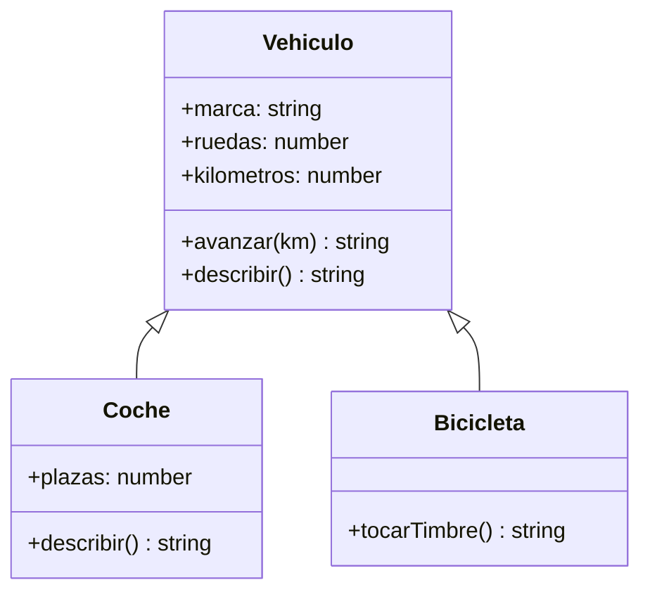
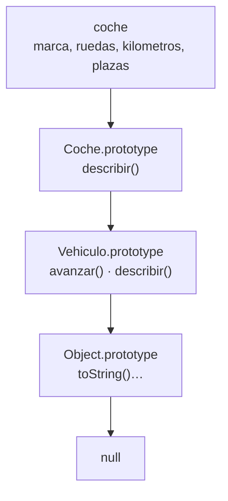
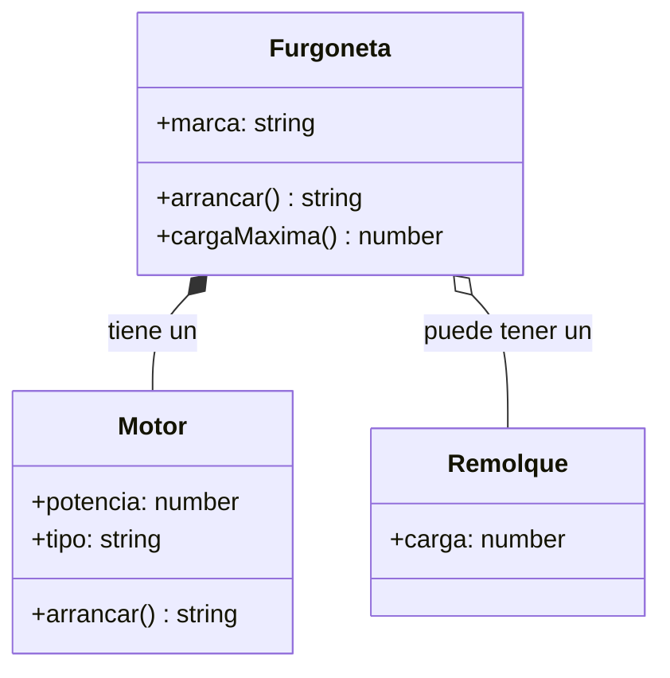
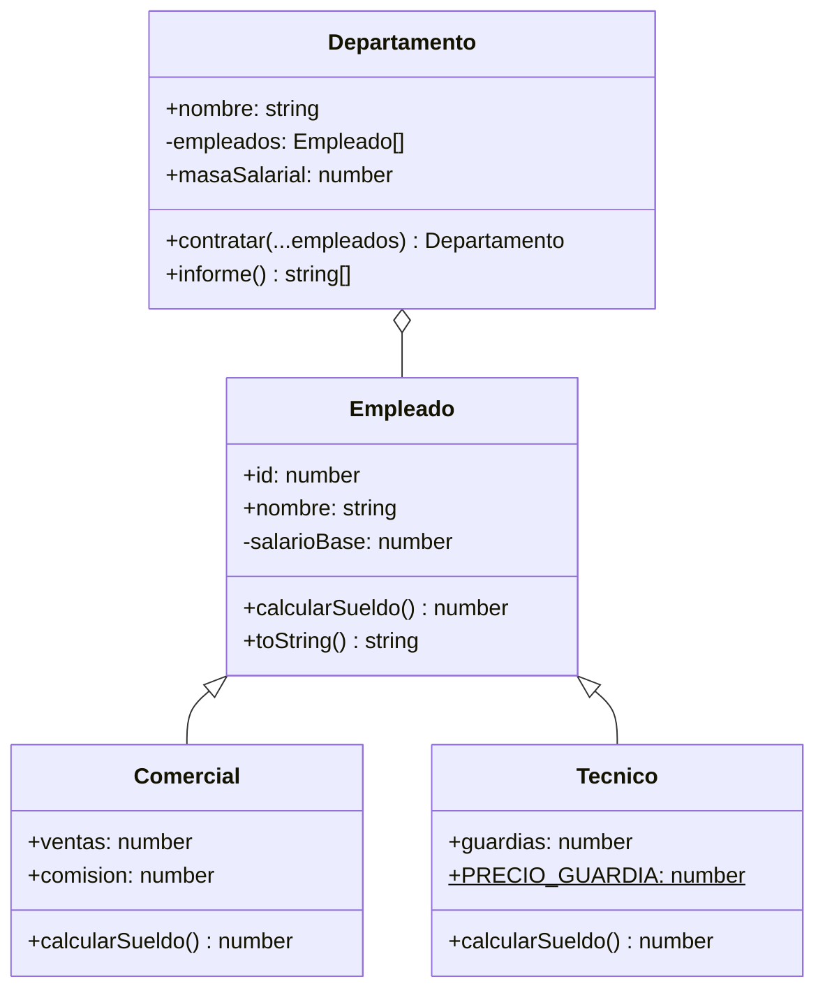

# 7. Clases

[⬅️ Volver a la unidad](./README.md)

## Índice

- [7.1. Qué es una clase](#71-qué-es-una-clase)
- [7.2. Definir una clase](#72-definir-una-clase)
  - [7.2.1. Constructor y propiedades](#721-constructor-y-propiedades)
  - [7.2.2. Métodos](#722-métodos)
  - [7.2.3. Campos públicos](#723-campos-públicos)
  - [7.2.4. Crear y usar instancias](#724-crear-y-usar-instancias)
- [7.3. Encapsulación: campos y métodos privados](#73-encapsulación-campos-y-métodos-privados)
- [7.4. _Getters_ y _setters_ en las clases](#74-getters-y-setters-en-las-clases)
- [7.5. Miembros estáticos](#75-miembros-estáticos)
- [7.6. Herencia](#76-herencia)
  - [7.6.1. `extends` y `super`](#761-extends-y-super)
  - [7.6.2. Sobrescribir métodos y polimorfismo](#762-sobrescribir-métodos-y-polimorfismo)
  - [7.6.3. `instanceof` y la cadena de prototipos](#763-instanceof-y-la-cadena-de-prototipos)
- [7.7. Composición frente a herencia](#77-composición-frente-a-herencia)
- [7.8. Qué hay debajo de una clase](#78-qué-hay-debajo-de-una-clase)
- [7.9. Errores frecuentes](#79-errores-frecuentes)
- [7.10. Ejemplo integrador: plantilla de una empresa](#710-ejemplo-integrador-plantilla-de-una-empresa)
- [Resumen](#resumen)
- [Ejercicios de reflexión](#ejercicios-de-reflexión)

> **CE que trabaja este tema:** RA4 f, g, h, i.

---

## 7.1. Qué es una clase

Una **clase** es una **plantilla** para crear objetos con la misma estructura y el mismo comportamiento. Es como el molde de una galleta: con un molde haces muchas galletas iguales en forma, aunque cada una tenga su propia decoración.

- La **clase** define qué propiedades y métodos tendrán los objetos.
- Cada objeto creado con la clase es una **instancia**, con sus propios valores.

```js
class Alumno {
  constructor(nombre, nota) {
    this.nombre = nombre;
    this.nota = nota;
  }

  estaAprobado() {
    return this.nota >= 5;
  }
}

const ana = new Alumno('Ana', 7);
const luis = new Alumno('Luis', 4);
console.log(ana.estaAprobado(), luis.estaAprobado()); // true false
```

Las clases llegaron con **ES2015** y son hoy la forma estándar de definir tipos de objetos en JavaScript. Las usarás en todo el curso y, sobre todo, en Angular (UD8), donde componentes y servicios son clases.

---

## 7.2. Definir una clase

### 7.2.1. Constructor y propiedades

El **constructor** es un método especial que se ejecuta **automáticamente** al crear una instancia con `new`. Su trabajo es **inicializar** las propiedades del objeto nuevo, al que se refiere con `this`.

```js
class Producto {
  constructor(nombre, precio, stock = 0) {
    this.nombre = nombre;
    this.precio = precio;
    this.stock = stock;
  }
}

const teclado = new Producto('Teclado', 25, 4);
console.log(teclado); // Producto { nombre: 'Teclado', precio: 25, stock: 4 }
```

- Solo puede haber **un** constructor por clase (no hay sobrecarga como en Java: se usan parámetros por defecto).
- Si no escribes constructor, la clase tiene uno vacío.
- Los nombres de clase van en **`PascalCase`**: `Producto`, `CuentaBancaria`.

### 7.2.2. Métodos

Los **métodos** se escriben dentro de la clase, sin la palabra `function` y **sin comas** entre ellos. Todas las instancias los comparten (están en el prototipo, apartado 7.8).

```js
class Producto {
  constructor(nombre, precio, stock = 0) {
    this.nombre = nombre;
    this.precio = precio;
    this.stock = stock;
  }

  estaDisponible() {
    return this.stock > 0;
  }

  vender(unidades = 1) {
    if (unidades > this.stock) {
      throw new Error(`Solo quedan ${this.stock} unidades de ${this.nombre}`);
    }
    this.stock -= unidades;
    return this.stock;
  }

  toString() {
    return `${this.nombre} (${this.precio} €, ${this.stock} uds)`;
  }
}

const raton = new Producto('Ratón', 12, 3);
raton.vender(2);
console.log(`${raton}`);           // 'Ratón (12 €, 1 uds)': la plantilla llama a toString
console.log(raton.estaDisponible()); // true
```

Definir `toString` hace que la instancia se muestre bien al meterla en un texto.

### 7.2.3. Campos públicos

Los **campos** (ES2022) se declaran directamente en el cuerpo de la clase, fuera del constructor. Sirven para propiedades con un **valor inicial fijo** y para dejar claro, de un vistazo, qué propiedades tiene cada instancia:

```js
class Pedido {
  estado = 'pendiente'; // campo público con valor inicial
  lineas = [];          // cada instancia tiene SU propio array

  constructor(cliente) {
    this.cliente = cliente;
  }
}

const p1 = new Pedido('Ana');
const p2 = new Pedido('Luis');
p1.lineas.push('libro');
console.log(p1.lineas, p2.lineas); // [ 'libro' ] []
```

### 7.2.4. Crear y usar instancias

```js
const p = new Producto('Monitor', 180, 2);

console.log(p.nombre);                  // acceder a una propiedad
p.precio = 170;                         // modificarla
console.log(p.vender());                // llamar a un método: 1
console.log(p instanceof Producto);     // true
console.log(typeof p);                  // 'object'
```

> 💡 **Tip del Examinador**: "¿Qué es el constructor de una clase y cuándo se ejecuta?" → Es el método especial que inicializa las propiedades de cada instancia; se ejecuta automáticamente una vez, al crear el objeto con `new`.

---

## 7.3. Encapsulación: campos y métodos privados

En el `Producto` anterior, cualquiera puede escribir `raton.stock = -50`. La **encapsulación** consiste en **ocultar** los datos internos y obligar a modificarlos a través de **métodos** que comprueban que el cambio es válido.

Desde ES2022, los nombres que empiezan por **`#`** son **privados**: solo se pueden usar **dentro** de la clase.

```js
class CuentaBancaria {
  #saldo = 0;            // campo privado
  #movimientos = [];     // campo privado

  constructor(titular) {
    this.titular = titular; // propiedad pública
  }

  ingresar(importe) {
    this.#validarImporte(importe);
    this.#saldo += importe;
    this.#registrar('ingreso', importe);
  }

  retirar(importe) {
    this.#validarImporte(importe);
    if (importe > this.#saldo) throw new Error('Saldo insuficiente');
    this.#saldo -= importe;
    this.#registrar('retirada', importe);
  }

  consultarSaldo() {
    return this.#saldo;
  }

  // Métodos privados: ayudantes internos que no forman parte de la interfaz pública
  #validarImporte(importe) {
    if (!Number.isFinite(importe) || importe <= 0) {
      throw new Error(`Importe no válido: ${importe}`);
    }
  }

  #registrar(tipo, importe) {
    this.#movimientos.push({ tipo, importe });
  }
}

const cuenta = new CuentaBancaria('Ana');
cuenta.ingresar(100);
cuenta.retirar(30);
console.log(cuenta.consultarSaldo()); // 70
console.log(cuenta.saldo);            // undefined: no existe una propiedad pública "saldo"
// cuenta.#saldo = 1000;              // ❌ SyntaxError: no se puede ni escribir fuera de la clase
console.log(Object.keys(cuenta));     // [ 'titular' ]: los privados no aparecen
```

| | Público | Privado `#` |
|---|---|---|
| Se usa desde fuera de la clase | ✅ | ❌ (`SyntaxError`) |
| Aparece en `Object.keys` y `JSON.stringify` | ✅ | ❌ |
| Lo heredan las subclases | ✅ | ❌ (solo la clase que lo declara) |
| Se declara | En el constructor o como campo | Como campo, **obligatoriamente**, antes de usarlo |

> 📝 **Nota del Profesor**: En código anterior a ES2022 verás la convención `this._saldo`: el guion bajo **avisa** de que es "privado", pero no lo protege. Los campos `#` sí son privados de verdad, impuestos por el lenguaje.

> ✅ **Buena práctica**: Haz privado todo lo que no necesite usarse desde fuera. La **interfaz pública** de la clase (sus métodos y propiedades públicos) debe ser pequeña: lo que la clase **ofrece**, no cómo lo hace.

---

## 7.4. _Getters_ y _setters_ en las clases

Combinados con los campos privados, los _getters_ y _setters_ (tema 6) permiten exponer una **propiedad controlada**: se lee y se asigna como una propiedad normal, pero la clase decide qué se permite.

```js
class Alumno {
  #nota = 0;

  constructor(nombre, nota) {
    this.nombre = nombre;
    this.nota = nota; // usa el setter: también valida al crear
  }

  get nota() {
    return this.#nota;
  }

  set nota(valor) {
    if (!Number.isFinite(valor) || valor < 0 || valor > 10) {
      throw new Error(`Nota fuera de rango: ${valor}`);
    }
    this.#nota = valor;
  }

  get calificacion() { // solo lectura: no tiene setter
    if (this.#nota < 5) return 'Suspenso';
    if (this.#nota < 7) return 'Aprobado';
    if (this.#nota < 9) return 'Notable';
    return 'Sobresaliente';
  }
}

const eva = new Alumno('Eva', 6.5);
console.log(eva.nota, eva.calificacion); // 6.5 'Aprobado'
eva.nota = 9;
console.log(eva.calificacion);           // 'Sobresaliente'

try {
  eva.nota = 15;
} catch (error) {
  console.log(`❌ ${error.message}`);    // ❌ Nota fuera de rango: 15
}
```

> ⚠️ **Cuidado**: El _getter_ y el campo privado **no pueden llamarse igual sin `#`**. Si escribes `get nota() { return this.nota; }`, el _getter_ se llama a sí mismo sin fin (`RangeError: Maximum call stack size exceeded`). Por eso el dato se guarda en `#nota`.

---

## 7.5. Miembros estáticos

Los miembros **estáticos** (`static`) pertenecen a la **clase**, no a cada instancia. Se usan con el nombre de la clase: `Clase.metodo()`.

```js
class Temperatura {
  static CERO_ABSOLUTO = -273.15;    // campo estático (constante de la clase)
  static #creadas = 0;               // campo estático privado

  constructor(celsius) {
    if (celsius < Temperatura.CERO_ABSOLUTO) throw new Error('Por debajo del cero absoluto');
    this.celsius = celsius;
    Temperatura.#creadas++;
  }

  get fahrenheit() {
    return this.celsius * 1.8 + 32;
  }

  // Método estático de fábrica: otra forma de crear instancias
  static desdeFahrenheit(fahrenheit) {
    return new Temperatura((fahrenheit - 32) / 1.8);
  }

  static get creadas() {
    return Temperatura.#creadas;
  }
}

const t1 = new Temperatura(25);
const t2 = Temperatura.desdeFahrenheit(212);
console.log(t1.fahrenheit);         // 77
console.log(t2.celsius);            // 100
console.log(Temperatura.creadas);   // 2
console.log(t1.desdeFahrenheit);    // undefined: no está en las instancias
```

Usos típicos de `static`:

- **Constantes** de la clase: `Temperatura.CERO_ABSOLUTO`.
- **Métodos de fábrica** que crean instancias de otra forma: `Temperatura.desdeFahrenheit(212)`.
- **Utilidades** relacionadas con la clase que no dependen de una instancia: `Number.isInteger`, `Array.from` y `Object.keys` son métodos estáticos predefinidos (tema 1).
- **Datos compartidos** por todas las instancias: un contador de instancias creadas.

> 💡 **Tip del Examinador**: "¿Qué diferencia hay entre un método estático y uno de instancia?" → El de instancia se llama sobre un objeto (`cuenta.ingresar()`) y usa sus datos con `this`; el estático se llama sobre la clase (`Temperatura.desdeFahrenheit()`) y no tiene acceso a los datos de ninguna instancia concreta.

---

## 7.6. Herencia

### 7.6.1. `extends` y `super`

La **herencia** permite crear una clase **a partir de otra**: la **subclase** (hija) recibe todas las propiedades y métodos de la **superclase** (madre) y puede añadir los suyos o cambiar los heredados. Expresa una relación **"es un"**: un coche **es un** vehículo.

```js
class Vehiculo {
  constructor(marca, ruedas) {
    this.marca = marca;
    this.ruedas = ruedas;
    this.kilometros = 0;
  }

  avanzar(km) {
    this.kilometros += km;
    return `${this.marca} ha recorrido ${this.kilometros} km`;
  }

  describir() {
    return `${this.marca} con ${this.ruedas} ruedas`;
  }
}

class Coche extends Vehiculo {
  constructor(marca, plazas) {
    super(marca, 4);     // llama al constructor de Vehiculo: OBLIGATORIO antes de usar this
    this.plazas = plazas;
  }

  describir() {          // sobrescribe el método de Vehiculo
    return `${super.describir()} y ${this.plazas} plazas`; // reutiliza el de la madre
  }
}

class Bicicleta extends Vehiculo {
  constructor(marca) {
    super(marca, 2);
  }

  tocarTimbre() {        // método nuevo, solo de las bicicletas
    return '¡Ring, ring!';
  }
}

const coche = new Coche('Seat', 5);
const bici = new Bicicleta('Orbea');

console.log(coche.avanzar(120));  // 'Seat ha recorrido 120 km' (heredado)
console.log(coche.describir());   // 'Seat con 4 ruedas y 5 plazas' (sobrescrito)
console.log(bici.describir());    // 'Orbea con 2 ruedas' (heredado)
console.log(bici.tocarTimbre());  // '¡Ring, ring!'
```



El diagrama de clases muestra la jerarquía: las flechas con triángulo apuntan de la subclase a la superclase. `Coche` sobrescribe `describir` y añade `plazas`; `Bicicleta` añade `tocarTimbre`.

| `super` | Dónde | Qué hace |
|---------|-------|----------|
| `super(…)` | En el constructor de la subclase | Llama al constructor de la superclase. **Obligatorio** antes de usar `this` |
| `super.metodo(…)` | En cualquier método de la subclase | Llama a la versión del método de la superclase |

### 7.6.2. Sobrescribir métodos y polimorfismo

**Sobrescribir** (*override*) un método es definir en la subclase un método con el **mismo nombre** que en la superclase. El de la subclase "tapa" al heredado (como en la cadena de prototipos del tema 6).

Gracias a eso, objetos de clases distintas pueden **responder al mismo mensaje cada uno a su manera**. Es el **polimorfismo**: el código que los usa no necesita saber de qué clase es cada uno.

```js
const garaje = [new Coche('Seat', 5), new Bicicleta('Orbea'), new Vehiculo('Genérico', 6)];

for (const vehiculo of garaje) {
  console.log(vehiculo.describir()); // cada uno usa su versión
}
```

```text
// Salida:
Seat con 4 ruedas y 5 plazas
Orbea con 2 ruedas
Genérico con 6 ruedas
```

El bucle llama a `describir()` sin preguntar qué tipo de vehículo es. Si mañana añades una clase `Moto`, el bucle sigue funcionando sin cambios.

> ✅ **Buena práctica**: Si te ves escribiendo `if (vehiculo instanceof Coche) … else if (vehiculo instanceof Bicicleta) …` para hacer lo mismo de forma distinta, probablemente necesitas un método sobrescrito en cada clase.

### 7.6.3. `instanceof` y la cadena de prototipos

`instanceof` comprueba si un objeto pertenece a una clase **o a cualquiera de sus superclases**:

```js
console.log(coche instanceof Coche);    // true
console.log(coche instanceof Vehiculo); // true: un coche es un vehículo
console.log(coche instanceof Bicicleta); // false
console.log(coche instanceof Object);   // true: todo objeto hereda de Object
```

Porque, por debajo, `extends` monta una **cadena de prototipos** (tema 6):



Al llamar `coche.describir()`, JavaScript encuentra primero el de `Coche.prototype`; al llamar `coche.avanzar()`, sube hasta `Vehiculo.prototype`.

> 💡 **Tip del Examinador**: "¿Para qué sirve `super` en una subclase?" → `super(…)` llama al constructor de la superclase (obligatorio antes de usar `this` en el constructor) y `super.metodo()` ejecuta la versión del método de la superclase, normalmente para ampliarla en lugar de reescribirla entera.

---

## 7.7. Composición frente a herencia

La herencia es tentadora, pero tiene problemas cuando la jerarquía crece:

- Una subclase depende de **todos** los detalles de su superclase: un cambio arriba puede romper todas las de abajo.
- JavaScript solo permite **una** superclase. ¿Qué hereda un coche eléctrico con remolque: de `CocheElectrico` o de `ConRemolque`?
- Las jerarquías profundas (`Vehiculo → Terrestre → Motorizado → Coche → Deportivo`) son difíciles de entender.

La alternativa es la **composición**: en lugar de que un objeto **sea** algo, **tiene** objetos que hacen cosas. Expresa una relación **"tiene un"**: un coche **tiene un** motor.

```js
class Motor {
  constructor(potencia, tipo) {
    this.potencia = potencia;
    this.tipo = tipo;
  }

  arrancar() {
    return this.tipo === 'eléctrico' ? 'zzz…' : 'brrum';
  }
}

class Remolque {
  constructor(carga) {
    this.carga = carga;
  }
}

class Furgoneta {
  constructor(marca, motor, remolque = null) {
    this.marca = marca;
    this.motor = motor;       // composición: tiene un motor
    this.remolque = remolque; // composición: puede tener un remolque
  }

  arrancar() {
    return `${this.marca}: ${this.motor.arrancar()}`; // delega en el motor
  }

  cargaMaxima() {
    return 800 + (this.remolque?.carga ?? 0);
  }
}

const reparto = new Furgoneta('Renault', new Motor(90, 'eléctrico'), new Remolque(500));
const taller = new Furgoneta('Ford', new Motor(130, 'diésel'));
console.log(reparto.arrancar(), reparto.cargaMaxima()); // Renault: zzz… 1300
console.log(taller.arrancar(), taller.cargaMaxima());   // Ford: brrum 800
```



El diagrama muestra composición (rombo relleno: la furgoneta siempre tiene un motor) y agregación (rombo vacío: el remolque es opcional y puede existir por separado). Cambiar el motor de diésel a eléctrico no exige una clase nueva: basta con pasar otro objeto `Motor`.

| | Herencia | Composición |
|---|---|---|
| Relación | "**es un**" (un coche es un vehículo) | "**tiene un**" (un coche tiene un motor) |
| Reutiliza | Heredando el código de la superclase | Delegando en otros objetos |
| Acoplamiento | Fuerte: la subclase depende de la superclase | Débil: solo se usa la interfaz pública |
| Combinar comportamientos | Difícil (una sola superclase) | Fácil (varios objetos) |
| Cambiar en tiempo de ejecución | ❌ | ✅ (se sustituye el objeto) |

> ✅ **Buena práctica**: "Favorece la composición sobre la herencia" es un principio clásico del diseño orientado a objetos. Usa la herencia para relaciones "es un" claras y estables, con jerarquías de uno o dos niveles. Para todo lo demás, composición.

---

## 7.8. Qué hay debajo de una clase

Una clase es una **sintaxis más cómoda** sobre las funciones constructoras y los prototipos del tema 6. Estas dos formas son equivalentes:

```js
// Con clase (ES2015)
class Punto {
  constructor(x, y) {
    this.x = x;
    this.y = y;
  }
  distanciaAlOrigen() {
    return Math.hypot(this.x, this.y);
  }
}

// Con función constructora y prototipo (código heredado)
function PuntoAntiguo(x, y) {
  this.x = x;
  this.y = y;
}
PuntoAntiguo.prototype.distanciaAlOrigen = function () {
  return Math.hypot(this.x, this.y);
};

console.log(typeof Punto);                           // 'function': una clase es una función
console.log(Object.hasOwn(Punto.prototype, 'distanciaAlOrigen')); // true: el método está en el prototipo
console.log(new Punto(3, 4).distanciaAlOrigen());    // 5
console.log(new PuntoAntiguo(3, 4).distanciaAlOrigen()); // 5
```

Pero las clases aportan cosas que la forma antigua no tiene, o que eran incómodas:

- Llamar a una clase **sin `new`** da error (con una función constructora, se ejecutaba mal sin avisar).
- El cuerpo de una clase está **siempre en modo estricto**.
- **Campos privados** `#`, **estáticos** y **_getters_/_setters_** con una sintaxis clara.
- `extends` y `super` en lugar de enlazar prototipos a mano.
- Las clases **no se elevan** como las declaraciones de función: hay que definirlas antes de usarlas (zona muerta temporal).

> 📝 **Nota del Profesor**: Saber que una clase es una función con un prototipo explica muchos comportamientos: por qué `typeof` da `'function'`, por qué los métodos se comparten entre instancias y por qué `this` se pierde al pasar un método como callback, igual que en los objetos literales.

---

## 7.9. Errores frecuentes

```js
// ❌ Olvidar new
const p = Producto('Teclado', 25); // TypeError: Class constructor Producto cannot be invoked without 'new'

// ❌ Usar this antes de super en una subclase
class Moto extends Vehiculo {
  constructor(marca) {
    this.casco = true; // ReferenceError: Must call super constructor before accessing 'this'
    super(marca, 2);
  }
}

// ❌ Comas entre métodos (eso es de los objetos literales)
class Mal {
  a() {},   // SyntaxError
  b() {}
}

// ❌ Perder this al pasar un método como callback
const cuenta = new CuentaBancaria('Ana');
setTimeout(cuenta.consultarSaldo, 100); // this es undefined dentro del método
// ✅
setTimeout(() => console.log(cuenta.consultarSaldo()), 100);

// ❌ Acceder a un privado desde una subclase
class CuentaJoven extends CuentaBancaria {
  bonificar() {
    this.#saldo += 10; // SyntaxError: #saldo es de CuentaBancaria, no de CuentaJoven
  }
}
// ✅ Usar la interfaz pública de la superclase
// bonificar() { this.ingresar(10); }
```

---

## 7.10. Ejemplo integrador: plantilla de una empresa

Una empresa tiene empleados de distintos tipos. Todos tienen nombre y salario base, pero el sueldo mensual se calcula de forma distinta. Junta clases, campos privados, _getters_, estáticos, herencia, polimorfismo y composición.

```js
// plantilla.js (módulo)
class Empleado {
  static #siguienteId = 1;
  #salarioBase;

  constructor(nombre, salarioBase) {
    if (!Number.isFinite(salarioBase) || salarioBase <= 0) {
      throw new Error(`Salario no válido para ${nombre}: ${salarioBase}`);
    }
    this.id = Empleado.#siguienteId++;
    this.nombre = nombre;
    this.#salarioBase = salarioBase;
  }

  get salarioBase() {
    return this.#salarioBase;
  }

  calcularSueldo() {
    return this.#salarioBase;
  }

  toString() {
    return `#${this.id} ${this.nombre} (${this.constructor.name}): ${this.calcularSueldo().toFixed(2)} €`;
  }
}

class Comercial extends Empleado {
  constructor(nombre, salarioBase, ventas, comision = 0.05) {
    super(nombre, salarioBase);
    this.ventas = ventas;
    this.comision = comision;
  }

  calcularSueldo() {
    return super.calcularSueldo() + this.ventas * this.comision;
  }
}

class Tecnico extends Empleado {
  constructor(nombre, salarioBase, guardias) {
    super(nombre, salarioBase);
    this.guardias = guardias;
  }

  calcularSueldo() {
    return super.calcularSueldo() + this.guardias * Tecnico.PRECIO_GUARDIA;
  }

  static PRECIO_GUARDIA = 60;
}

// Composición: un departamento TIENE empleados
class Departamento {
  #empleados = [];

  constructor(nombre) {
    this.nombre = nombre;
  }

  contratar(...empleados) {
    this.#empleados.push(...empleados);
    return this;
  }

  get masaSalarial() {
    return this.#empleados.reduce((suma, e) => suma + e.calcularSueldo(), 0);
  }

  informe() {
    return [`🏢 ${this.nombre}`, ...this.#empleados.map((e) => `  ${e}`), `  Total: ${this.masaSalarial.toFixed(2)} €`];
  }
}

const ventas = new Departamento('Ventas y soporte').contratar(
  new Comercial('Ana', 1400, 20000),
  new Tecnico('Luis', 1600, 3),
  new Empleado('Marta', 1300),
);

ventas.informe().forEach((linea) => console.log(linea));

try {
  new Tecnico('Pablo', -100, 1);
} catch (error) {
  console.log(`❌ ${error.message}`);
}
```

```text
// Salida:
🏢 Ventas y soporte
  #1 Ana (Comercial): 2400.00 €
  #2 Luis (Tecnico): 1780.00 €
  #3 Marta (Empleado): 1300.00 €
  Total: 5480.00 €
❌ Salario no válido para Pablo: -100
```



El diagrama junta las dos relaciones: herencia entre `Empleado` y sus subclases, y composición entre `Departamento` y sus empleados. El signo `-` marca lo privado, `+` lo público y `$` lo estático.

| Concepto | Dónde |
|----------|-------|
| Clase, constructor y métodos | `Empleado`, `Departamento` |
| Campo privado y _getter_ | `#salarioBase` y `salarioBase` |
| Campo estático privado | `#siguienteId`: un id distinto por empleado |
| Campo estático público | `Tecnico.PRECIO_GUARDIA` |
| Herencia con `super(…)` y `super.metodo()` | `Comercial` y `Tecnico` |
| Polimorfismo | `calcularSueldo()` en `toString` y en `masaSalarial` |
| Composición | `Departamento` tiene un array privado de empleados |
| `this.constructor.name` | El nombre de la clase real de cada instancia |
| Validación con errores | El constructor de `Empleado` |

> 📝 **Nota del Profesor**: Fíjate en que el `id` de Pablo no se llega a asignar: el error se lanza antes de `Empleado.#siguienteId++`. Si la validación estuviera después, Pablo "gastaría" el número 4 aunque no se creara. El orden de las instrucciones en un constructor importa.

---

## Resumen

- Una **clase** es una plantilla para crear **instancias** con `new`. El **constructor** inicializa las propiedades.
- Los **métodos** se escriben sin `function` ni comas y los comparten todas las instancias. Los **campos** declaran propiedades con valor inicial.
- Los nombres con **`#`** son **privados**: solo se usan dentro de la clase. Son la base de la **encapsulación**.
- Los **_getters_** y **_setters_** exponen propiedades controladas, normalmente sobre un campo privado.
- Los miembros **`static`** pertenecen a la clase: constantes, métodos de fábrica y utilidades.
- **`extends`** crea una subclase; **`super(…)`** llama al constructor de la superclase (antes de usar `this`) y **`super.metodo()`** a su versión del método.
- **Sobrescribir** métodos permite el **polimorfismo**: el mismo mensaje, distinto comportamiento según la clase.
- **`instanceof`** comprueba la clase y sus superclases.
- **Composición** ("tiene un") frente a **herencia** ("es un"): favorece la composición.
- Una clase es una **función** con un **prototipo**: sintaxis más clara sobre el mecanismo del tema 6.

## Ejercicios de reflexión

1. ¿Qué ventajas tiene usar `#saldo` frente a `this._saldo`? ¿Y frente a una variable de un closure, como en el tema 6?
2. Diseña con un diagrama de clases una jerarquía para una tienda con `Producto`, `ProductoFisico` (con peso) y `ProductoDigital` (con tamaño de descarga). ¿Qué método sobrescribirías en cada una?
3. ¿Por qué `super(…)` tiene que ir antes de usar `this` en el constructor de una subclase?
4. Un compañero modela "un pájaro que nada" con `class PatoNadador extends Pajaro` y después necesita un "pez que vuela". ¿Qué problema tiene la herencia aquí y cómo lo resolverías con composición?
5. ¿Qué muestra `typeof class {}`? ¿Y `Object.getPrototypeOf(new Coche('Seat', 5)) === Coche.prototype`? Explica por qué.

---

[⬅️ Volver a la unidad](./README.md)
