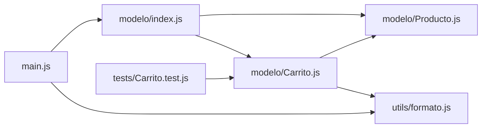
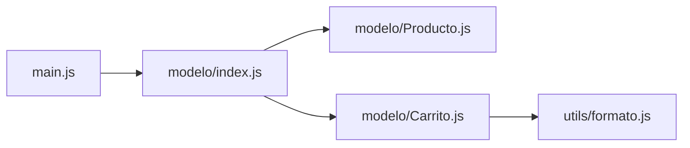

# 8. Módulos

[⬅️ Volver a la unidad](./README.md)

## Índice

- [8.1. Por qué dividir el código en módulos](#81-por-qué-dividir-el-código-en-módulos)
- [8.2. Exportar e importar](#82-exportar-e-importar)
  - [8.2.1. Exportaciones con nombre](#821-exportaciones-con-nombre)
  - [8.2.2. Exportación por defecto](#822-exportación-por-defecto)
  - [8.2.3. Renombrar e importar todo](#823-renombrar-e-importar-todo)
  - [8.2.4. Reexportar: el fichero índice](#824-reexportar-el-fichero-índice)
- [8.3. Cómo se comportan los módulos](#83-cómo-se-comportan-los-módulos)
- [8.4. Módulos en el navegador y en Node.js](#84-módulos-en-el-navegador-y-en-nodejs)
- [8.5. Organizar un proyecto en módulos](#85-organizar-un-proyecto-en-módulos)
  - [8.5.1. Criterios para repartir el código](#851-criterios-para-repartir-el-código)
  - [8.5.2. Dependencias entre módulos](#852-dependencias-entre-módulos)
- [8.6. Importación dinámica](#86-importación-dinámica)
- [8.7. Módulos en código heredado: CommonJS](#87-módulos-en-código-heredado-commonjs)
- [8.8. Ejemplo integrador: una tienda en módulos](#88-ejemplo-integrador-una-tienda-en-módulos)
- [Resumen](#resumen)
- [Ejercicios de reflexión](#ejercicios-de-reflexión)

> **CE que trabaja este tema:** RA4 i.

---

## 8.1. Por qué dividir el código en módulos

Un programa de 2.000 líneas en un único fichero es difícil de leer, de probar y de modificar entre varias personas. Un **módulo** es un **fichero** de JavaScript que agrupa código relacionado y decide qué **expone** al resto del programa (**exporta**) y qué **usa** de otros módulos (**importa**).

Ya trabajaste con módulos en la UD2 (`<script type="module">` y el cajero con `cajero.js` y `main.js`). Ahora los ves a fondo, porque son la forma de **organizar** las clases y funciones que defines y de **usarlas** desde otras partes del programa.

| Sin módulos | Con módulos |
|-------------|-------------|
| Todo en un fichero o varios scripts que comparten el ámbito global | Cada fichero con su propio ámbito |
| Choques de nombres entre scripts | Cada módulo decide qué nombres exporta |
| Dependencias implícitas: el orden de los `<script>` importa | Dependencias explícitas con `import` |
| Difícil de probar por partes | Cada módulo se prueba por separado (tema 10) |

> 📝 **Nota del Profesor**: Los módulos ES (*ECMAScript modules*, ESM) son el estándar del lenguaje desde ES2015 y funcionan igual en el navegador, en Node.js, en Vite y en Angular. Lo que aprendas aquí lo usarás en todas las unidades siguientes.

---

## 8.2. Exportar e importar

### 8.2.1. Exportaciones con nombre

Con **`export`** delante de una declaración, el nombre queda disponible para otros módulos. Un módulo puede tener **muchas** exportaciones con nombre.

```js
// js/matematicas.js
export const PI_REDONDEADO = 3.14;

export function sumar(a, b) {
  return a + b;
}

export class Calculadora {
  multiplicar(a, b) {
    return a * b;
  }
}

function auxiliarInterno() { // sin export: privado del módulo
  return 'nadie fuera de este fichero me ve';
}
```

También se puede exportar al final, en una lista:

```js
const IVA = 0.21;
function conIva(precio) {
  return precio * (1 + IVA);
}

export { IVA, conIva };
```

Para usarlas, **`import`** con las llaves y los **mismos nombres**:

```js
// js/main.js
import { sumar, PI_REDONDEADO, Calculadora } from './matematicas.js';

console.log(sumar(2, 3));                         // 5
console.log(PI_REDONDEADO);                       // 3.14
console.log(new Calculadora().multiplicar(2, 4)); // 8
```

> ⚠️ **Cuidado**: En el navegador y en Node.js, la ruta del `import` es **relativa** (`./` o `../`) y lleva la **extensión** `.js`. `import { sumar } from 'matematicas'` falla: sin `./`, se interpreta como el nombre de un paquete de `node_modules`. Vite y Angular permiten omitir la extensión, pero ponerla funciona en todas partes.

### 8.2.2. Exportación por defecto

Un módulo puede tener **una** exportación **por defecto** (`export default`): el valor "principal" del módulo. Se importa **sin llaves** y con el nombre que quieras.

```js
// js/Producto.js
export default class Producto {
  constructor(nombre, precio) {
    this.nombre = nombre;
    this.precio = precio;
  }
}
```

```js
// js/main.js
import Producto from './Producto.js';     // sin llaves
import Articulo from './Producto.js';     // el nombre lo elige quien importa

console.log(new Producto('Libro', 20) instanceof Articulo); // true: es la misma clase
```

Se pueden combinar las dos en un mismo módulo y en un mismo `import`:

```js
// js/carrito.js
export default class Carrito { /* … */ }
export const MAX_LINEAS = 20;

// js/main.js
import Carrito, { MAX_LINEAS } from './carrito.js';
```

| | Con nombre | Por defecto |
|---|---|---|
| Cuántas por módulo | Las que quieras | Una como máximo |
| Exportar | `export function f() {}` | `export default function f() {}` |
| Importar | `import { f } from './m.js'` | `import f from './m.js'` |
| Nombre al importar | El mismo (o renombrado con `as`) | El que quieras |
| Si te equivocas de nombre | Error al cargar: el nombre no existe | No hay error: cualquier nombre vale |

> ✅ **Buena práctica**: Prefiere las **exportaciones con nombre**. El nombre es el mismo en todo el proyecto (más fácil de buscar), el editor las autocompleta y un error de escritura se detecta al cargar. Usa `export default` solo cuando el módulo tenga una única cosa principal y sea la convención de la herramienta.

> 💡 **Tip del Examinador**: "¿Qué diferencia hay entre `import { Producto } from './producto.js'` e `import Producto from './producto.js'`?" → La primera importa una exportación **con nombre** llamada `Producto`; la segunda, la exportación **por defecto** del módulo, que puede tener cualquier nombre.

### 8.2.3. Renombrar e importar todo

```js
// Renombrar al importar (por ejemplo, si dos módulos exportan el mismo nombre)
import { formatear as formatearPrecio } from './precios.js';
import { formatear as formatearFecha } from './fechas.js';

// Renombrar al exportar
export { conIva as calcularConIva };

// Importar todo el módulo como un objeto (espacio de nombres)
import * as mates from './matematicas.js';
console.log(mates.sumar(1, 2), mates.PI_REDONDEADO);
```

### 8.2.4. Reexportar: el fichero índice

En un proyecto con muchos módulos, es habitual tener un fichero **índice** (`index.js`) que **reexporta** lo público de una carpeta. Así, quien usa la carpeta importa de un solo sitio.

```js
// js/modelo/index.js
export { Producto } from './Producto.js';
export { Carrito, MAX_LINEAS } from './Carrito.js';
export { Cliente } from './Cliente.js';
```

```js
// js/main.js
import { Producto, Carrito, Cliente } from './modelo/index.js';
```

El índice también decide qué es **público**: lo que no reexporta queda como detalle interno de la carpeta.

---

## 8.3. Cómo se comportan los módulos

Los módulos tienen reglas propias que los diferencian de un script clásico:

| Característica | Qué significa |
|----------------|---------------|
| **Ámbito propio** | Lo declarado en el nivel superior del módulo no es global (UD2) |
| **Modo estricto siempre** | Sin globales implícitas; `this` vale `undefined` en el nivel superior |
| **Se evalúan una sola vez** | Aunque diez módulos importen `config.js`, su código se ejecuta **una vez** y todos reciben lo mismo |
| **Importaciones de solo lectura** | No se puede reasignar un nombre importado (`sumar = 5` da error) |
| **Enlaces vivos** | Si el módulo que exporta cambia el valor de una variable `let` exportada, quien importa ve el valor nuevo |
| **Carga diferida en el navegador** | `<script type="module">` se ejecuta cuando el HTML ya está analizado, como `defer` (UD1) |
| **`import` se procesa antes** | Todos los `import` se resuelven antes de ejecutar el código del módulo, estén donde estén |

La evaluación única tiene una consecuencia muy útil: un objeto exportado por un módulo es **compartido** por todos los que lo importan.

```js
// js/contador.js
let visitas = 0;
export function registrarVisita() {
  visitas++;
  return visitas;
}
```

```js
// js/a.js
import { registrarVisita } from './contador.js';
registrarVisita();

// js/b.js
import { registrarVisita } from './contador.js';
console.log(registrarVisita()); // 2: comparten el mismo "visitas"
```

`visitas` es privado del módulo (nadie puede importarlo) y único para todo el programa. Es el **patrón Módulo** y una forma natural de tener un **Singleton**, que verás en el tema 9.

> 📝 **Nota del Profesor**: Un módulo es la aplicación más directa de la **encapsulación** a nivel de fichero: lo que no se exporta es privado. Igual que una clase tiene una interfaz pública de métodos, un módulo tiene una interfaz pública de exportaciones.

---

## 8.4. Módulos en el navegador y en Node.js

**En el navegador**, el punto de entrada se carga con `type="module"` y desde él se importa el resto:

```html
<!-- index.html -->
<script type="module" src="js/main.js"></script>
```

> ⚠️ **Cuidado**: Si abres `index.html` haciendo doble clic (`file://…`), los módulos **no cargan**: el navegador bloquea la petición por seguridad (CORS). Hay que servir la página con un servidor local: la extensión Live Server de VS Code, `npx serve` o Vite (`npm run dev`).

**En Node.js**, un fichero `.js` se trata como módulo ES si el `package.json` del proyecto tiene `"type": "module"` (es lo que has usado desde la UD2). También se puede usar la extensión `.mjs`.

```json
{
  "name": "tienda",
  "type": "module",
  "scripts": {
    "start": "node js/main.js"
  }
}
```

| | Navegador | Node.js |
|---|---|---|
| Activar módulos | `<script type="module">` | `"type": "module"` en `package.json` o `.mjs` |
| Rutas | Relativas con extensión; también URL completas | Relativas con extensión; nombres de paquete para `node_modules` |
| Necesita servidor | ✅ (no funciona con `file://`) | ❌ |
| Paquetes de npm (`import x from 'paquete'`) | Solo con un empaquetador (Vite) o *import maps* | ✅ |

> 📝 **Nota del Profesor**: En proyectos grandes no se sirven cientos de módulos sueltos al navegador: un **empaquetador** (*bundler*) como **Vite** (que usa Rollup por debajo) los une y optimiza para producción. Angular hace lo mismo con su propia herramienta. Tú sigues escribiendo `import` y `export`; la herramienta se encarga del resto.

---

## 8.5. Organizar un proyecto en módulos

### 8.5.1. Criterios para repartir el código

No hay una única forma correcta, pero estos criterios funcionan bien:

1. **Un módulo, una responsabilidad**: `validaciones.js`, `formato.js`, `Carrito.js`. Si el nombre necesita un "y", divide.
2. **Una clase principal por fichero**, con el nombre de la clase: `Producto.js` exporta `Producto`.
3. **Separa la lógica de la entrada y salida**: los módulos de lógica (clases, cálculos) no hacen `console.log` ni tocan el DOM; un módulo de entrada (`main.js`) los usa y muestra los resultados.
4. **Agrupa por tema** en carpetas cuando el proyecto crece: `modelo/`, `servicios/`, `utils/`, `ui/`.
5. **Exporta lo mínimo**: lo que otros módulos necesitan. Lo demás, privado.

Estructura típica de un proyecto de consola de esta unidad:

```text
tienda/
├── package.json
├── eslint.config.js
├── src/
│   ├── main.js              ← punto de entrada: usa los módulos y muestra resultados
│   ├── modelo/
│   │   ├── Producto.js      ← clase Producto
│   │   ├── Carrito.js       ← clase Carrito
│   │   └── index.js         ← reexporta lo público del modelo
│   └── utils/
│       └── formato.js       ← funciones puras de formato
└── tests/
    └── Carrito.test.js      ← tests (tema 10)
```

### 8.5.2. Dependencias entre módulos

Cada `import` crea una **dependencia**: el módulo que importa necesita al importado. Dibujarlas ayuda a ver si la organización es sana.



El diagrama muestra que las dependencias van **en un solo sentido**: `main.js` depende del modelo, el modelo de las utilidades, y las utilidades de nada. Los tests dependen del módulo que prueban.

> ✅ **Buena práctica**: Evita las **dependencias circulares** (A importa B y B importa A). JavaScript las permite, pero según el orden de carga un valor importado puede estar aún sin inicializar (`ReferenceError`). Si aparecen, suele ser señal de que algo debería estar en un tercer módulo del que dependan los dos.

> 💡 **Tip del Examinador**: "¿Qué ventajas tiene organizar el código en módulos?" → Cada módulo tiene su propio ámbito (sin choques de nombres), las dependencias son explícitas, se puede ocultar lo interno (encapsulación), se reutiliza en otros proyectos y se prueba por separado.

---

## 8.6. Importación dinámica

`import` en la cabecera es **estático**: se resuelve antes de ejecutar nada. La función **`import()`** carga un módulo **cuando se necesita**, durante la ejecución, y devuelve una **promesa** (UD7):

```js
const boton = document.querySelector('#informe');
boton.addEventListener('click', async () => {
  const { generarInforme } = await import('./informe.js'); // se descarga solo al hacer clic
  generarInforme();
});
```

Sirve para no cargar al principio código que quizá no se use (un editor, una librería de gráficos…). Angular la usa para la **carga perezosa** (*lazy loading*) de rutas. Es **Ampliación**: lo entenderás del todo con las promesas de la UD7.

---

## 8.7. Módulos en código heredado: CommonJS

Antes de ES2015, Node.js tenía su propio sistema de módulos, **CommonJS**, que aún verás en muchos proyectos y tutoriales:

```js
// CommonJS (código heredado)
const { sumar } = require('./matematicas.js');
module.exports = { conIva };
```

| | Módulos ES (ESM) | CommonJS |
|---|---|---|
| Sintaxis | `import` / `export` | `require()` / `module.exports` |
| Estándar | ✅ ECMAScript | ❌ Propio de Node.js |
| Navegador | ✅ | ❌ (solo con empaquetador) |
| Carga | Estática (se analiza antes de ejecutar) | Dinámica (al ejecutar `require`) |
| En Node.js | Con `"type": "module"` o `.mjs` | Por defecto sin `"type"`, o con `.cjs` |

> 📝 **Nota del Profesor**: En este curso se usan **siempre** módulos ES. Si un paquete o un tutorial usa `require`, es CommonJS: Node.js permite importar esos paquetes desde un módulo ES con `import`, así que no necesitas cambiar tu forma de trabajar.

---

## 8.8. Ejemplo integrador: una tienda en módulos

El carrito de los temas 6 y 7, repartido en módulos con responsabilidades claras. Se ejecuta con `node src/main.js`.

```js
// src/utils/formato.js — funciones puras de presentación
export function formatearEuros(importe) {
  return `${importe.toFixed(2)} €`;
}

export function formatearLinea(unidades, nombre, importe) {
  return `${String(unidades).padStart(2)} x ${nombre.padEnd(12)} ${formatearEuros(importe)}`;
}
```

```js
// src/modelo/Producto.js
export class Producto {
  constructor(codigo, nombre, precio) {
    this.codigo = codigo;
    this.nombre = nombre;
    this.precio = precio;
  }
}
```

```js
// src/modelo/Carrito.js
import { formatearLinea, formatearEuros } from '../utils/formato.js';

export const MAX_UNIDADES = 10;

export class Carrito {
  #lineas = new Map(); // código → { producto, unidades }

  anadir(producto, unidades = 1) {
    const actuales = this.#lineas.get(producto.codigo)?.unidades ?? 0;
    if (actuales + unidades > MAX_UNIDADES) {
      throw new Error(`Máximo ${MAX_UNIDADES} unidades de ${producto.nombre}`);
    }
    this.#lineas.set(producto.codigo, { producto, unidades: actuales + unidades });
    return this;
  }

  get total() {
    return [...this.#lineas.values()].reduce((suma, l) => suma + l.producto.precio * l.unidades, 0);
  }

  ticket() {
    const lineas = [...this.#lineas.values()].map(({ producto, unidades }) =>
      formatearLinea(unidades, producto.nombre, producto.precio * unidades),
    );
    return [...lineas, `TOTAL ${formatearEuros(this.total)}`];
  }
}
```

```js
// src/modelo/index.js — la interfaz pública del modelo
export { Producto } from './Producto.js';
export { Carrito, MAX_UNIDADES } from './Carrito.js';
```

```js
// src/main.js — punto de entrada: crea objetos, los usa y muestra resultados
import { Producto, Carrito, MAX_UNIDADES } from './modelo/index.js';

const catalogo = [
  new Producto('P1', 'Cuaderno', 2.5),
  new Producto('P2', 'Bolígrafo', 0.8),
  new Producto('P3', 'Mochila', 24.9),
];

const carrito = new Carrito();
carrito.anadir(catalogo[0], 3).anadir(catalogo[1], 5).anadir(catalogo[2]);
carrito.ticket().forEach((linea) => console.log(linea));

try {
  carrito.anadir(catalogo[1], MAX_UNIDADES);
} catch (error) {
  console.log(`❌ ${error.message}`);
}
```

```text
// Salida:
 3 x Cuaderno     7.50 €
 5 x Bolígrafo    4.00 €
 1 x Mochila      24.90 €
TOTAL 36.40 €
❌ Máximo 10 unidades de Bolígrafo
```



| Módulo | Responsabilidad | Exporta |
|--------|-----------------|---------|
| `utils/formato.js` | Presentar importes y líneas | `formatearEuros`, `formatearLinea` |
| `modelo/Producto.js` | Datos de un producto | `Producto` |
| `modelo/Carrito.js` | Reglas del carrito | `Carrito`, `MAX_UNIDADES` |
| `modelo/index.js` | Interfaz pública del modelo | Reexporta las dos clases y la constante |
| `main.js` | Usar el modelo y mostrar los resultados | Nada |

Fíjate en que solo `main.js` hace `console.log`: el resto de módulos **devuelve** datos. Por eso `Carrito` se puede probar con tests sin mirar la consola (tema 10).

---

## Resumen

- Un **módulo** es un fichero con su propio ámbito que **exporta** lo que ofrece e **importa** lo que necesita.
- **Exportaciones con nombre** (`export function f`, `import { f }`): varias por módulo, mismo nombre al importar. **Por defecto** (`export default`, `import f`): una como máximo, cualquier nombre. Se prefieren las de nombre.
- `as` renombra; `import * as m` importa todo como objeto; `export { … } from` reexporta (fichero **índice**).
- Las rutas son **relativas** y llevan **extensión**: `./carrito.js`.
- Los módulos están en **modo estricto**, se **evalúan una vez** (su estado se comparte) y sus importaciones son de solo lectura.
- En el navegador: `<script type="module">` y **servidor local**. En Node.js: `"type": "module"` en `package.json`.
- Organiza por **responsabilidades**, una clase por fichero, lógica separada de la entrada y salida, y dependencias **en un solo sentido**.
- `import()` carga un módulo bajo demanda (Ampliación). **CommonJS** (`require`) es el sistema heredado de Node.js.

## Ejercicios de reflexión

1. ¿Qué error da `import { sumar } from 'matematicas.js'` en el navegador y por qué? ¿Cómo se corrige?
2. Un módulo exporta `export default function calcular() {}` y otro lo importa con `import { calcular } from './calculo.js'`. ¿Qué pasa? ¿Cómo lo arreglarías de las dos formas posibles?
3. Explica por qué dos módulos que importan `contador.js` (apartado 8.3) comparten el mismo contador. ¿Qué tendría que pasar para que cada uno tuviera el suyo?
4. Dibuja el grafo de dependencias de un proyecto con `main.js`, `Biblioteca.js`, `Libro.js`, `Socio.js` y `fechas.js`. ¿Qué dependencia crearía un ciclo y cómo la evitarías?
5. ¿Por qué conviene que solo `main.js` muestre mensajes por consola y los demás módulos devuelvan datos?

---

[⬅️ Volver a la unidad](./README.md)
