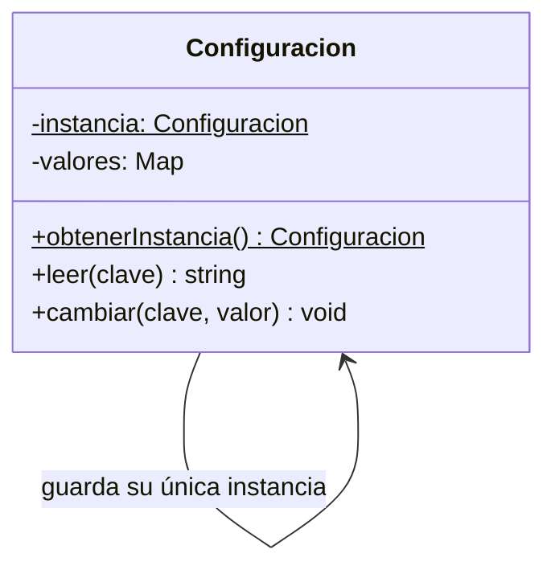
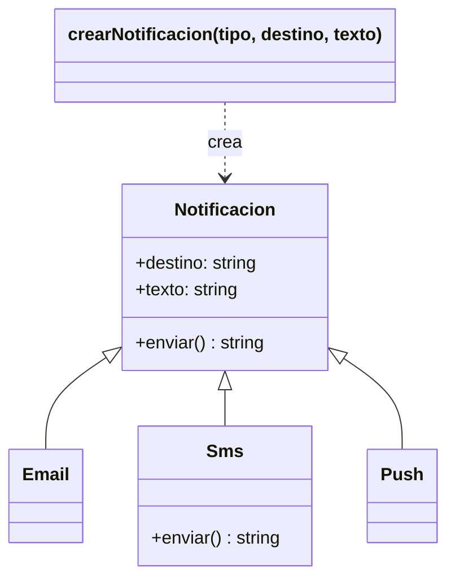
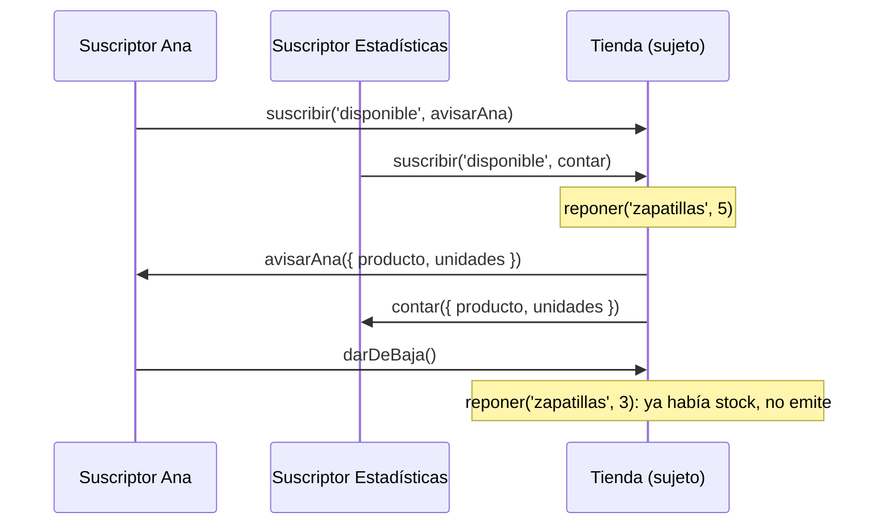
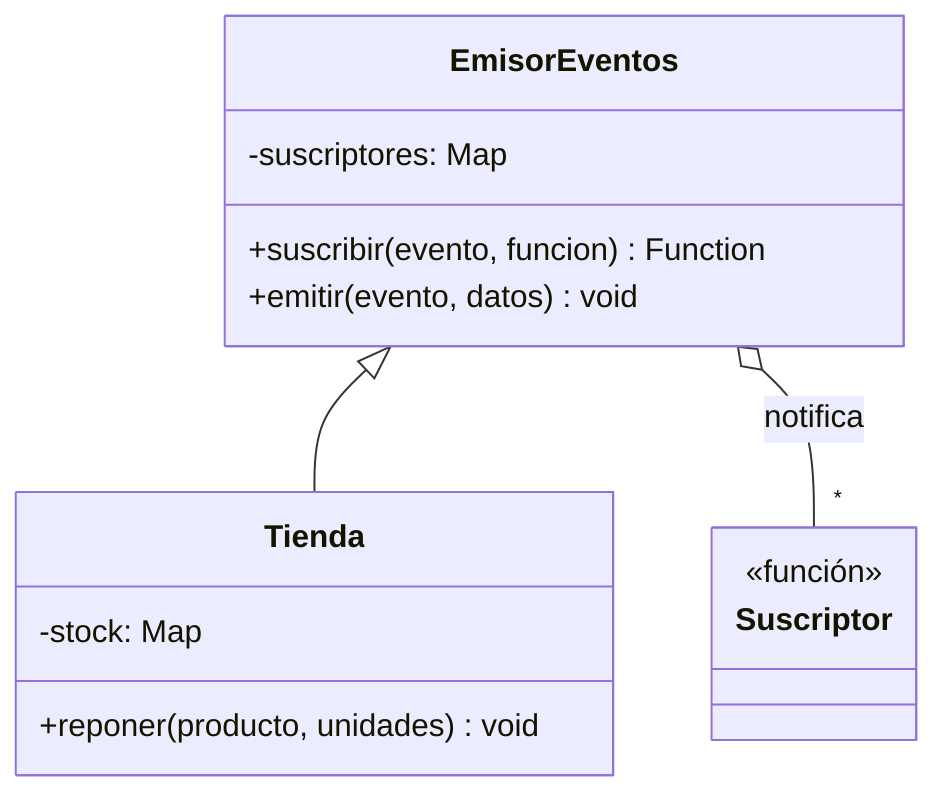
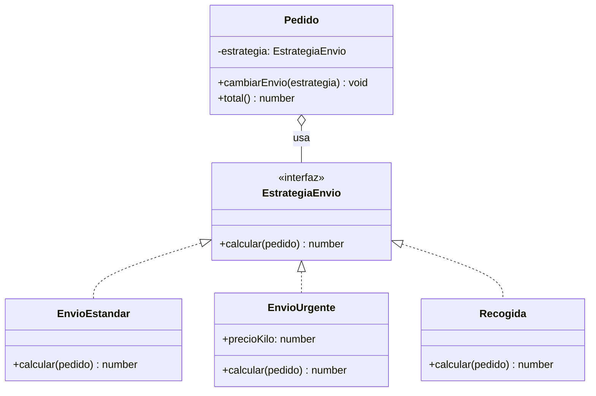

# 9. Patrones de diseño

[⬅️ Volver a la unidad](./README.md)

## Índice

- [9.1. Qué es un patrón de diseño](#91-qué-es-un-patrón-de-diseño)
  - [9.1.1. Cómo se describe un patrón](#911-cómo-se-describe-un-patrón)
  - [9.1.2. Tipos de patrones](#912-tipos-de-patrones)
- [9.2. Módulo](#92-módulo)
- [9.3. Singleton](#93-singleton)
- [9.4. Factory](#94-factory)
- [9.5. Observer](#95-observer)
- [9.6. Strategy](#96-strategy)
- [9.7. Otros patrones que verás](#97-otros-patrones-que-verás)
- [9.8. Cuándo usar (y cuándo no) un patrón](#98-cuándo-usar-y-cuándo-no-un-patrón)
- [9.9. Ejemplo integrador: gestión de pedidos](#99-ejemplo-integrador-gestión-de-pedidos)
- [Resumen](#resumen)
- [Ejercicios de reflexión](#ejercicios-de-reflexión)

> **CE que trabaja este tema:** RA4 j.

---

## 9.1. Qué es un patrón de diseño

Cuando muchos programadores se enfrentan al mismo tipo de problema, acaban llegando a soluciones parecidas. Un **patrón de diseño** (*design pattern*) es una **solución probada a un problema de diseño que se repite**, descrita de forma que se pueda aplicar en muchos programas distintos.

No es código para copiar, sino una **idea con nombre**. Como en arquitectura: "patio interior" no es un plano concreto, sino una solución conocida para dar luz a una casa, que cada arquitecto adapta.

Los patrones aportan:

- **Soluciones probadas**: no reinventas algo que otros ya resolvieron bien.
- **Vocabulario común**: decir "aquí uso un Observer" explica en tres palabras cómo está organizado el código.
- **Código más fácil de cambiar**: casi todos buscan separar lo que cambia de lo que se mantiene.

> 📝 **Nota del Profesor**: Los patrones clásicos se popularizaron en 1994 con el libro *Design Patterns* de Gamma, Helm, Johnson y Vlissides, la "Banda de los Cuatro" (*Gang of Four*, GoF), que describe 23. En JavaScript algunos se simplifican mucho porque las funciones son valores y los módulos ya encapsulan. Aquí ves los cinco que más aparecen en el desarrollo web y en el resto del curso.

### 9.1.1. Cómo se describe un patrón

Cada patrón de este tema se presenta igual:

| Apartado | Pregunta que responde |
|----------|-----------------------|
| **Problema** | ¿Qué situación lo hace necesario? |
| **Solución** | ¿Cuál es la idea y qué piezas tiene? |
| **Ejemplo en JavaScript** | ¿Cómo se escribe? |
| **Dónde reaparece** | ¿Dónde lo vas a encontrar en el curso y en las herramientas? |

### 9.1.2. Tipos de patrones

| Tipo | Qué resuelven | Patrones de este tema |
|------|---------------|-----------------------|
| **Creacionales** | Cómo se **crean** los objetos | Singleton, Factory |
| **Estructurales** | Cómo se **organizan y combinan** objetos y módulos | Módulo |
| **De comportamiento** | Cómo se **comunican** los objetos y se reparten las responsabilidades | Observer, Strategy |

> 💡 **Tip del Examinador**: "¿Qué es un patrón de diseño?" → Una solución reutilizable y probada a un problema de diseño que aparece con frecuencia. No es código concreto, sino una forma de organizarlo que se adapta a cada caso. Se clasifican en creacionales, estructurales y de comportamiento.

---

## 9.2. Módulo

**Problema.** Quieres agrupar datos y funciones relacionados y **ocultar** los detalles internos para que el resto del programa no pueda tocarlos ni depender de ellos.

**Solución.** Encapsular el estado en un ámbito privado y exponer solo una **interfaz pública**. En JavaScript hay dos formas:

```js
// 1. Con un módulo ES (la forma moderna): lo que no se exporta es privado
// js/sesion.js
let usuarioActual = null;          // privado del módulo
const intentos = new Map();        // privado del módulo

export function iniciarSesion(usuario, clave) {
  const fallos = intentos.get(usuario) ?? 0;
  if (fallos >= 3) return '🔒 Cuenta bloqueada';
  if (clave !== '1234') {
    intentos.set(usuario, fallos + 1);
    return '❌ Clave incorrecta';
  }
  usuarioActual = usuario;
  return `✅ Hola, ${usuario}`;
}

export function obtenerUsuario() {
  return usuarioActual;
}
```

```js
// 2. Con un closure (código heredado, anterior a los módulos ES): IIFE
const sesion = (() => {
  let usuarioActual = null;  // privado gracias al closure
  return {
    iniciar(usuario) {
      usuarioActual = usuario;
    },
    obtenerUsuario() {
      return usuarioActual;
    },
  };
})(); // la función se define y se ejecuta en el momento

sesion.iniciar('ana');
console.log(sesion.obtenerUsuario()); // 'ana'
console.log(sesion.usuarioActual);    // undefined: no es accesible
```

La segunda forma es una **IIFE** (*Immediately Invoked Function Expression*): una función que se ejecuta nada más definirse y cuyo closure guarda las variables privadas. Era la forma de hacer módulos antes de ES2015 y la verás en librerías antiguas.

**Dónde reaparece.** En **todos** los ficheros que escribas con `import`/`export` (tema 8). En Angular, cada servicio y cada componente expone una interfaz y oculta su estado.

---

## 9.3. Singleton

**Problema.** Necesitas que de una clase exista **una única instancia** compartida por todo el programa: la configuración, la conexión a la base de datos, el registro de errores, el carrito de la sesión…

**Solución.** Controlar la creación para que siempre se devuelva el mismo objeto.

```js
// js/Configuracion.js
class Configuracion {
  static #instancia = null;
  #valores = new Map([
    ['idioma', 'es'],
    ['tema', 'claro'],
  ]);

  static obtenerInstancia() {
    Configuracion.#instancia ??= new Configuracion(); // solo la primera vez
    return Configuracion.#instancia;
  }

  leer(clave) {
    return this.#valores.get(clave);
  }

  cambiar(clave, valor) {
    this.#valores.set(clave, valor);
  }
}

const config1 = Configuracion.obtenerInstancia();
const config2 = Configuracion.obtenerInstancia();
config1.cambiar('tema', 'oscuro');

console.log(config2.leer('tema')); // 'oscuro': es el mismo objeto
console.log(config1 === config2);  // true
```



El diagrama muestra la idea: la clase guarda en un campo estático privado su única instancia y la devuelve con un método estático.

En JavaScript hay una forma aún más sencilla: como un módulo **se evalúa una sola vez** (tema 8), exportar una instancia ya es un Singleton.

```js
// js/registro.js
class Registro {
  #entradas = [];
  anotar(mensaje) {
    this.#entradas.push(mensaje);
  }
  get total() {
    return this.#entradas.length;
  }
}

export const registro = new Registro(); // todos los que importen reciben esta misma instancia
```

> ⚠️ **Cuidado**: Un Singleton es, en el fondo, un **estado global**: cualquier parte del programa puede cambiarlo, y eso dificulta seguir los cambios y probar el código (los tests comparten la misma instancia). Úsalo solo cuando de verdad tenga que haber una única instancia.

**Dónde reaparece.** Los **servicios de Angular** (UD8) declarados con `providedIn: 'root'` son Singletons: el framework crea una instancia y la comparte entre todos los componentes.

---

## 9.4. Factory

**Problema.** El código que necesita objetos tiene que decidir **qué clase** instanciar según unos datos (un tipo que llega de un formulario, de una API…), y esa decisión se repite en muchos sitios con cadenas de `if` o `switch`.

**Solución.** Centralizar la creación en una **fábrica**: una función o método que recibe los datos y devuelve el objeto adecuado. Quien la usa no necesita conocer las clases concretas.

```js
class Notificacion {
  constructor(destino, texto) {
    this.destino = destino;
    this.texto = texto;
  }
  enviar() {
    return `${this.constructor.name} a ${this.destino}: ${this.texto}`;
  }
}
class Email extends Notificacion {}
class Sms extends Notificacion {
  enviar() {
    return super.enviar().slice(0, 40); // los SMS tienen límite
  }
}
class Push extends Notificacion {}

const TIPOS = { email: Email, sms: Sms, push: Push };

function crearNotificacion(tipo, destino, texto) {
  const Clase = TIPOS[tipo];
  if (!Clase) throw new Error(`Tipo de notificación desconocido: ${tipo}`);
  return new Clase(destino, texto);
}

// Quien la usa solo conoce la fábrica
const preferencias = [
  ['email', 'ana@example.com'],
  ['sms', '600111222'],
  ['push', 'móvil de Luis'],
];
for (const [tipo, destino] of preferencias) {
  console.log(crearNotificacion(tipo, destino, 'Tu pedido ha salido del almacén').enviar());
}
```

```text
// Salida:
Email a ana@example.com: Tu pedido ha salido del almacén
Sms a 600111222: Tu pedido ha salido del
Push a móvil de Luis: Tu pedido ha salido del almacén
```



El diagrama muestra que el código cliente solo depende de la fábrica y de la interfaz común `Notificacion`; las clases concretas quedan escondidas detrás. Añadir un tipo nuevo (`whatsapp`) solo exige una clase y una entrada en `TIPOS`.

Ya has visto fábricas más sencillas en esta unidad: las **funciones fábrica** del tema 6 (`crearCuenta`) y los **métodos estáticos de fábrica** del tema 7 (`Temperatura.desdeFahrenheit`).

**Dónde reaparece.** `document.createElement('div')` (UD5) es una fábrica: recibe el tipo y devuelve el elemento adecuado. `Array.from`, `Object.fromEntries` o `structuredClone` también lo son.

---

## 9.5. Observer

**Problema.** Cuando algo cambia en un objeto (llega un mensaje, se añade un producto, termina una descarga), otras partes del programa tienen que **enterarse y reaccionar**. Si el objeto llama directamente a cada una, queda **acoplado** a todas: cada vez que alguien nuevo quiere enterarse, hay que modificar el objeto.

**Solución.** El objeto que cambia (**sujeto** o **emisor**) mantiene una **lista de suscriptores** (**observadores**). Quien quiera enterarse se **suscribe** con una función; cuando hay un cambio, el sujeto **notifica** a todos llamando a esas funciones. El sujeto no sabe quiénes son ni qué hacen.

```js
class EmisorEventos {
  #suscriptores = new Map(); // evento → Set de funciones

  suscribir(evento, funcion) {
    if (!this.#suscriptores.has(evento)) this.#suscriptores.set(evento, new Set());
    this.#suscriptores.get(evento).add(funcion);
    return () => this.#suscriptores.get(evento).delete(funcion); // función para darse de baja
  }

  emitir(evento, datos) {
    for (const funcion of this.#suscriptores.get(evento) ?? []) {
      funcion(datos);
    }
  }
}

class Tienda extends EmisorEventos {
  #stock = new Map([['zapatillas', 0]]);

  reponer(producto, unidades) {
    const antes = this.#stock.get(producto) ?? 0;
    this.#stock.set(producto, antes + unidades);
    if (antes === 0) this.emitir('disponible', { producto, unidades });
  }
}

const tienda = new Tienda();
const darDeBajaAna = tienda.suscribir('disponible', ({ producto }) => console.log(`📧 Ana: ya hay ${producto}`));
tienda.suscribir('disponible', ({ producto, unidades }) => console.log(`📊 Estadísticas: +${unidades} ${producto}`));

tienda.reponer('zapatillas', 5);
darDeBajaAna();
tienda.reponer('zapatillas', 3); // no notifica: ya había stock
```

```text
// Salida:
📧 Ana: ya hay zapatillas
📊 Estadísticas: +5 zapatillas
```



El diagrama de secuencia muestra las dos fases: primero los observadores se suscriben; después, cuando ocurre el cambio, el sujeto les avisa a todos. La tienda no conoce a Ana ni a las estadísticas: solo llama a las funciones de su lista.



> 💡 **Tip del Examinador**: "¿Qué problema resuelve el patrón Observer?" → Permite que varios objetos reaccionen a los cambios de otro sin que este los conozca: el sujeto mantiene una lista de suscriptores y les notifica cuando cambia. Reduce el acoplamiento: se pueden añadir o quitar observadores sin modificar el sujeto.

**Dónde reaparece.** Es el patrón más presente del desarrollo web:

- **Eventos del DOM** (UD6): `boton.addEventListener('click', funcion)` es suscribirse; el navegador emite el evento.
- **Promesas** (UD7): `then` registra lo que se hará cuando el resultado esté listo.
- **Angular** (UD8): los **signals** notifican a quien los lee cuando cambian, y los `Observable` de RxJS llevan el nombre del patrón.

---

## 9.6. Strategy

**Problema.** Una operación se puede hacer de **varias formas** (calcular el envío por peso, por zona o gratis; ordenar por precio o por nombre; validar un DNI o un pasaporte) y el código acaba lleno de `if`/`switch` que hay que tocar cada vez que aparece una forma nueva.

**Solución.** Sacar cada forma a una **estrategia** independiente con la **misma interfaz** (en JavaScript, normalmente una función con los mismos parámetros) y que el código que la usa (el **contexto**) reciba la estrategia que debe aplicar.

```js
// ❌ Sin Strategy: cada tipo nuevo obliga a modificar la función
function calcularEnvioSwitch(tipo, pedido) {
  switch (tipo) {
    case 'estandar':
      return 4.95;
    case 'urgente':
      return 4.95 + pedido.peso * 1.5;
    case 'recogida':
      return 0;
    default:
      throw new Error(`Tipo de envío desconocido: ${tipo}`);
  }
}

// ✅ Con Strategy: cada forma de calcular es una función con la misma firma
const estrategiasEnvio = {
  estandar: () => 4.95,
  urgente: (pedido) => 4.95 + pedido.peso * 1.5,
  recogida: () => 0,
  gratisDesde50: (pedido) => (pedido.importe >= 50 ? 0 : 4.95),
};

// El contexto no sabe cómo se calcula: recibe la estrategia
function calcularTotal(pedido, estrategia) {
  return pedido.importe + estrategia(pedido);
}

const pedido = { importe: 60, peso: 2 };
for (const [nombre, estrategia] of Object.entries(estrategiasEnvio)) {
  console.log(`${nombre}: ${calcularTotal(pedido, estrategia).toFixed(2)} €`);
}
```

```text
// Salida:
estandar: 64.95 €
urgente: 67.95 €
recogida: 60.00 €
gratisDesde50: 60.00 €
```

Añadir una forma nueva es añadir una función: `calcularTotal` no cambia. También se puede escribir con clases, cada una con un método `calcular(pedido)`, cuando la estrategia necesita guardar datos o tiene varios métodos:



El diagrama muestra el contexto (`Pedido`) **usando** una estrategia a través de su interfaz común, y las tres implementaciones intercambiables. JavaScript no tiene la palabra `interface`: basta con que todas tengan el método `calcular`.

> 📝 **Nota del Profesor**: Ya has usado Strategy sin saberlo: la **función de comparación** de `sort` y `toSorted` (tema 3) es una estrategia de ordenación, y el callback de `filter` es una estrategia de filtrado. Toda función de orden superior que recibe "cómo hacer algo" aplica esta idea.

**Dónde reaparece.** Las funciones de validación de formularios (UD6), elegir el algoritmo de ordenación o de filtrado de una tabla según lo que pulse el usuario, y los validadores de los formularios reactivos de Angular (UD8).

| Patrón | Tipo | Problema | Idea clave |
|--------|------|----------|------------|
| **Módulo** | Estructural | Ocultar detalles internos | Ámbito privado + interfaz pública |
| **Singleton** | Creacional | Una sola instancia compartida | La clase (o el módulo) guarda y devuelve siempre la misma |
| **Factory** | Creacional | Decidir qué clase crear | Una función centraliza la creación |
| **Observer** | De comportamiento | Avisar de cambios sin acoplarse | Lista de suscriptores a los que se notifica |
| **Strategy** | De comportamiento | Varias formas de hacer lo mismo | Funciones u objetos intercambiables con la misma interfaz |

---

## 9.7. Otros patrones que verás

Son **Ampliación**: no hace falta dominarlos, pero conviene reconocer el nombre cuando aparezcan.

| Patrón | Idea | Dónde lo verás |
|--------|------|----------------|
| **Decorator** | Envolver un objeto o función para añadirle comportamiento sin modificarlo | Los decoradores `@Component` y `@Injectable` de Angular (UD8) |
| **Adapter** | Traducir la interfaz de un objeto a la que espera otro | Convertir la respuesta de una API a tus clases (UD7) |
| **Facade** | Ofrecer una interfaz sencilla a un sistema complejo | Un servicio que oculta varias llamadas a `fetch` (UD7 y UD8) |
| **Iterator** | Recorrer una colección sin conocer su estructura interna | El protocolo de iteración del tema 5 |
| **Inyección de dependencias** | Un objeto recibe desde fuera lo que necesita en lugar de crearlo | El sistema de inyección de Angular (UD8) |

---

## 9.8. Cuándo usar (y cuándo no) un patrón

Los patrones son herramientas, no objetivos. Un patrón mal aplicado añade complejidad sin aportar nada.

✅ **Úsalo** cuando reconozcas **el problema** que resuelve:

- Hay un `switch` que crece cada vez que aparece un caso nuevo → Strategy o Factory.
- Un objeto llama directamente a otros para avisar de sus cambios → Observer.
- Varias partes del programa crean "su" configuración y se desincronizan → Singleton.

❌ **No lo uses** cuando:

- Solo hay **un** caso y no se prevén más: una función sencilla es mejor que una jerarquía de estrategias.
- Lo aplicas "porque queda profesional": si no sabes explicar qué problema resuelve en **tu** código, sobra.
- Hace el código más difícil de leer que la versión sin patrón.

> ✅ **Buena práctica**: Justifica cada patrón con el problema concreto: "uso Strategy para el cálculo de multas porque hay tres tipos de socio y la biblioteca prevé añadir más sin tocar la clase `Prestamo`". Esa justificación es la que se pide en los ejercicios de esta unidad.

---

## 9.9. Ejemplo integrador: gestión de pedidos

Una tienda online procesa pedidos con distintos métodos de pago (**Strategy**), crea los pedidos a partir de los datos que llegan del formulario (**Factory**), avisa a otros módulos cuando cambia su estado (**Observer**) y mantiene un registro único (**Singleton** a través de un **módulo**).

```js
// pedidos.js (módulo)

// Módulo + Singleton: un único registro, privado, compartido por todo el programa
const registro = (() => {
  const entradas = [];
  return {
    anotar: (texto) => entradas.push(texto),
    total: () => entradas.length,
  };
})();

// Strategy: formas de calcular el recargo del pago
const metodosPago = {
  tarjeta: () => 0,
  paypal: (importe) => Math.round(importe * 0.034 * 100) / 100,
  contrareembolso: () => 3,
};

// Observer: emisor de eventos mínimo
class Emisor {
  #suscriptores = [];
  suscribir(funcion) {
    this.#suscriptores.push(funcion);
  }
  emitir(datos) {
    this.#suscriptores.forEach((funcion) => funcion(datos));
  }
}

class Pedido extends Emisor {
  static #siguiente = 1;
  estado = 'pendiente';

  constructor(cliente, importe, recargo) {
    super();
    this.numero = Pedido.#siguiente++;
    this.cliente = cliente;
    this.total = importe + recargo;
  }

  cambiarEstado(nuevo) {
    const anterior = this.estado;
    this.estado = nuevo;
    this.emitir({ pedido: this, anterior, nuevo });
  }
}

// Factory: crea un pedido válido a partir de los datos del formulario
function crearPedido({ cliente, importe, pago }) {
  const calcularRecargo = metodosPago[pago];
  if (!calcularRecargo) throw new Error(`Método de pago no admitido: ${pago}`);
  const pedido = new Pedido(cliente, importe, calcularRecargo(importe));
  pedido.suscribir(({ pedido: p, nuevo }) => registro.anotar(`#${p.numero} → ${nuevo}`));
  pedido.suscribir(({ pedido: p, anterior, nuevo }) => {
    console.log(`📣 Pedido #${p.numero} de ${p.cliente}: ${anterior} → ${nuevo} (${p.total.toFixed(2)} €)`);
  });
  return pedido;
}

const formularios = [
  { cliente: 'Ana', importe: 100, pago: 'paypal' },
  { cliente: 'Luis', importe: 40, pago: 'contrareembolso' },
  { cliente: 'Eva', importe: 25, pago: 'bizum' },
];

const pedidos = [];
for (const datos of formularios) {
  try {
    pedidos.push(crearPedido(datos));
  } catch (error) {
    console.log(`❌ ${datos.cliente}: ${error.message}`);
  }
}

pedidos[0].cambiarEstado('pagado');
pedidos[1].cambiarEstado('enviado');
pedidos[0].cambiarEstado('enviado');
console.log(`🗒️ Cambios registrados: ${registro.total()}`);
```

```text
// Salida:
❌ Eva: Método de pago no admitido: bizum
📣 Pedido #1 de Ana: pendiente → pagado (103.40 €)
📣 Pedido #2 de Luis: pendiente → enviado (43.00 €)
📣 Pedido #1 de Ana: pagado → enviado (103.40 €)
🗒️ Cambios registrados: 3
```

| Patrón | Dónde | Qué problema resuelve aquí |
|--------|-------|----------------------------|
| Módulo + Singleton | `registro` (IIFE con closure) | Un único registro, con las entradas ocultas |
| Strategy | `metodosPago` | Añadir un método de pago no exige tocar `Pedido` ni `crearPedido` |
| Observer | `Emisor` y `suscribir` | El pedido avisa de sus cambios sin conocer al registro ni a la consola |
| Factory | `crearPedido` | Valida, elige la estrategia y deja el pedido listo con sus suscriptores |

---

## Resumen

- Un **patrón de diseño** es una solución probada a un problema de diseño que se repite. Aporta vocabulario común y código más fácil de cambiar.
- Tipos: **creacionales** (Singleton, Factory), **estructurales** (Módulo) y **de comportamiento** (Observer, Strategy).
- **Módulo**: estado privado e interfaz pública. En JavaScript, con módulos ES o con closures (IIFE).
- **Singleton**: una única instancia compartida. Un módulo que exporta una instancia ya lo es. Cuidado: es estado global.
- **Factory**: una función decide qué clase instanciar; quien la usa no conoce las clases concretas.
- **Observer**: el sujeto notifica a sus suscriptores sin conocerlos. Es la base de los eventos del DOM, las promesas y los signals de Angular.
- **Strategy**: formas intercambiables de hacer lo mismo con la misma interfaz. En JavaScript, a menudo, simples funciones.
- Usa un patrón cuando reconozcas **su problema** en tu código y sepas justificarlo; si no, sobra.

## Ejercicios de reflexión

1. Identifica el patrón: (a) `boton.addEventListener('click', guardar)`; (b) `[…].toSorted((a, b) => a.precio - b.precio)`; (c) un módulo `api.js` que exporta funciones y guarda la URL base en una constante no exportada; (d) `document.createElement('img')`.
2. ¿Qué inconvenientes tiene el Singleton para escribir tests? ¿Cómo lo resolverías?
3. Reescribe con Strategy una función `aplicarDescuento(tipoCliente, importe)` que tiene un `switch` con los tipos `normal`, `socio` y `empleado`. ¿Qué ganas si mañana aparece el tipo `estudiante`?
4. En el Observer del apartado 9.5, ¿por qué `suscribir` devuelve una función? ¿Qué pasaría en una aplicación que suscribe funciones y nunca las da de baja?
5. Piensa en una aplicación que uses a diario (mensajería, música, banca). Describe dónde crees que usa un Observer y dónde una Strategy.

---

[⬅️ Volver a la unidad](./README.md)
