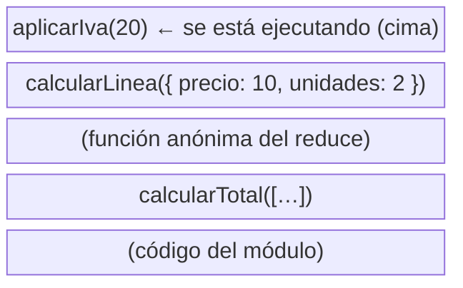
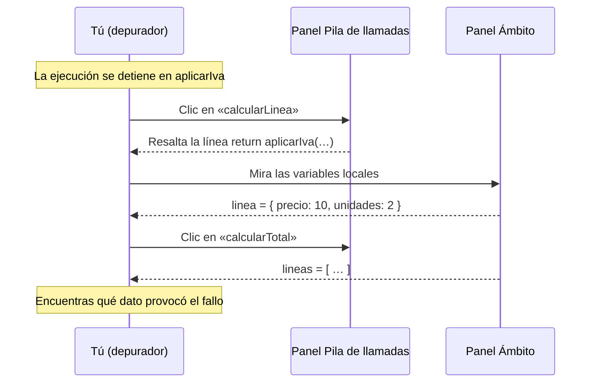
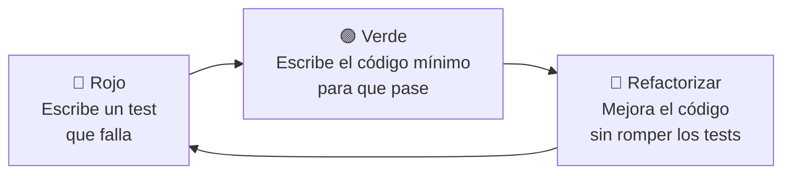

# 10. Depuración, documentación y pruebas

[⬅️ Volver a la unidad](./README.md)

## Índice

- [10.1. Qué se añade en esta unidad](#101-qué-se-añade-en-esta-unidad)
- [10.2. Depurar funciones y objetos](#102-depurar-funciones-y-objetos)
  - [10.2.1. La pila de llamadas](#1021-la-pila-de-llamadas)
  - [10.2.2. Leer la traza de un error](#1022-leer-la-traza-de-un-error)
  - [10.2.3. La pila en el depurador](#1023-la-pila-en-el-depurador)
  - [10.2.4. Ámbitos y closures en el depurador](#1024-ámbitos-y-closures-en-el-depurador)
  - [10.2.5. Puntos de ruptura avanzados](#1025-puntos-de-ruptura-avanzados)
- [10.3. JSDoc completo](#103-jsdoc-completo)
  - [10.3.1. Tipos propios con `@typedef`](#1031-tipos-propios-con-typedef)
  - [10.3.2. Funciones como parámetro: `@callback`](#1032-funciones-como-parámetro-callback)
  - [10.3.3. Documentar clases](#1033-documentar-clases)
  - [10.3.4. Documentar módulos y usar tipos de otro módulo](#1034-documentar-módulos-y-usar-tipos-de-otro-módulo)
  - [10.3.5. Resumen de etiquetas](#1035-resumen-de-etiquetas)
- [10.4. Generar la documentación](#104-generar-la-documentación)
- [10.5. Escribir tests unitarios con Vitest](#105-escribir-tests-unitarios-con-vitest)
  - [10.5.1. La estructura de un test](#1051-la-estructura-de-un-test)
  - [10.5.2. Comprobaciones (_matchers_)](#1052-comprobaciones-matchers)
  - [10.5.3. Probar errores](#1053-probar-errores)
  - [10.5.4. Tablas de casos con `it.each`](#1054-tablas-de-casos-con-iteach)
  - [10.5.5. Probar clases: `beforeEach`](#1055-probar-clases-beforeeach)
  - [10.5.6. Qué probar](#1056-qué-probar)
  - [10.5.7. Cuando un test falla](#1057-cuando-un-test-falla)
  - [10.5.8. Unitarios y de integración](#1058-unitarios-y-de-integración)
- [10.6. Desarrollo guiado por pruebas](#106-desarrollo-guiado-por-pruebas)
- [10.7. Ejemplo integrador: el proyecto `boletin`](#107-ejemplo-integrador-el-proyecto-boletin)
- [Resumen](#resumen)
- [Ejercicios de reflexión](#ejercicios-de-reflexión)

> **CE que trabaja este tema:** RA4 k.

---

## 10.1. Qué se añade en esta unidad

La prueba y la documentación del código se trabajan en todas las unidades del curso. En la UD2 aprendiste a usar la consola y el depurador, a escribir comentarios y bloques JSDoc sencillos, y a leer, ejecutar y **escribir** tus primeros tests con Vitest. En esta unidad das el siguiente paso:

| | UD2 | UD3 (este tema) |
|---|---|---|
| **Depuración** | `console.*`, `debugger`, puntos de ruptura | **Pila de llamadas**, **ámbitos y closures** en el depurador, puntos de ruptura condicionales |
| **Documentación** | Comentarios, `@param` y `@returns` | **`@typedef`**, **`@callback`**, **clases** y **módulos**. **Generar** la documentación como web |
| **Pruebas** | Primeros tests: `describe`, `it`, `toBe`, `toBeNull`, `toBeCloseTo` y casos límite | Tests más completos: **probar errores** (`toThrow`), comparar objetos y arrays (`toEqual`), **tablas de casos**, `beforeEach` y desarrollo guiado por pruebas |

El motivo es que ahora tus programas tienen muchas funciones que se llaman unas a otras, objetos con estado y varios módulos: hace falta saber **por dónde ha pasado** la ejecución, **documentar** qué ofrece cada pieza y **comprobar automáticamente** que cada una hace lo que debe.

---

## 10.2. Depurar funciones y objetos

### 10.2.1. La pila de llamadas

Cuando una función llama a otra, la primera **espera** a que la segunda termine. JavaScript lleva la cuenta de qué funciones están a medio ejecutar en la **pila de llamadas** (*call stack*): cada llamada **apila** un marco; cada `return`, lo **desapila**.

```js
function calcularTotal(lineas) {
  return lineas.reduce((suma, linea) => suma + calcularLinea(linea), 0);
}

function calcularLinea(linea) {
  return aplicarIva(linea.precio * linea.unidades);
}

function aplicarIva(importe) {
  debugger; // ¿cómo hemos llegado aquí?
  return importe * 1.21;
}

console.log(calcularTotal([{ precio: 10, unidades: 2 }]));
```

En el `debugger`, la pila de llamadas es:



El diagrama muestra la pila con la función que se ejecuta arriba y, debajo, todas las que esperan a que termine. Leída de abajo arriba, cuenta la historia: el módulo llamó a `calcularTotal`, que a través del `reduce` llamó a `calcularLinea`, que llamó a `aplicarIva`.

> 📝 **Nota del Profesor**: Es la misma pila de llamadas del **bucle de eventos** que viste en la UD1. Y es la que se desborda con una recursividad sin caso base (tema 2): `RangeError: Maximum call stack size exceeded` significa que se han apilado demasiados marcos.

### 10.2.2. Leer la traza de un error

Cuando se lanza un error que nadie captura, Node.js (y la consola del navegador) muestran la **traza** (*stack trace*): la pila de llamadas **en el momento del error**, de la más reciente a la más antigua.

```js
// src/traza.js
import { Boletin } from './Boletin.js';

function cargarNotas(boletin, filas) {
  for (const [modulo, texto] of filas) {
    boletin.anotar(modulo, Number(texto));
  }
}

const boletin = new Boletin('Luis');
cargarNotas(boletin, [
  ['DWEC', '8'],
  ['DWES', '11'],
]);
```

```text
file:///w/boletin/src/Boletin.js:35
      throw new RangeError(`Nota fuera de rango: ${valor}`);
            ^

RangeError: Nota fuera de rango: 11
    at Boletin.anotar (file:///w/boletin/src/Boletin.js:35:13)
    at cargarNotas (file:///w/boletin/src/traza.js:5:13)
    at file:///w/boletin/src/traza.js:10:1
    at ModuleJob.run (node:internal/modules/esm/module_job:561:25)
    …
```

Cómo se lee:

1. **Tipo y mensaje**: `RangeError: Nota fuera de rango: 11`. Dice **qué** ha pasado.
2. **Primera línea `at`**: dónde se lanzó: el método `anotar` de `Boletin`, en `Boletin.js`, línea 35, columna 13.
3. **Siguientes líneas `at`**: quién llamó a quién. `anotar` fue llamado por `cargarNotas` (línea 5 de `traza.js`), que fue llamado desde el código del módulo (línea 10).
4. Las líneas `node:internal/…` son de Node.js: se ignoran.

> ✅ **Buena práctica**: No te quedes en la primera línea de la traza. El error se **lanza** en `anotar`, pero el **fallo** suele estar más abajo: aquí, en los datos que se pasan a `cargarNotas`. Busca en la traza la **primera línea que sea de tu código y no tenga sentido**.

### 10.2.3. La pila en el depurador

En el depurador (pestaña **Fuentes** de las DevTools, o el panel de depuración de VS Code, UD2), cuando la ejecución se detiene, el panel **Pila de llamadas** (*Call Stack*) muestra la misma lista. Lo interesante es que puedes **hacer clic en cada marco** para ver:

- La **línea** de esa función donde se quedó esperando.
- Sus **variables locales** en ese momento.

Así puedes "subir" desde `aplicarIva` hasta `calcularLinea` y ver qué `linea` recibió, sin poner más puntos de ruptura.



El diagrama resume una sesión típica: con la ejecución detenida, recorres los marcos de la pila y, en cada uno, consultas sus variables.

Los botones de avance de la UD2 cobran ahora más sentido:

| Botón | Qué hace con las funciones |
|-------|----------------------------|
| **Paso a paso por encima** (*Step over*) | Ejecuta la línea entera, sin entrar en las funciones que llama |
| **Entrar** (*Step into*) | Entra en la función que se llama en esa línea (se apila un marco) |
| **Salir** (*Step out*) | Termina la función actual y vuelve a quien la llamó (se desapila) |

### 10.2.4. Ámbitos y closures en el depurador

El panel **Ámbito** (*Scope*) muestra las variables visibles en el punto donde está detenida la ejecución, agrupadas por ámbito (UD2). Con funciones y clases aparecen secciones nuevas:

| Sección | Qué contiene |
|---------|--------------|
| **Local** | Parámetros y variables de la función actual. También `this` |
| **Bloque** (*Block*) | Variables `let`/`const` del bloque actual (`if`, `for`…) |
| **Closure** | Variables de las funciones exteriores que la función actual **recuerda** (tema 2) |
| **Módulo** (*Module*) o **Script** | Lo declarado en el nivel superior del módulo |
| **Global** | `window` o `globalThis` |

Por ejemplo, con el contador del tema 2:

```js
function crearContador() {
  let cuenta = 0;
  return function incrementar() {
    debugger;
    cuenta++;
    return cuenta;
  };
}
const siguiente = crearContador();
siguiente();
```

Al detenerse en `debugger`, el panel Ámbito muestra **Local** con `this: undefined` y, debajo, **Closure (crearContador)** con `cuenta: 0`. Es la "mochila" del tema 2, vista en directo. En un método de una clase, dentro de **Local** está `this` y, al desplegarlo, sus propiedades, **incluidos los campos privados `#`**, que el depurador sí puede mostrar.

> 💡 **Tip del Examinador**: "¿Cómo comprobarías en las DevTools qué variables recuerda un closure?" → Poniendo un punto de ruptura dentro de la función interna y mirando la sección **Closure** del panel Ámbito, que muestra las variables de la función exterior que conserva.

### 10.2.5. Puntos de ruptura avanzados

Cuando un bucle o una operación agregada procesa cien elementos y solo falla con uno, un punto de ruptura normal se detiene cien veces. Las DevTools y VS Code ofrecen (clic derecho sobre el número de línea):

| Tipo | Qué hace | Ejemplo |
|------|----------|---------|
| **Condicional** | Solo se detiene si la condición es verdadera | `linea.precio < 0` |
| **Punto de registro** (*logpoint*) | No se detiene: muestra un mensaje en la consola | `Línea {linea.producto}: {importe}` |
| **En excepciones** | Se detiene al lanzarse cualquier error (opción del panel de puntos de ruptura) | Para encontrar dónde se lanza un error capturado |

Y en el panel **Inspección** (*Watch*) puedes añadir expresiones que se recalculan en cada paso: `boletin.media`, `lineas.length`, `importe > 100`.

> ✅ **Buena práctica**: Prefiere los puntos de registro a llenar el código de `console.log`: no modifican el fichero, así que no se te olvidan en un commit.

---

## 10.3. JSDoc completo

En la UD2 documentaste funciones con descripción, `@param`, `@returns` y `@example`. Con funciones que reciben objetos, clases y módulos, necesitas algunas etiquetas más.

### 10.3.1. Tipos propios con `@typedef`

Si varias funciones reciben el mismo tipo de objeto, descríbelo **una vez** con `@typedef` y sus `@property`, y úsalo por su nombre:

```js
/**
 * Nota de un alumno en un módulo.
 * @typedef {object} Nota
 * @property {string} modulo Código del módulo, por ejemplo `'DWEC'`.
 * @property {number} valor Nota de 0 a 10.
 */

/**
 * Calcula la media de un conjunto de notas, redondeada a dos decimales.
 *
 * @param {Nota[]} notas Notas del alumno.
 * @returns {number} La media, o 0 si no hay notas.
 */
export function calcularMedia(notas) {
  /* … */
}
```

Tipos que puedes escribir entre llaves:

| Tipo | Significado |
|------|-------------|
| `{number}`, `{string}`, `{boolean}` | Primitivos |
| `{Nota}`, `{Boletin}` | Un tipo propio (`@typedef`) o una clase |
| `{Nota[]}` o `{Array<Nota>}` | Array de ese tipo |
| `{Map<string, number>}`, `{Set<string>}` | Colecciones con el tipo de clave y valor |
| `{number\|null}` | Uno u otro |
| `{object}` | Cualquier objeto |
| `{function(number): string}` o un `@callback` | Una función: tipos de sus parámetros y de lo que devuelve |
| `[parametro]` o `[parametro=valor]` en `@param` | Parámetro opcional (con su valor por defecto) |
| `{...number}` en `@param` | Parámetro _rest_ |

### 10.3.2. Funciones como parámetro: `@callback`

Para documentar un parámetro que es una función (un callback, una estrategia), describe su forma con `@callback`:

```js
/**
 * Calcula el recargo de un método de pago.
 * @callback EstrategiaPago
 * @param {number} importe Importe del pedido.
 * @returns {number} Recargo en euros.
 */

/**
 * Calcula el total de un pedido con el recargo del método de pago.
 *
 * @param {number} importe Importe del pedido.
 * @param {EstrategiaPago} calcularRecargo Estrategia de recargo.
 * @returns {number} Importe más recargo.
 */
export function calcularTotal(importe, calcularRecargo) {
  return importe + calcularRecargo(importe);
}
```

### 10.3.3. Documentar clases

En una clase se documentan: la **clase** (encima de `class`), el **constructor** y sus parámetros, las **propiedades públicas**, los **métodos**, los **_getters_** (con `@type`) y los **estáticos**. Los campos privados `#` no forman parte de la documentación pública, aunque puedes darles un `@type` para el editor.

```js
/**
 * Boletín de notas de un alumno.
 *
 * @example
 * const boletin = new Boletin('Ana');
 * boletin.anotar('DWEC', 7).anotar('DWES', 4);
 * boletin.media; // 5.5
 */
export class Boletin {
  /** @type {Nota[]} */
  #notas = [];

  /**
   * @param {string} alumno Nombre del alumno.
   */
  constructor(alumno) {
    /** Nombre del alumno. */
    this.alumno = alumno;
  }

  /**
   * Anota la nota de un módulo. Si el módulo ya tenía nota, la sustituye.
   *
   * @param {string} modulo Código del módulo.
   * @param {number} valor Nota de 0 a 10.
   * @returns {Boletin} El propio boletín, para encadenar llamadas.
   * @throws {RangeError} Si la nota no está entre 0 y 10.
   */
  anotar(modulo, valor) {
    /* … */
  }

  /**
   * Media de todas las notas anotadas.
   * @type {number}
   */
  get media() {
    /* … */
  }
}
```

> ✅ **Buena práctica**: Documenta con `@throws` **cada error** que pueda lanzar un método o una función: quien lo use tiene que saber qué capturar. Y añade un `@example` a las clases: es lo primero que se lee para aprender a usarlas.

### 10.3.4. Documentar módulos y usar tipos de otro módulo

Al principio de un módulo, un bloque con **`@module`** le da nombre y describe para qué sirve. La herramienta de documentación lo usa para agrupar todo lo que exporta.

```js
/**
 * Cálculos con las notas de un alumno.
 * @module notas
 */
```

Si un módulo usa un tipo definido en otro (por ejemplo, `Boletin.js` usa `Nota` de `notas.js`), se importa **solo para la documentación** con la etiqueta `@import`:

```js
/** @import { Nota } from './notas.js' */
```

No ejecuta nada: solo le dice al editor (y a TypeScript, si activas `// @ts-check`) dónde está definido el tipo.

### 10.3.5. Resumen de etiquetas

| Etiqueta | Para qué | Dónde |
|----------|----------|-------|
| `@param {tipo} nombre descripción` | Un parámetro | Funciones, métodos, constructor |
| `@returns {tipo} descripción` | Lo que devuelve | Funciones y métodos |
| `@throws {TipoError} descripción` | Un error que puede lanzar | Funciones y métodos |
| `@example` | Ejemplo de uso | Funciones, clases, métodos |
| `@type {tipo}` | Tipo de una variable, constante, campo o _getter_ | Variables y propiedades |
| `@typedef {object} Nombre` + `@property` | Un tipo de objeto propio | Normalmente al principio del módulo |
| `@callback Nombre` | La forma de una función que se pasa como parámetro | Normalmente al principio del módulo |
| `@module nombre` | Nombre y descripción del módulo | Primer bloque del fichero |
| `@import { Tipo } from './fichero.js'` | Usar un tipo de otro módulo | Al principio del fichero |
| `@see` | Referencia a otra función o a una URL | Cualquiera |
| `@deprecated` | Marca algo como obsoleto | Cualquiera |

---

## 10.4. Generar la documentación

Los bloques JSDoc no solo los lee el editor: la herramienta **JSDoc** (paquete `jsdoc` de npm) los convierte en una **web de documentación** con una página por clase y por módulo, como las de MDN.

**1. Instalar** como dependencia de desarrollo:

```bash
npm install -D jsdoc
```

**2. Configurar** con un fichero `jsdoc.json` en la raíz del proyecto:

```json
{
  "source": { "include": ["src"], "includePattern": "\\.js$" },
  "opts": { "destination": "docs", "recurse": true, "readme": "README.md" }
}
```

| Opción | Qué indica |
|--------|------------|
| `source.include` | Carpetas que se documentan (aquí, solo `src`: los tests no) |
| `opts.destination` | Carpeta donde se genera la web |
| `opts.recurse` | Incluir las subcarpetas |
| `opts.readme` | Fichero Markdown que se usa como portada de la documentación |

**3. Añadir el script** en `package.json`:

```json
"scripts": {
  "docs": "jsdoc -c jsdoc.json"
}
```

**4. Generar** y abrir `docs/index.html` en el navegador:

```bash
npm run docs
```

La web tiene una portada (el `README.md`), un índice lateral con los **módulos** y las **clases**, y una página por cada uno con sus miembros, métodos, parámetros, tipos, valores devueltos, errores y ejemplos, más un enlace al código fuente. Los campos y métodos privados (`#`) no aparecen.

**5. Excluir la carpeta generada** de Git, de Prettier y de ESLint, porque no es código tuyo:

```text
# .gitignore y .prettierignore
docs/
```

```js
// eslint.config.js: primer elemento del array
export default [
  { ignores: ['docs/'] },
  js.configs.recommended,
  // …
];
```

Si no la excluyes, `npm run lint` mostrará decenas de errores de los scripts que `jsdoc` copia en `docs/`.

> 📝 **Nota del Profesor**: La carpeta `docs/` se **genera**, así que no se sube al repositorio: cualquiera puede regenerarla con `npm run docs`. En un proyecto real se publica automáticamente, por ejemplo con GitHub Pages; lo verás con GitHub Actions en la UD8.

> ⚠️ **Cuidado**: La herramienta `jsdoc` no entiende algunas sintaxis de tipos que sí entiende VS Code porque vienen de TypeScript, como `{import('./notas.js').Nota}` o los tipos de función con flecha `{(n: number) => number}`: da un error al generar. Usa en su lugar la etiqueta `@import` del apartado 10.3.4 y, para las funciones, un `@callback` o la forma `{function(number): number}`. Las dos funcionan en el editor y en `jsdoc`.

---

## 10.5. Escribir tests unitarios con Vitest

Un **test unitario** comprueba una **unidad** pequeña de código (una función, un método, una clase) **de forma aislada**: con unos datos concretos, ¿devuelve lo que debe? En la UD2 escribiste los primeros, con comprobaciones sencillas y casos límite. Aquí repasas su estructura y aprendes a probar errores, objetos, clases y muchos casos a la vez.

### 10.5.1. La estructura de un test

Los tests van en una carpeta `tests/`, en ficheros que terminan en **`.test.js`**, normalmente uno por módulo: `tests/notas.test.js` prueba `src/notas.js`.

```js
// tests/notas.test.js
import { describe, it, expect } from 'vitest';
import { calcularMedia } from '../src/notas.js';

describe('calcularMedia', () => {
  it('calcula la media de varias notas', () => {
    // 1. Preparar: los datos de entrada
    const notas = [
      { modulo: 'DWEC', valor: 7 },
      { modulo: 'DWES', valor: 8 },
    ];

    // 2. Actuar: llamar a lo que se prueba
    const media = calcularMedia(notas);

    // 3. Comprobar: el resultado es el esperado
    expect(media).toBe(7.5);
  });

  it('devuelve 0 si no hay notas', () => {
    expect(calcularMedia([])).toBe(0);
  });
});
```

| Pieza | Qué hace |
|-------|----------|
| `import { describe, it, expect } from 'vitest'` | Trae las funciones de Vitest |
| `import { … } from '../src/…'` | Trae lo que se va a probar: por eso conviene **exportar** las funciones |
| `describe('nombre', () => { … })` | Agrupa los tests de una función o una clase |
| `it('qué hace', () => { … })` | Un test. El texto describe **un comportamiento** y se lee como una frase: "calcularMedia **devuelve 0 si no hay notas**" |
| `expect(real).toBe(esperado)` | La comprobación: si no se cumple, el test falla |

Cada test sigue la estructura **Preparar, Actuar, Comprobar** (en inglés, *Arrange, Act, Assert*, o AAA). En los tests cortos las tres partes caben en una línea, como en el segundo.

> ✅ **Buena práctica**: Un test comprueba **un solo comportamiento**, y su nombre lo dice. Si falla "redondea a dos decimales", sabes qué se ha roto sin leer el código del test.

### 10.5.2. Comprobaciones (_matchers_)

`expect(valor)` devuelve un objeto con muchos métodos de comprobación, llamados ***matchers***:

| _Matcher_ | Comprueba que… | Ejemplo |
|-----------|----------------|---------|
| `toBe(v)` | Es **idéntico** (`Object.is`, como `===`). Para primitivos | `expect(suma(2, 2)).toBe(4)` |
| `toEqual(v)` | Tiene el **mismo contenido**. Para arrays y objetos | `expect(lista).toEqual([1, 2])` |
| `toBeCloseTo(v, decimales)` | Es casi igual, para decimales | `expect(0.1 + 0.2).toBeCloseTo(0.3)` |
| `toBeTruthy()` / `toBeFalsy()` | Es _truthy_ / _falsy_ | `expect(esValido('x')).toBeFalsy()` |
| `toBeNull()` / `toBeUndefined()` | Es `null` / `undefined` | `expect(buscar('zz')).toBeUndefined()` |
| `toContain(v)` | Un array o un texto contiene `v` | `expect(nombres).toContain('Ana')` |
| `toHaveLength(n)` | Tiene longitud `n` | `expect(lista).toHaveLength(3)` |
| `toHaveProperty(clave, valor?)` | El objeto tiene esa propiedad | `expect(libro).toHaveProperty('isbn')` |
| `toBeInstanceOf(Clase)` | Es una instancia de la clase | `expect(c).toBeInstanceOf(Coche)` |
| `toMatchObject(parcial)` | Contiene al menos esas propiedades | `expect(p).toMatchObject({ estado: 'pagado' })` |
| `toThrow(error?)` | Lanza un error (apartado 10.5.3) | `expect(() => f(-1)).toThrow()` |
| `.not.…` | Niega cualquier _matcher_ | `expect(lista).not.toContain('Eva')` |

> ⚠️ **Cuidado**: `toBe` con arrays u objetos compara **referencias** (tema 3): `expect([1, 2]).toBe([1, 2])` **falla**. Para comparar contenidos, usa `toEqual`. Y con decimales calculados, `toBeCloseTo`: `expect(0.1 + 0.2).toBe(0.3)` falla.

> 💡 **Tip del Examinador**: "¿Qué diferencia hay entre `toBe` y `toEqual`?" → `toBe` comprueba que son el mismo valor o la misma referencia (como `===`); `toEqual` compara el contenido recursivamente, así que sirve para arrays y objetos distintos con los mismos datos.

### 10.5.3. Probar errores

Para comprobar que algo **lanza** un error, hay que pasar a `expect` una **función** que haga la llamada, no la llamada en sí:

```js
it('lanza un RangeError si la nota no está entre 0 y 10', () => {
  expect(() => calificar(11)).toThrow(RangeError);               // el tipo de error
  expect(() => calificar(-1)).toThrow('Nota fuera de rango: -1'); // el mensaje
  expect(() => calificar(Number.NaN)).toThrow();                 // cualquier error
});
```

Si escribieras `expect(calificar(11)).toThrow()`, el error se lanzaría **antes** de llegar a `expect`, y el test fallaría por el error, no por la comprobación. La flecha `() =>` retrasa la llamada para que Vitest la ejecute y capture el error.

### 10.5.4. Tablas de casos con `it.each`

Cuando quieres probar la misma función con muchos datos, en lugar de copiar el test, usa una **tabla**:

```js
describe('calificar', () => {
  it.each([
    [0, 'Suspenso'],
    [4.99, 'Suspenso'],
    [5, 'Aprobado'],
    [6.99, 'Aprobado'],
    [7, 'Notable'],
    [9, 'Sobresaliente'],
    [10, 'Sobresaliente'],
  ])('califica %d como %s', (valor, esperado) => {
    expect(calificar(valor)).toBe(esperado);
  });
});
```

Cada fila genera un test. `%d` y `%s` en el nombre se sustituyen por los valores de la fila, así que Vitest muestra "califica 4.99 como Suspenso", "califica 5 como Aprobado"… Fíjate en que la tabla recorre los **límites** de cada calificación: 4,99 y 5, 6,99 y 7.

### 10.5.5. Probar clases: `beforeEach`

Para probar una clase, cada test crea sus instancias, llama a sus métodos y comprueba su estado. Para no repetir la creación y, sobre todo, para que **cada test empiece desde cero**, se usa `beforeEach`, que se ejecuta antes de cada `it`:

```js
import { describe, it, expect, beforeEach } from 'vitest';
import { Boletin } from '../src/Boletin.js';

describe('Boletin', () => {
  let boletin;

  beforeEach(() => {
    boletin = new Boletin('Ana'); // un boletín nuevo para cada test
  });

  it('calcula la media de las notas anotadas', () => {
    boletin.anotar('DWEC', 7).anotar('DWES', 4);
    expect(boletin.media).toBe(5.5);
  });

  it('rechaza notas fuera de rango sin modificar el boletín', () => {
    boletin.anotar('DWEC', 7);
    expect(() => boletin.anotar('DWES', 12)).toThrow(RangeError);
    expect(boletin.media).toBe(7);
  });
});
```

> ⚠️ **Cuidado**: Los tests deben ser **independientes**: cada uno tiene que pasar aunque se ejecute solo o en otro orden. Si un test usa un objeto que otro test ya ha modificado, el resultado depende del orden. `beforeEach` lo evita. Por la misma razón, los Singletons (tema 9) son incómodos de probar: su estado pasa de un test a otro.

Existen también `afterEach` (después de cada test), `beforeAll` y `afterAll` (una vez, antes o después de todos).

### 10.5.6. Qué probar

No hace falta probar cada línea, pero sí cada **comportamiento** importante. Para cada función o método, piensa en tres tipos de casos:

| Tipo de caso | Pregunta | Ejemplos para `calcularMedia` |
|--------------|----------|-------------------------------|
| **Normal** | ¿Hace lo que debe con datos habituales? | Dos o tres notas |
| **Límite** | ¿Y en los bordes? | Array vacío, una sola nota, notas 0 y 10, redondeo |
| **Erróneo** | ¿Rechaza bien lo que no es válido? | Notas fuera de rango (si la función las valida) |

Y algunos consejos:

- Prueba la **interfaz pública** (lo que se exporta, los métodos públicos), no los detalles internos. Si mañana cambias cómo se guardan las notas, los tests deben seguir pasando.
- Las **funciones puras** (tema 2) son las más fáciles de probar: entrada y salida, sin preparar nada más. Es otro motivo para separar la lógica de la consola y del DOM.
- Calcula el **valor esperado a mano**, no copiando lo que devuelve el código: si copias el resultado, el test confirmará el error en lugar de detectarlo.

> 📝 **Nota del Profesor**: En la UD4 verás cómo probar código que depende de cosas externas (la fecha actual, `localStorage`) con **mocks**, y en la UD5, código que usa el DOM.

### 10.5.7. Cuando un test falla

Vitest dice qué test falla, qué esperaba, qué recibió y en qué línea:

```text
 ❯ tests/notas.test.js (11 tests | 1 failed) 12ms
   ❯ calcularMedia (3)
     ✓ calcula la media de varias notas 2ms
     × redondea a dos decimales 7ms
     ✓ devuelve 0 si no hay notas 0ms

 FAIL  tests/notas.test.js > calcularMedia > redondea a dos decimales
AssertionError: expected 7.67 to be 7.66 // Object.is equality

- Expected
+ Received

- 7.66
+ 7.67

 ❯ tests/notas.test.js:19:34
     17|       { modulo: 'C', valor: 8 },
     18|     ];
     19|     expect(calcularMedia(notas)).toBe(7.66);
       |                                  ^

 Test Files  1 failed | 1 passed (2)
      Tests  1 failed | 16 passed (17)
```

Como en la UD2, antes de cambiar nada hay que **razonar** quién tiene razón: la media de 7, 8 y 8 es 7,666…, que redondeada a dos decimales es **7,67**. El código está bien y el test está mal.

> ✅ **Buena práctica**: Para depurar un test que falla, pon un punto de ruptura dentro del test o del código y ejecuta Vitest desde el panel de depuración de VS Code (o la extensión oficial de Vitest). Funciona igual que depurar un programa.

### 10.5.8. Unitarios y de integración

Recuerda la **pirámide de pruebas** de la UD1 (tema 6). Hasta ahora todos tus tests eran **unitarios**: cada uno prueba **una pieza** (una función, una clase) y, si falla, sabes exactamente cuál está mal. Cuando un proyecto tiene varios módulos, también hace falta comprobar que **encajan**: que la clase usa bien las funciones del otro módulo, que los datos pasan de una pieza a otra con el formato esperado. Eso es un test **de integración** (*integration test*): prueba **varias piezas reales juntas**, a través de su interfaz pública, sin sustituir ninguna.

En el proyecto `boletin` (apartado 10.7), `Boletin` calcula la media con `calcularMedia` y `main.js` la califica con `calificar`. Este test comprueba el mismo recorrido que hace el programa, con las dos piezas a la vez:

```js
// tests/boletin.integracion.test.js
import { describe, it, expect } from 'vitest';
import { Boletin } from '../src/Boletin.js';
import { calificar } from '../src/notas.js';

describe('boletín completo (integración)', () => {
  it('califica la media de un boletín con varias notas', () => {
    const boletin = new Boletin('Ana').anotar('DWEC', 7.5).anotar('DWES', 4).anotar('DIW', 9);
    expect(boletin.media).toBe(6.83);
    expect(calificar(boletin.media)).toBe('Aprobado');
    expect(boletin.suspensos()).toEqual(['DWES']);
  });

  it('un boletín sin notas tiene media 0 y se califica como suspenso', () => {
    const boletin = new Boletin('Luis');
    expect(calificar(boletin.media)).toBe('Suspenso');
  });
});
```

```text
// Salida de npm test (solo este fichero):
 ✓ tests/boletin.integracion.test.js (2 tests)

      Tests  2 passed (2)
```

Se escribe igual que un test unitario: lo que cambia es **qué** prueba.

| | Unitario | De integración |
|---|---|---|
| Qué prueba | Una pieza aislada | Varias piezas reales juntas |
| Ejemplo | `calificar(4.99)` devuelve `'Suspenso'` | Un `Boletin` con notas se califica bien con `calificar` |
| Cuántos | Muchos: uno por comportamiento y caso límite | Algunos: los recorridos principales |
| Si falla | Sabes qué pieza está mal | Sabes que algo no encaja; los unitarios te dicen dónde |

Los dos se necesitan: los unitarios cubren los casos límite de cada pieza con detalle, y los de integración comprueban que el conjunto funciona. La frontera no siempre es nítida (`Boletin` ya usa `calcularMedia` por dentro), así que lo que cuenta es la **intención** del test: centrarse en una pieza o en cómo colaboran.

> 📝 **Nota del Profesor**: Desde ahora, en los ejercicios dirás de qué tipo es cada test. En la UD4, los tests que sustituyen el almacenamiento o la fecha por un **doble** siguen siendo unitarios: el doble sirve precisamente para aislar la pieza. En la UD5 llegarán los tests de integración **con el DOM** y las pruebas **de extremo a extremo**, que abren la página en un navegador real con Playwright.

---

## 10.6. Desarrollo guiado por pruebas

El **desarrollo guiado por pruebas** (*Test-Driven Development*, TDD) le da la vuelta al orden habitual: **primero se escribe el test** y después el código que lo hace pasar. Se trabaja en ciclos cortos:



El diagrama muestra el ciclo **rojo, verde, refactorizar**: cada vuelta añade un comportamiento pequeño y deja el código limpio y probado.

Ventajas:

- Te obliga a pensar **qué debe hacer** la función (sus casos normales, límite y erróneos) antes de **cómo**.
- Todo el código nace con sus tests.
- Puedes **refactorizar** con tranquilidad: si los tests siguen en verde, no has roto nada.

> 📝 **Nota del Profesor**: No es obligatorio trabajar siempre con TDD, pero sí es una forma muy buena de hacer los ejercicios de esta unidad: lee el contrato del enunciado, conviértelo en tests y programa hasta que pasen. Cuando el enunciado da ejemplos de entrada y salida, ya tienes medio fichero de tests escrito.

---

## 10.7. Ejemplo integrador: el proyecto `boletin`

Un proyecto completo que junta todo el tema: dos módulos documentados con JSDoc, tests propios, ESLint, Prettier y documentación generada.

```text
boletin/
├── package.json        ← scripts start, test, lint, format, format:check y docs
├── jsdoc.json          ← configuración de la documentación
├── eslint.config.js    ← ignora docs/
├── .prettierrc
├── .prettierignore     ← *.md y docs/
├── .gitignore          ← node_modules/ y docs/
├── README.md           ← portada del proyecto y de la documentación
├── src/
│   ├── notas.js        ← @module notas: @typedef Nota, calcularMedia, calificar
│   ├── Boletin.js      ← clase Boletin con campo privado, getter y @throws
│   └── main.js         ← punto de entrada
└── tests/
    ├── notas.test.js   ← 11 tests (incluye una tabla con it.each)
    └── Boletin.test.js ← 6 tests con beforeEach
```

```json
{
  "name": "boletin",
  "version": "1.0.0",
  "private": true,
  "type": "module",
  "scripts": {
    "start": "node src/main.js",
    "test": "vitest run",
    "lint": "eslint .",
    "format": "prettier --write .",
    "format:check": "prettier --check .",
    "docs": "jsdoc -c jsdoc.json"
  },
  "devDependencies": {
    "@eslint/js": "^10.0.1",
    "eslint": "^10.12.0",
    "globals": "^17.13.0",
    "jsdoc": "^4.0.5",
    "prettier": "^3.9.9",
    "vitest": "^5.0.3"
  }
}
```

El código de `src/notas.js` y `src/Boletin.js` es el de los apartados 10.3.1 y 10.3.3; los tests, los de 10.5. El programa principal:

```js
// src/main.js
import { Boletin } from './Boletin.js';
import { calificar } from './notas.js';

const boletin = new Boletin('Ana').anotar('DWEC', 7.5).anotar('DWES', 4).anotar('DIW', 9);
console.log(`📋 ${boletin.alumno}: media ${boletin.media} (${calificar(boletin.media)})`);
console.log(`❌ Suspensos: ${boletin.suspensos().join(', ')}`);
```

Flujo de trabajo completo:

```bash
npm install          # 1. dependencias (la primera vez)
npm test             # 2. los tests, en verde antes de seguir
npm start            # 3. ejecutar el programa
npm run lint         # 4. revisar con ESLint
npm run format       # 5. formatear con Prettier
npm run docs         # 6. generar la documentación en docs/
git add . && git commit -m "Añade la clase Boletin con sus tests"   # 7. guardar el cambio
```

```text
// Salida de npm start:
📋 Ana: media 6.83 (Aprobado)
❌ Suspensos: DWES
```

```text
// Salida de npm test:
 RUN  v5.0.3 /boletin

 ✓ tests/Boletin.test.js (6 tests) 6ms
 ✓ tests/notas.test.js (11 tests) 6ms

 Test Files  2 passed (2)
      Tests  17 passed (17)
```

| Paso | Herramienta | Qué te garantiza |
|------|-------------|------------------|
| Probar | Vitest | Cada función y cada método hace lo que dicen sus tests, también en los casos límite |
| Depurar | DevTools o VS Code | Si algo falla, encuentras por qué con la pila de llamadas y los ámbitos |
| Documentar | JSDoc | Tipos, parámetros, errores y ejemplos de cada pieza pública |
| Generar la documentación | `jsdoc` | Una web navegable con la interfaz pública del proyecto |
| Revisar y formatear | ESLint y Prettier | Sin malas prácticas y con un estilo uniforme |
| Guardar | Git | Historial de cada cambio, con los tests en verde |

---

## Resumen

- La **pila de llamadas** guarda las funciones que están a medio ejecutar. La **traza** de un error la muestra de la llamada más reciente a la más antigua: busca la primera línea de tu código que no tenga sentido.
- En el depurador, el panel **Pila de llamadas** permite moverse entre marcos y ver sus variables; el panel **Ámbito** muestra **Local**, **Bloque**, **Closure**, **Módulo** y **Global**. Los puntos de ruptura **condicionales** y de **registro** evitan detenerse en cada vuelta.
- **JSDoc completo**: `@typedef` y `@property` para tipos propios, `@callback` para funciones como parámetro, `@throws` para errores, documentación de **clases** (constructor, métodos, _getters_ con `@type`) y **módulos** (`@module`, `@import`).
- La herramienta **`jsdoc`** genera la documentación como web (`npm run docs`, carpeta `docs/` fuera del repositorio).
- Un **test unitario** prueba una unidad aislada siguiendo **Preparar, Actuar, Comprobar**. `describe` agrupa, `it` describe un comportamiento y `expect` comprueba con un _matcher_: `toBe`, `toEqual`, `toBeCloseTo`, `toContain`, `toThrow`…
- Para probar errores: `expect(() => llamada).toThrow(…)`. Para muchos casos: `it.each`. Para clases: `beforeEach`, con tests **independientes**.
- Prueba casos **normales**, **límite** y **erróneos** a través de la interfaz pública, con valores esperados calculados a mano.
- Un test **unitario** prueba una pieza aislada; uno **de integración**, varias piezas reales juntas (por ejemplo, la librería a través de su interfaz pública). Se necesitan los dos.
- **TDD**: rojo, verde, refactorizar.

## Ejercicios de reflexión

1. Escribe a mano la pila de llamadas en el momento en que se lanza el error si llamas a `cargarNotas(boletin, [['DWEC', 'diez']])` en el ejemplo del apartado 10.2.2. ¿Qué error se lanza y en qué método?
2. ¿Por qué `expect([1, 2]).toBe([1, 2])` falla y `expect([1, 2]).toEqual([1, 2])` pasa?
3. Escribe los tests (solo los `it` con su nombre y su `expect`) para una función `esBisiesto(anio)`. Incluye al menos un caso normal, dos límite y uno erróneo.
4. ¿Qué pasaría si en el `describe('Boletin')` creases el boletín una sola vez fuera de `beforeEach`? ¿Qué test podría fallar dependiendo del orden?
5. ¿Qué ventajas tiene generar la documentación con `jsdoc` frente a escribirla a mano en el README? ¿Qué debe seguir yendo en el README?

---

[⬅️ Volver a la unidad](./README.md)
