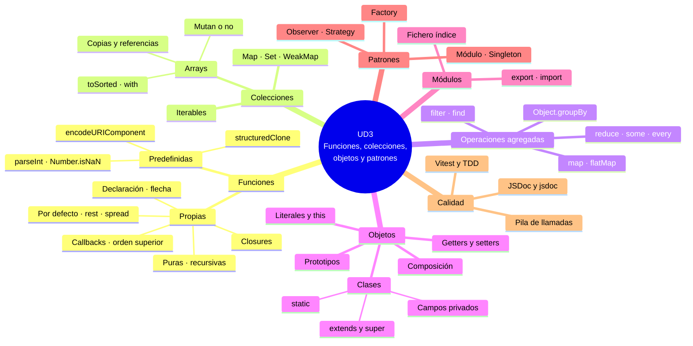

# 11. Resumen y mapa mental

[⬅️ Volver a la unidad](./README.md)

- [11. Resumen y mapa mental](#11-resumen-y-mapa-mental)
  - [Resumen ejecutivo](#resumen-ejecutivo)
  - [Mapa mental](#mapa-mental)
  - [Checklist de evaluación](#checklist-de-evaluación)
    - [Funciones predefinidas (CE a)](#funciones-predefinidas-ce-a)
    - [Funciones definidas por el usuario (CE b)](#funciones-definidas-por-el-usuario-ce-b)
    - [Arrays y colecciones (CE c, d)](#arrays-y-colecciones-ce-c-d)
    - [Operaciones agregadas (CE e)](#operaciones-agregadas-ce-e)
    - [Orientación a objetos (CE f, g, h, i)](#orientación-a-objetos-ce-f-g-h-i)
    - [Patrones de diseño (CE j)](#patrones-de-diseño-ce-j)
    - [Depuración, documentación y pruebas (CE k)](#depuración-documentación-y-pruebas-ce-k)

## Resumen ejecutivo

En esta unidad has aprendido a **definir tus propias estructuras** (funciones, colecciones, objetos, clases y módulos), a **organizarlas con patrones de diseño** y a **probarlas y documentarlas**:

1. **Funciones predefinidas**: llamar a una función, argumentos y valor devuelto. Clasificación en globales (conversión, comprobación, URI y evaluación), métodos de objetos predefinidos y funciones del entorno. `parseInt`, `Number.isNaN`, `Number.isFinite`, `encodeURIComponent`, `structuredClone` y por qué no `eval`.
2. **Funciones definidas por el usuario**: declaración, expresión y flecha. Parámetros por defecto, _rest_, _spread_ y objetos como parámetro. Callbacks, funciones de orden superior y closures. Funciones puras, recursividad y errores con `throw` y `try…catch`.
3. **Arrays**: características propias de JavaScript, creación, acceso con `at`, métodos que mutan y que no (`sort` frente a `toSorted`), matrices, desestructuración, referencias y copias superficiales y profundas.
4. **Operaciones agregadas**: filtrado, transformación, reducción y recolección con `map`, `filter`, `reduce`, `find`, `some`, `every`, `flatMap` y `Object.groupBy`. Encadenamiento y equivalencia con los bucles.
5. **Colecciones**: `Map` para diccionarios, `Set` para valores únicos, `WeakMap` y el protocolo de iteración. Cuándo usar cada colección.
6. **Objetos y prototipos**: características de la orientación a objetos en JavaScript, objetos literales, métodos y `this`, _getters_ y _setters_, fábricas, funciones constructoras y la cadena de prototipos.
7. **Clases**: constructor, métodos, campos públicos y privados, estáticos, herencia con `extends` y `super`, polimorfismo y composición frente a herencia.
8. **Módulos**: exportaciones con nombre y por defecto, ficheros índice, comportamiento de los módulos y cómo organizar un proyecto.
9. **Patrones de diseño**: Módulo, Singleton, Factory, Observer y Strategy, y cuándo aplicarlos.
10. **Depuración, documentación y pruebas**: pila de llamadas, ámbitos y closures en el depurador; JSDoc completo y documentación generada con `jsdoc`; tests unitarios y de integración propios con Vitest y TDD.

## Mapa mental

## Checklist de evaluación

### Funciones predefinidas (CE a)

- [ ] Sé llamar a una función, distingo `f` de `f()` y sé que mostrar por consola no es devolver
- [ ] Clasifico las funciones predefinidas en globales, métodos de objetos predefinidos y funciones del entorno
- [ ] Uso `parseInt` y `parseFloat` para extraer números y `Number` para validar
- [ ] Explico la diferencia entre `isNaN` y `Number.isNaN`, y entre `isFinite` y `Number.isFinite`
- [ ] Codifico los valores de una URL con `encodeURIComponent`
- [ ] Hago copias profundas con `structuredClone` y sé por qué no se usa `eval`
- [ ] Consulto la ficha de una función en MDN: sintaxis, valor devuelto y compatibilidad

### Funciones definidas por el usuario (CE b)

- [ ] Defino funciones con declaración, expresión y flecha, y sé cuándo usar cada una
- [ ] Uso `return` y hago que mis funciones devuelvan resultados en lugar de mostrarlos
- [ ] Uso parámetros por defecto, parámetros _rest_, el operador _spread_ y objetos como parámetro
- [ ] Sé qué pasa al modificar dentro de una función un primitivo y un objeto recibidos
- [ ] Paso funciones como callbacks y escribo funciones de orden superior
- [ ] Explico qué es un closure y lo uso para crear funciones configuradas o datos privados
- [ ] Distingo una función pura de una con efectos secundarios
- [ ] Escribo funciones recursivas con su caso base
- [ ] Lanzo errores con `throw` y los capturo con `try…catch`

### Arrays y colecciones (CE c, d)

- [ ] Conozco las características de los arrays en JavaScript: dinámicos, heterogéneos y objetos
- [ ] Creo arrays con el literal, `Array.from` y `fill`, y sé por qué evitar `new Array(n)`
- [ ] Accedo con índices y `at`, añado y quito con `push`, `pop`, `shift`, `unshift` y `splice`
- [ ] Distingo los métodos que mutan de los que no, y uso `toSorted`, `toReversed`, `toSpliced` y `with`
- [ ] Ordeno números y textos con una función de comparación y `localeCompare`
- [ ] Trabajo con matrices (arrays de arrays)
- [ ] Desestructuro arrays y uso el _spread_ para copiar y unir
- [ ] Sé que los arrays se comparan por referencia y diferencio copia superficial y profunda
- [ ] Uso `Map` y `Set`, y elijo entre array, objeto, `Map` y `Set` según el problema
- [ ] Sé qué es un iterable y qué funciona con cualquier iterable

### Operaciones agregadas (CE e)

- [ ] Identifico si un problema es de filtrado, transformación, reducción o recolección
- [ ] Uso `forEach`, `map`, `filter` y `reduce` con su valor inicial
- [ ] Busco y compruebo con `find`, `findIndex`, `some` y `every`
- [ ] Aplano con `flat` y `flatMap` y agrupo con `Object.groupBy`
- [ ] Aplico operaciones agregadas a objetos, `Map` y `Set` convirtiéndolos en arrays
- [ ] Encadeno operaciones con una por línea
- [ ] Reescribo bucles como operaciones agregadas y sé cuándo es mejor el bucle

### Orientación a objetos (CE f, g, h, i)

- [ ] Explico los conceptos de la POO y en qué se diferencia la de JavaScript (prototipos, estructura dinámica)
- [ ] Creo objetos literales, leo sus propiedades con punto y corchetes, y uso los atajos de sintaxis
- [ ] Defino métodos y sé qué vale `this` según cómo se llama el método
- [ ] Uso _getters_ y _setters_ para propiedades calculadas y validadas
- [ ] Explico la cadena de prototipos y por qué los métodos se comparten
- [ ] Defino clases con constructor, métodos, campos públicos y privados (`#`) y miembros estáticos
- [ ] Creo subclases con `extends` y `super`, y sobrescribo métodos (polimorfismo)
- [ ] Elijo entre herencia y composición y lo justifico
- [ ] Organizo el código en módulos con exportaciones con nombre y un fichero índice
- [ ] Uso desde un programa principal los objetos y clases que he definido en otros módulos

### Patrones de diseño (CE j)

- [ ] Explico qué es un patrón de diseño y sus tipos
- [ ] Reconozco y aplico los patrones Módulo, Singleton, Factory, Observer y Strategy
- [ ] Sé dónde reaparecen en el curso: eventos del DOM, promesas y servicios de Angular
- [ ] Justifico el patrón que uso con el problema concreto que resuelve

### Depuración, documentación y pruebas (CE k)

- [ ] Leo la traza de un error y uso el panel Pila de llamadas del depurador
- [ ] Inspecciono los ámbitos y los closures en el panel Ámbito
- [ ] Uso puntos de ruptura condicionales y de registro
- [ ] Documento con `@typedef`, `@callback`, `@throws`, clases y módulos
- [ ] Genero la documentación del proyecto con `jsdoc`
- [ ] Escribo tests unitarios con `describe`, `it`, `expect` y los _matchers_ principales
- [ ] Pruebo errores, uso `it.each` y `beforeEach`, y escribo tests independientes
- [ ] Pruebo casos normales, límite y erróneos, e interpreto un test que falla
- [ ] Distingo un test unitario de uno de integración y escribo los dos

---

[⬅️ Volver a la unidad](./README.md)
