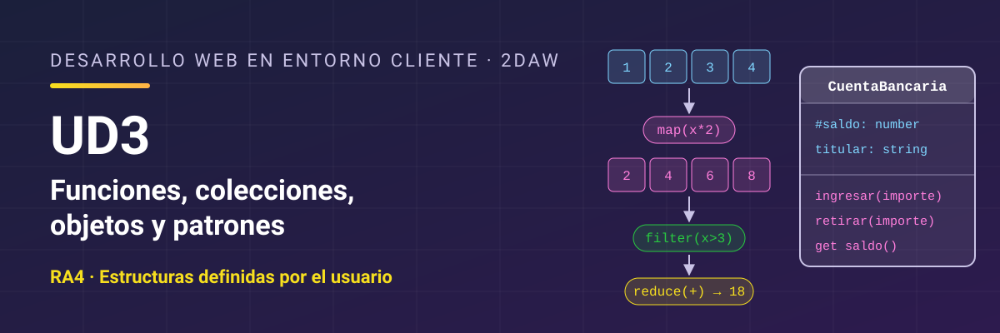

# Desarrollo Web en Entorno Cliente - UD3 Funciones, colecciones, objetos y patrones de diseño

Unidad 3 Funciones, colecciones, objetos y patrones de diseño. 2DAW.

## Resultado de aprendizaje

Esta unidad trabaja el **RA4** y sus criterios de evaluación: [ver resultado de aprendizaje y criterios de evaluación](./resultados-aprendizaje.md).

## Referencias

- [*Eloquent JavaScript*](https://www.eloquentjavascript.es/), de Marijn Haverbeke (4.ª edición, traducida al español por midudev; licencia CC BY-NC). Libro gratuito en línea que explica el lenguaje y el navegador con otro enfoque y trae ejercicios. Es una buena lectura complementaria para cualquier unidad del curso. Ten en cuenta que llama **enlace** (*binding*) a lo que en el curso llamamos **variable** o **constante**, que usa comillas dobles y, a veces, `prompt`, y que la traducción tiene alguna errata. Si algo no cuadra, consulta el original en inglés en [eloquentjavascript.net](https://eloquentjavascript.net/).

## Contenidos

1. [Funciones predefinidas del lenguaje](./01-funciones-predefinidas.md)
2. [Funciones definidas por el usuario](./02-funciones-usuario.md)
3. [Arrays](./03-arrays.md)
4. [Operaciones agregadas](./04-operaciones-agregadas.md)
5. [Colecciones: Map, Set e iterables](./05-colecciones.md)
6. [Objetos y prototipos](./06-objetos.md)
7. [Clases](./07-clases.md)
8. [Módulos](./08-modulos.md)
9. [Patrones de diseño](./09-patrones-diseno.md)
10. [Depuración, documentación y pruebas](./10-depuracion-documentacion-pruebas.md)
11. [Resumen](./11-resumen.md)

## Licencia

Este material se distribuye bajo licencia **Creative Commons BY-NC-SA 4.0**. Consulta las condiciones en [LICENSE.md](./LICENSE.md).
