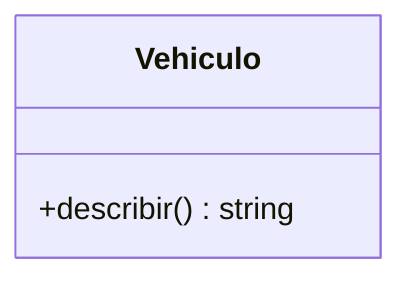

# Jerarquía de vehículos

<!-- Completa cada sección. Borra los comentarios como este cuando termines. -->

## Cómo ejecutarlo

<!-- El comando para ejecutar main.js. -->

## Salida

<!-- Pega la salida completa del programa. -->

```text

```

## Diagrama de clases

<!-- Diagrama classDiagram de Mermaid con las cinco clases, sus miembros, la herencia y la composición.
     Sustituye este diagrama de ejemplo. -->



## Cadena de prototipos del camión

<!-- La cadena de prototipos de flota[2], dibujada o como lista, y qué pasos sigue JavaScript
     para encontrar recorrer y calcularPeaje. -->

## Polimorfismo

<!-- Dónde hay polimorfismo en main.js y qué ganas con él. -->

## Por qué composición para el motor

<!-- Por qué el motor es un objeto aparte y no una subclase CocheElectrico.
     Usa la última línea de la salida como argumento. -->

## Validar antes de `super`

<!-- Qué error obtienes si escribes this.ejes antes de llamar a super(…) en Camion,
     y qué pasa si compruebas el parámetro ejes sin usar this. -->
