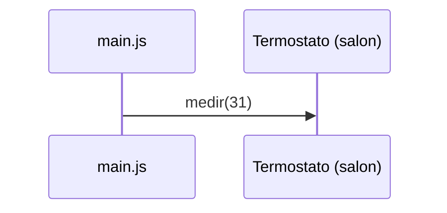

# Emisor de eventos

<!-- Completa cada sección. Borra los comentarios como este cuando termines. -->

## Cómo ejecutarlo

<!-- El comando para ejecutar main.js. -->

## Salida

<!-- Pega la salida completa del programa. -->

```text

```

## Secuencia de `salon.medir(31)`

<!-- Diagrama sequenceDiagram de Mermaid con lo que ocurre en salon.medir(31): qué eventos emite
     el termostato y a qué funciones avisa cada uno, en orden. Sustituye este diagrama de ejemplo. -->



## Piezas del patrón

<!-- Qué pieza del patrón Observer es EmisorEventos, Termostato y las funciones de main.js,
     y qué problema resuelve el patrón en este programa. -->

## Dónde reaparece

<!-- Dos sitios del desarrollo web donde reaparece este patrón (tema 9 y siguientes unidades). -->

## Un oyente más

<!-- Añade en main.js un tercer oyente de alerta que escriba en la consola (y quítalo después).
     ¿Qué líneas de la salida cambian? ¿Qué ficheros has tenido que tocar? -->
