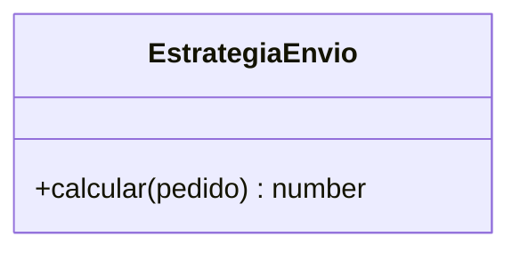

# Gastos de envío con Strategy y Factory

<!-- Completa cada sección. Borra los comentarios como este cuando termines. -->

## El problema del código original

<!-- Explica con tus palabras qué problemas tenía calcularGastosEnvio con el switch: qué había que
     tocar para añadir un tipo de envío y qué riesgo había al hacerlo. Cita líneas concretas del
     código original. -->

## Patrones aplicados

<!-- 1. Qué pieza del patrón Strategy es cada clase o función de tu proyecto (estrategia, estrategias
        concretas, contexto) y qué pieza del patrón Factory.
     2. Qué características de la orientación a objetos de JavaScript aprovechas: herencia,
        sobrescritura, polimorfismo, miembros estáticos… Di dónde está cada una.
     3. Por qué EstrategiaEnvio lanza un error en lugar de devolver 0. -->

## Diagrama de clases

<!-- Diagrama classDiagram de Mermaid con la superclase, las cuatro estrategias, la herencia y la
     relación de la fábrica y del contexto con las estrategias. Sustituye este diagrama de ejemplo. -->

## Añadir un tipo de envío

<!-- Qué ficheros has modificado para añadir EntregaEnPunto, cuáles NO y por qué.
     Compáralo con lo que habría hecho falta en el código original. -->

## Pruebas

<!-- 1. Pega la salida de `npm test` ANTES de empezar a refactorizar y AL TERMINAR.
     2. Lista de los casos límite que has probado en cada estrategia.
     3. Qué tests son unitarios y cuáles de integración (tema 10, apartado 10.5.8), y por qué los de
        envios.test.js han cambiado de tipo sin cambiar ni una línea.
     4. Cuenta un momento de la refactorización en que algún test original falló: qué cambio lo
        provocó y cómo lo arreglaste. Si no falló ninguno, cuenta qué test te dio más confianza
        y por qué. -->

## Herramientas

<!-- Pega la salida de `npm run lint` y de `npm run format:check` al terminar. -->

## Integración continua (opcional)

<!-- Solo si has hecho el apartado opcional de integración continua del enunciado; si no, borra esta sección.
     1. Enlace a una ejecución en verde de la pestaña Actions de tu repositorio.
     2. Captura de esa ejecución con sus pasos: guárdala en img/ y enlázala aquí.
     3. Captura de una ejecución en rojo provocada a propósito, y qué cambiaste para provocarla. -->
